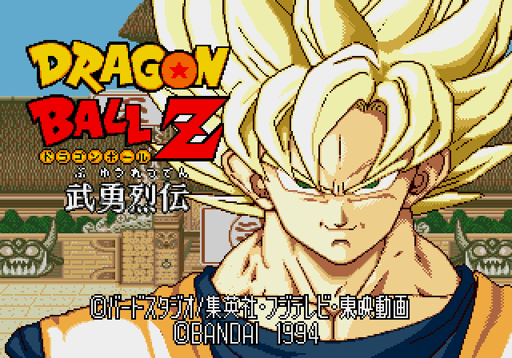

# Dragon Ball Z: Buyuu Retsuden Enhanced

Un mod de **Mega Drive / Genesis** para mejorar la respuesta de los controles y revisar los colores de *Dragon Ball Z: Buyuu Retsuden (Japan)*, tomando el anime y Hyper Dragon Ball Z como referencias visuales.

**Estado: jugabilidad v1 experimental · revisión gráfica en curso**


**[Ver la comparación completa en vídeo](assets/media/gameplay-v1-comparison.mp4)** · [Galería de variantes](docs/graphics.md) · [Decisiones guardadas](docs/decisions.md) · [Hoja de ruta](docs/roadmap.md)

## Qué hay ahora

| Apartado | Estado |
| --- | --- |
| Controles v1 | Implementados y probados en emulador con los 11 personajes, en normal y turbo. |
| Paletas de personajes y escenarios | Primera propuesta para 11 personajes, colores alternativos y 9 escenarios. |
| Presentación | **B — HDBZ cálido elegida**; pendiente de integrar en la próxima ROM. |
| HUD | Boceto con retratos originales recoloreados y jugador 2 reflejado hacia el centro. |
| Auras | Goku **C2 sin rayos** como referencia elegida; implementación pendiente. |
| Ataques especiales | Revisión pendiente. |

Las capturas comparativas de paletas, los bocetos de HUD y los conceptos de aura están identificados por separado. **El vídeo superior sí es una grabación real del juego original frente a la ROM de jugabilidad v1.**

## Las cuatro mejoras de jugabilidad

1. **Parada más rápida:** soltar la dirección interrumpe antes el desplazamiento terrestre; los toques breves conservan un mínimo avance.
2. **Pulsación pendiente:** una nueva pulsación de puño o patada se conserva durante cinco actualizaciones posteriores de entrada. Si termina la recuperación a tiempo, se ejecuta; una entrada demasiado temprana caduca.
3. **Recuperaciones ajustadas:** se recortan hasta dos ticks del tramo final de secuencias simples de golpes básicos, al llegar a su pose final.
4. **Vuelta a guardia más suave:** se enlazan unas pocas poses existentes; empezar otra acción cancela la transición visual inmediatamente.

Estos ajustes se centran en **movimiento terrestre y golpes básicos**. Se conserva la velocidad general y el turbo nativo; salto, vuelo y especiales mantienen sus reglas originales. Mantener A no debe producir ataques repetidos automáticamente.

### Qué se ha comprobado

- 11 personajes × 2 velocidades: **22 combinaciones** de pruebas.
- **32 situaciones** de alcance, golpes y defensa con el mismo daño que el original.
- **15 interrupciones por daño** sin que salga un ataque pendiente después del golpe recibido.
- Segundo mando y una secuencia prolongada contra CPU.
- Checksum de Mega Drive, aplicación del IPS e integridad de los archivos.

La evidencia histórica está en [evidence/gameplay-v1](evidence/gameplay-v1). Las pruebas se hicieron en **Genesis Plus GX v1.7.4 f27655b**; falta la prueba del usuario con mando y no se ha validado en consola física. No es una validación completa de todos los combos y enfrentamientos.

## Generar tu ROM

Necesitas **Node.js 22.13 o posterior**, **pnpm 11.18.0** y tu copia de la ROM japonesa original de 2 MB. Las herramientas de construcción usan sólo módulos incluidos en Node.

```sh
pnpm install --frozen-lockfile
pnpm check
pnpm test

# Controles nuevos y colores originales
pnpm build --rom "ruta/a/original.bin"

# Los mismos controles y las paletas Colores v1
pnpm build:colors --rom "ruta/a/original.bin"
```

También puedes colocar la base en `roms/original.bin` y ejecutar `pnpm build`. El resultado aparece en `dist/`, con un registro de hashes. El archivo de entrada nunca se sobrescribe.

**SHA-256 de la base admitida:**

```text
217fc312deeced6bbe3caa02ed3f72e067d6dbd6a0ee64a281ebf2e60f479557
```

Abre el BIN generado en tu emulador **desde el arranque**, sin estados guardados de otra ROM. El repositorio contiene fuentes, parches y comparaciones; las ROMs completas se generan localmente. [Construcción y ensamblado](docs/build.md).

## Dirección gráfica

### Presentación elegida: B — HDBZ cálido



Esta elección todavía no forma parte de la ROM de jugabilidad v1. **Las demás variantes se conservan** para poder volver atrás o retocar el tono de piel.

### Comparar el resto

| Personajes | Escenarios |
| --- | --- |
| [](docs/graphics.md#personajes) | [](docs/graphics.md#escenarios) |

[Las 67 imágenes y todas las variantes →](docs/graphics.md)

Reglas guardadas: retratos originales de selección para el HUD; jugador 2 mirando hacia el centro; **Goku C2 con llamas y polvo, sin rayos**. Los rayos quedan reservados para **Gohan y Cell como máximo**. Los conceptos anteriores con rayos se conservan como historial.

## Estructura

```text
assets/          Comparaciones y vídeo de jugabilidad
docs/            Construcción, estado, decisiones, pruebas y hoja de ruta
evidence/        Resultados históricos de las comprobaciones en emulador
patches/         IPS y manifiesto de hashes
project/         Catálogo de imágenes y elecciones en formato legible
research/        Datos de paletas y fuentes históricas de investigación
src/gameplay/    Ensamblador 68000 del parche y código verificado en hexadecimal
tests/           Pruebas de las herramientas de parcheo
tools/           Construcción, verificación y ensamblado local
roms/            Base local, excluida de Git
```

La rama de trabajo es **`development`**. Cada cambio debe conservar las variantes anteriores, actualizar su estado y distinguir entre **propuesto**, **elegido**, **implementado** y **probado**. Ver [CONTRIBUTING.md](CONTRIBUTING.md).

## Próximo paso

Probar la jugabilidad v1 con mando, elegir las variantes gráficas una a una e integrar la presentación B. Después vendrán el HUD, las auras y los ataques especiales. Las localizaciones nuevas siguen en espera.

Proyecto de modificación no oficial. Los personajes, el juego original y Hyper Dragon Ball Z se mencionan como obras y referencias de sus respectivos autores. [Créditos y procedencia](docs/credits.md).
