# Dragon Ball Z: Buyuu Retsuden Enhanced

Un mod de **Mega Drive / Genesis** para mejorar la respuesta de los controles y revisar los colores de *Dragon Ball Z: Buyuu Retsuden (Japan)*, tomando el anime y Hyper Dragon Ball Z como referencias visuales.

**Estado: jugabilidad v1 experimental · ki por personaje v4 grabado y listo para validación visual · escenario nevado en bocetos**

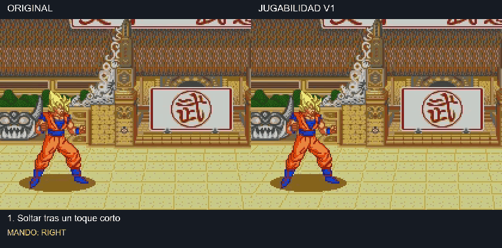

**[Ver la comparación completa en vídeo](assets/media/gameplay-v1-comparison.mp4)** · [Galería de variantes](docs/graphics.md) · [Decisiones guardadas](docs/decisions.md) · [Hoja de ruta](docs/roadmap.md)

**[Auras C2 v2: vídeo real con los once personajes, antes y después](assets/media/auras-c2-v2/Todas-las-auras-antes-despues.mp4)** · [Comparar los tres tamaños con Goku](assets/media/auras-c2-v2/Comparacion-tres-tamanos-Goku.mp4) · [Final del aura a cámara lenta](assets/media/auras-c2-v2/Salida-Goku-lenta.mp4)

La [primera prueba C2 v1](docs/auras-c2-v1.md) y [sus vídeos](assets/media/auras-c2-v1/Todas-las-auras-antes-despues.mp4) se conservan como historial.

## Qué hay ahora

| Apartado | Estado |
| --- | --- |
| Controles v1 | Implementados y probados en emulador con los 11 personajes, en normal y turbo. |
| Personajes | **Propuesta elegida para los 11; Goku G2 HDBZ**. Disponible en Colores v1. |
| Escenarios | **Propuesta elegida para los 9**. Disponible en Colores v1. |
| Retratos de selección | **Propuesta v1 elegida para los 11**; pendiente de integrar en el próximo BIN combinado. |
| Presentación | **G — C con contraste marcado elegida**; pendiente de integrar en la próxima ROM. |
| HUD | **H4**, coherente con los retratos de selección elegidos; conserva el diseño H3 y el jugador 2 reflejado. Pendiente implementar. |
| Auras | **Ki v4 con colores individuales implementado y grabado para los once personajes.** Todos sin rayos; pendiente validación visual de paletas. |
| Ataques especiales | Revisión pendiente. |

Las capturas comparativas de paletas, los bocetos de HUD y los conceptos de aura están identificados por separado. **El vídeo superior sí es una grabación real del juego original frente a la ROM de jugabilidad v1.**

## Ki actual: colores por personaje v4

**Ya están implementadas y grabadas las once paletas para revisión. Todos los personajes van sin rayos.** Cell comparte dorado con los Super Saiyan; Ginyu usa lila, Recoome blanco/violeta, Piccolo/A18/Freezer blanco azulado y Krilin blanco. El contorno aprobado se mantiene.

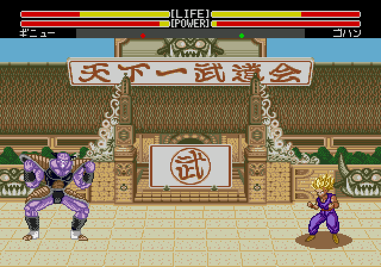

[Ver los once, antes y después](assets/media/ki-colores-v4/Ki-todos-antes-despues.mp4) · [Revisar las salidas a cámara lenta](assets/media/ki-colores-v4/Salida-ki-todos-lenta.mp4) · [Vídeos individuales, pruebas y límites](docs/ki-colores-v4.md)

La comparación muestra el ki nativo con Colores v1 a la izquierda y la nueva aura a la derecha. Son grabaciones reales. La ROM de prueba es de 4 MiB y las paletas quedan pendientes de tu aprobación visual. La revisión de especiales completos y hardware sigue pendiente.

La [variante anterior sin rayos y paleta común](docs/auras-c2-v3-no-rays.md) se conserva. Los vídeos con rayos de versiones antiguas que aparecen más abajo forman parte del historial.

## Colores de aura: referencias

[Imágenes del anime y decisiones de color](docs/aura-color-references.md). Cell dorado, Ginyu lila y A18 blanca como Freezer son elecciones expresas del usuario; ya están aplicadas en esta prueba v4.

## Corrección del contorno: C2 v3

Tras elegir el tamaño de C2 v2, el usuario señaló puntas cortadas y huecos. **C2 v3 ya corrige esas uniones dentro del juego**, con un contorno de 80 × 128 basado en la referencia SNES aportada. Mantiene el dorado para los superguerreros y el polvo; Cell y Gohan SSJ2 alternan tres formas de rayos blancos. El contorno fue aceptado posteriormente; los rayos de este vídeo se retiraron en la [revisión actual](docs/auras-c2-v3-no-rays.md).

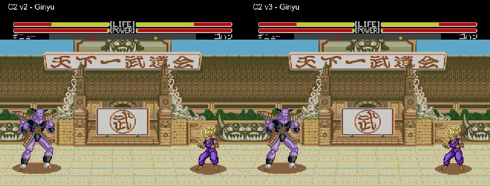

[Ver los once personajes](assets/media/auras-c2-v3/Todas-las-auras-antes-despues.mp4) · [Ver Cell y sus rayos](assets/media/auras-c2-v3/05-Cell.mp4) · [Revisar la salida a cámara lenta](assets/media/auras-c2-v3/Salida-Goku-lenta.mp4) · [Fuentes y pruebas de C2 v3](docs/auras-c2-v3.md)

La salida conserva el contorno entero y lo apaga durante doce ticks; ya no contrae tiras por separado. La ROM de prueba combina Jugabilidad v1, Colores v1 y esta revisión del aura. Las versiones anteriores siguen disponibles.

## Auras C2 v2: dirección elegida e historial

**C2 v2 elegida el 4 de noviembre de 2026:** tamaño, aspecto del aura y polvo aceptados. También quedan aprobados los rayos blancos largos de Cell y Gohan SSJ2.

La revisión posterior detectó extremos de llama rectos y huecos en el contorno, visibles en la captura de Ginyu. **La corrección de esas uniones está en curso**: se mantienen los 80 × 128 píxeles, el polvo y los rayos elegidos. El apartado visual sigue abierto hasta revisar el contorno corregido.

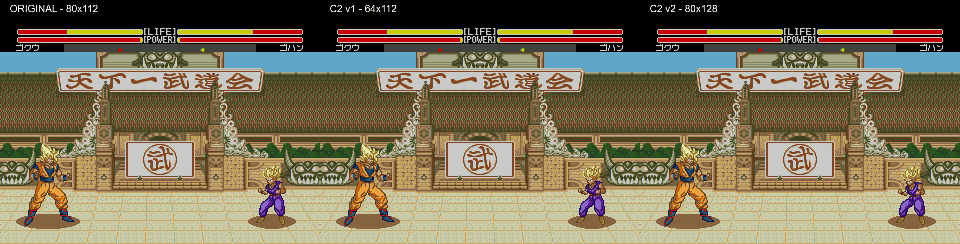

**Rayos de Cell y Gohan SSJ2, dentro del juego:**

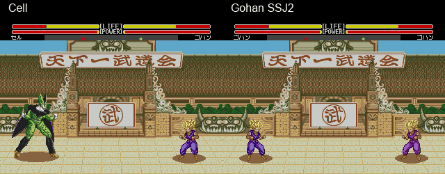

[Ver Cell en vídeo](assets/media/auras-c2-v2/05-Cell.mp4) · [Ver Gohan SSJ2 en vídeo](assets/media/auras-c2-v2/01-Gohan-SSJ2.mp4)

La segunda prueba responde a la revisión de tamaño: el aura ocupa **80 × 128 píxeles**, frente a los 64 × 112 de C2 v1 y los 80 × 112 del original. Es un **25 % más ancha y un 14 % más alta que la primera prueba**. Conserva la paleta compartida nativa; el dibujo sigue siendo una adaptación para Mega Drive del concepto elegido.

**Goku y el resto del reparto no llevan rayos; Gohan SSJ2 y Cell, sí.** Sus arcos blancos son intermitentes y alcanzan 32 píxeles, frente a los ocho del recurso anterior. Se añaden dos nubes de polvo animadas junto a los pies, sólo al cargar desde el suelo. Al soltar, la retirada visual sigue durando doce ticks del juego y reduce sus piezas para respetar los límites de dibujo de la consola.

Los vídeos son grabaciones reales de los once personajes. Las pruebas cubren golpes, cargas consecutivas, ambos jugadores y ausencia de polvo en el aire. **La dirección C2 v2 y sus rayos están aceptados; falta corregir y revisar el contorno.** [Detalles, vídeos y evidencia C2 v2](docs/auras-c2-v2.md).

La ROM de prueba combina **Jugabilidad v1 + Colores v1 + Auras C2 v2**. La presentación G, el crédito **- 2026 ALEX LLAO**, los retratos de selección y el HUD H4 todavía están pendientes de integración.

## Propuesta de décimo escenario: montañas nevadas

El usuario ha elegido montañas nevadas para una primera propuesta visual, con vistas de suelo y vuelo. **Son bocetos; el décimo escenario todavía no está integrado en la ROM.**

| En el suelo | Durante el vuelo |
| --- | --- |
| 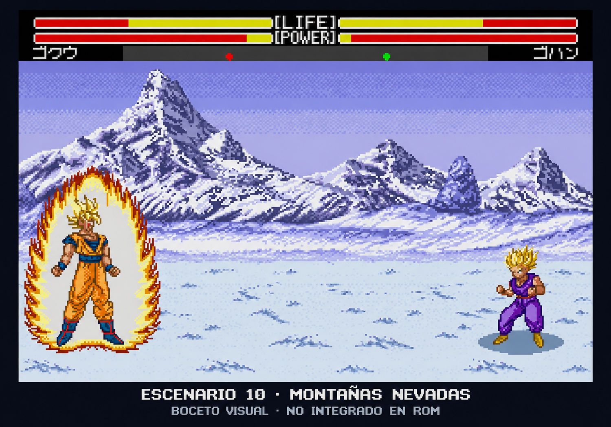 | 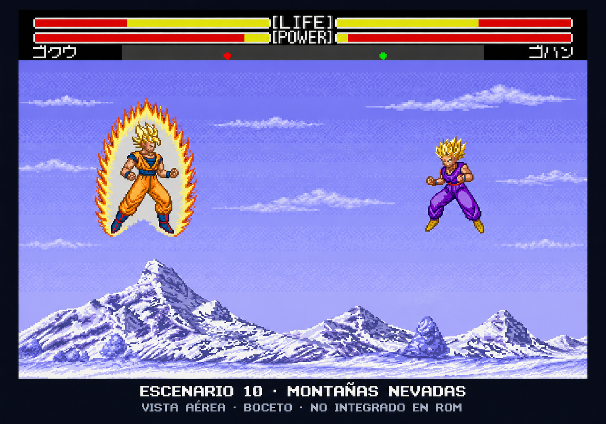 |

[Ver ambas vistas y sus referencias](docs/stage10-snow.md). Las imágenes del escenario se han generado como conceptos visuales; los vídeos y GIF de las auras sí son grabaciones del mod en el emulador.

Referencias aportadas: [Super Butōden 2 en The Spriters Resource](https://www.spriters-resource.com/snes/dragonballzsuperbutoden2/) y [archivos conservados con sus créditos](assets/references/super-butoden-2/references.json).

## Revisión de colisiones

**Se conservan las diferencias de tamaño entre personajes.** Que una patada alta no alcance a Gohan puede ser correcto. No hemos cambiado las cajas.

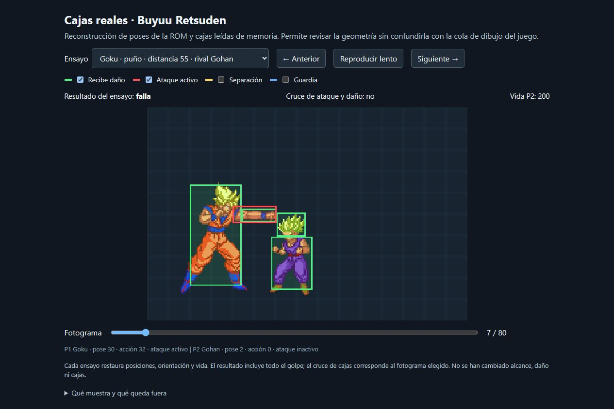

[Descargar y abrir el visor paso a paso](assets/tools/collision-viewer/visor-colisiones.html) · [Resultados y límites](docs/collision-review-v1.md) · [Visor Lua de solo lectura](tools/collision)

El HTML funciona sin conexión y reconstruye 13 ensayos con gráficos nativos y cajas registradas del juego. No es una grabación. Las comparaciones de alcance no detectan cambios en los casos probados; las tablas y rutinas de colisión examinadas conservan sus bytes originales.

## Las cuatro mejoras de jugabilidad

1. **Parada más rápida:** soltar la dirección interrumpe antes el desplazamiento terrestre; los toques breves conservan un mínimo avance.
2. **Pulsación pendiente:** una nueva pulsación de puño o patada se conserva durante cinco actualizaciones posteriores de entrada. Si termina la recuperación a tiempo, se ejecuta; una entrada demasiado temprana caduca.
3. **Recuperaciones ajustadas:** se recortan hasta dos ticks del tramo final de secuencias simples de golpes básicos, al llegar a su pose final.
4. **Vuelta a guardia más suave:** se enlazan unas pocas poses existentes; empezar otra acción cancela la transición visual inmediatamente.

Estos ajustes se centran en **movimiento terrestre y golpes básicos**. Se conserva la velocidad general y el turbo nativo; salto, vuelo y especiales mantienen sus reglas originales. Mantener A no debe producir ataques repetidos automáticamente.

### Qué se ha comprobado

- 11 personajes × 2 velocidades: **22 combinaciones** de pruebas.
- **32 situaciones** de alcance, golpes y defensa con el mismo daño que el original.
- **15 interrupciones por daño** sin que salga un ataque pendiente después del golpe recibido.
- Segundo mando y una secuencia prolongada contra CPU.
- Checksum de Mega Drive, aplicación del IPS e integridad de los archivos.

La evidencia histórica está en [evidence/gameplay-v1](evidence/gameplay-v1). Las pruebas se hicieron en **Genesis Plus GX v1.7.4 f27655b**; falta la prueba del usuario con mando y no se ha validado en consola física. No es una validación completa de todos los combos y enfrentamientos.

## Generar tu ROM

Necesitas **Node.js 22.13 o posterior**, **pnpm 11.18.0** y tu copia de la ROM japonesa original de 2 MB. Las herramientas de construcción usan sólo módulos incluidos en Node.

```sh
pnpm install --frozen-lockfile
pnpm check
pnpm test

# Controles nuevos y colores originales
pnpm build --rom "ruta/a/original.bin"

# Los mismos controles y las paletas Colores v1
pnpm build:colors --rom "ruta/a/original.bin"

# Prueba actual: controles, colores y auras C2 v2
pnpm build:auras:v2 --rom "ruta/a/original.bin"
```

También puedes colocar la base en `roms/original.bin` y ejecutar `pnpm build`. El resultado aparece en `dist/`, con un registro de hashes. El archivo de entrada nunca se sobrescribe.

**SHA-256 de la base admitida:**

```text
217fc312deeced6bbe3caa02ed3f72e067d6dbd6a0ee64a281ebf2e60f479557
```

Abre el BIN generado en tu emulador **desde el arranque**, sin estados guardados de otra ROM. El repositorio contiene fuentes, parches y comparaciones; las ROMs completas se generan localmente. [Construcción y ensamblado](docs/build.md).

## Dirección gráfica

### Presentación elegida: G — C con contraste marcado

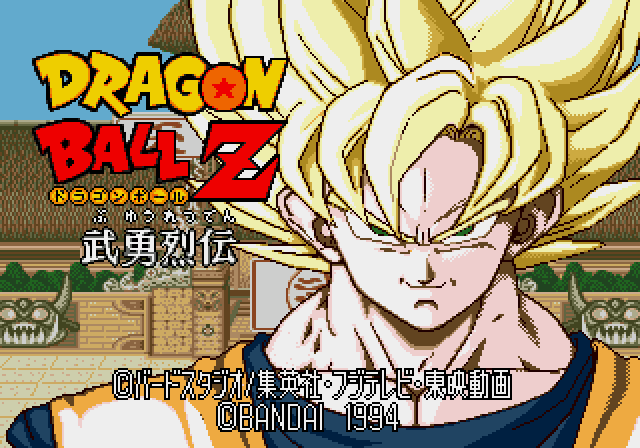

La piel de G parte de C con sombras más marcadas y menos amarillo. El crédito solicitado es **- 2026 ALEX LLAO**, con el nombre real; su cambio gráfico está pendiente. Esta elección todavía no forma parte de la ROM de jugabilidad v1. **Las demás variantes se conservan** para poder volver atrás o retocar el tono de piel.

### Comparar el resto

| Personajes | Escenarios |
| --- | --- |
| [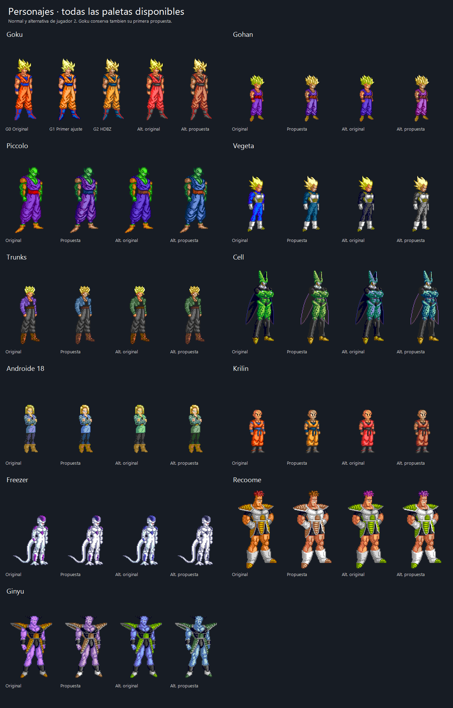](docs/graphics.md#personajes) | [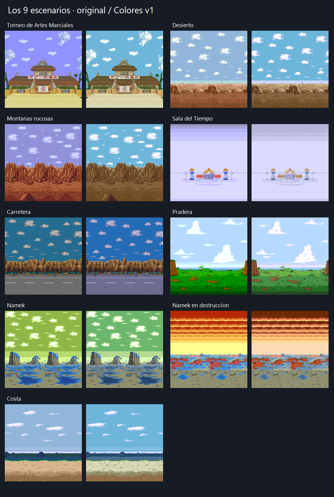](docs/graphics.md#escenarios) |

[Las 71 imágenes y todas las variantes →](docs/graphics.md)

Reglas guardadas: retratos originales de selección para el HUD; jugador 2 mirando hacia el centro; **Goku C2 con llamas y polvo, sin rayos**. **Cell y Gohan SSJ2 deben llevar rayos; los demás, sin rayos**. Los conceptos anteriores con rayos se conservan como historial.

## Estructura

```text
assets/          Comparaciones y vídeo de jugabilidad
docs/            Construcción, estado, decisiones, pruebas y hoja de ruta
evidence/        Resultados históricos de las comprobaciones en emulador
patches/         IPS y manifiesto de hashes
project/         Catálogo de imágenes y elecciones en formato legible
research/        Datos de paletas y fuentes históricas de investigación
src/gameplay/    Ensamblador 68000 del parche y código verificado en hexadecimal
src/auras/       Fuente, tiles y mapas del prototipo C2
tests/           Pruebas de las herramientas de parcheo
tools/           Construcción, verificación y ensamblado local
roms/            Base local, excluida de Git
```

La rama de trabajo es **`development`**. Cada cambio debe conservar las variantes anteriores, actualizar su estado y distinguir entre **propuesto**, **elegido**, **implementado** y **probado**. Ver [CONTRIBUTING.md](CONTRIBUTING.md).

## Próximo paso

Corregir las uniones, los cortes rectos y los huecos del contorno del aura, manteniendo el tamaño, el polvo y los rayos aceptados; volver a grabarlo y revisarlo. Después, integrar la presentación G, el crédito, los retratos elegidos y el HUD H4. La prueba con mando, los ataques especiales y la validación en consola siguen pendientes; las localizaciones nuevas permanecen en espera.

Proyecto de modificación no oficial. Los personajes, el juego original y Hyper Dragon Ball Z se mencionan como obras y referencias de sus respectivos autores. [Créditos y procedencia](docs/credits.md).
