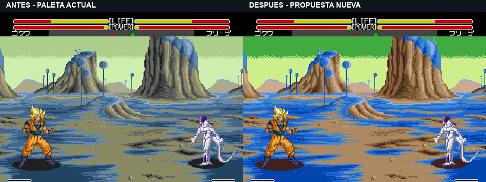
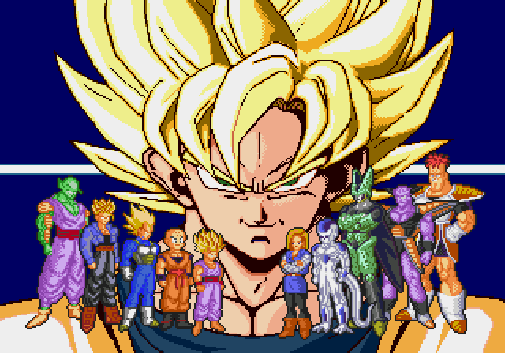

# Dragon Ball Z: Buyuu Retsuden Enhanced

Mod de **Mega Drive / Genesis** para mejorar los controles y revisar las paletas de *Dragon Ball Z: Buyuu Retsuden (Japan)*, con el anime y Hyper Dragon Ball Z como referencias.

**Actualizado: 5 de noviembre de 2026 · rama `development`.** La última ROM de prueba es **HUD HITS v3 (`hud-hits-v3`)**, sobre Ventaja v1 y Stun v2: conserva las mejoras gráficas y de control, las pruebas de combos con animación natural y las dos barras de aturdimiento sin texto. **El primer impacto conectado termina el mareo y reinicia su acumulación.**

[**Corregido: antes/después de los golpes separados**](assets/media/hud-hits-v3/Antes-y-despues-golpes-separados.mp4) · [Reglas y pruebas actuales](docs/hud-hits-v3.md) · [Decisiones vigentes](docs/decisions.md) · [Pendientes](docs/roadmap.md)

La jugabilidad sigue en pruebas con mando. **HITS ya está integrado y aparece desde 2 impactos; el golpe suelto queda oculto.** Las nuevas paletas de Namek siguen siendo propuestas, sin aplicar a esta ROM. El comando sin `--version` conserva v6.6 como base anterior; para construir la última prueba hay que indicar `--version hud-hits-v3`.

[Demostración anterior sin ventana extra: P1/P2](assets/media/teleport-exchange-v1/Teletransportes-P1-P2-juego-real.mp4) · [**Namek: antes y nueva propuesta**](#namek-antes-y-nueva-propuesta)

## HITS: separar el plazo para enlazar del tiempo para leer

**Los puñetazos separados del 0:24 ya no forman un combo.** Cada uno empieza otra cuenta y queda oculto como golpe suelto. Se separan **30 actualizaciones elegibles para enlazar** de **90 para leer el resultado**: que el número continúe visible no significa que la cadena siga abierta.

[**Comparación: izquierda anterior, derecha corregida**](assets/media/hud-hits-v3/Antes-y-despues-golpes-separados.mp4) · [Un minuto de pruebas](assets/media/hud-hits-v3/HITS-v3-enlaces-y-golpes-separados.mp4).

Tres golpes rápidos →cruce →Meteor siguen sumando **6 HITS**, y el Meteor de Goku solo cuenta **3**. El mareo conserva únicamente la cuenta vigente; no une los puñetazos aislados anteriores. Ataques y cruce pausan el plazo, el cruce no añade impactos, y el primer golpe sigue terminando el mareo. La limpieza de acumulación por inactividad se conserva.

[Reglas y evidencia](docs/hud-hits-v3.md) · [Vibración al bloquear: propuesta visual A/B/C, pendiente de elegir e integrar](docs/guard-shake-preview.md).

## Impacto: prueba variada con remates tipo B

[**Ver 1:06 de actual →propuesta**](assets/media/shake-varied-preview/Impactos-variados-actual-y-propuesta.mp4): bloqueos, multigolpe, Meteor solo y combo con cruce. Sacudidas suaves en contactos pequeños y B en los remates, con HUD quieto y velocidad natural. **Previsualización sobre grabaciones, aún sin integrar en la ROM.** [Distribución y capítulos](docs/guard-shake-preview.md).

## Nueva prueba: básicos, cruce, Meteor y respuesta de P2

[**Ver 1 min 37 s de juego real con sonido**](assets/media/combo-side-tests-v1/Combos-cambio-de-lado-y-remates.mp4)

Diez tomas de Goku, Vegeta, Piccolo y Cell: básicos → cambio de lado → especial/remate, ráfaga de Goku, Meteor bloqueado y contra de P2 terminada en Meteor. Misma ROM Ventaja v1, sin acelerar movimientos ni forzar impactos. Cada toma muestra el final y la devolución del control.

**Son secuencias de presión con huecos de defensa; no un combo cerrado garantizado.** Se conservaron 52 sondeos y las condiciones originales de vida/ki de los remates. [Resultados, capítulos y límites](docs/combo-side-tests-v1.md).

## Ventaja nueva: seis actualizaciones de entrada

Al completar un cambio de lado con C, el rival no puede iniciar A/B durante una ventana breve. **Puede defenderse, moverse y responder con otro cambio de lado**; una respuesta aceptada elimina la restricción recibida. La prueba actual se aplica a dos jugadores humanos. No añade golpe automático, invulnerabilidad ni aceleración de animación.

Los A/B pulsados durante la ventana se descartan; hace falta una pulsación nueva al terminar. **Falta probar con mando el valor de seis actualizaciones y el equilibrio de las contras.** [Reglas, implementación y pendientes](docs/side-advantage-v1.md).

## Lo elegido y su estado real

| Apartado | Elección vigente | Estado |
| --- | --- | --- |
| Personajes en combate | Propuestas para los once; **Goku G2 HDBZ**. | Paletas integradas; se conservan en la última ROM. |
| Escenarios existentes | Propuesta de colores de los nueve fondos. | Integrada. Namek está de nuevo en revisión, sin sustituir aún la paleta entregada. |
| Intro y presentación | **Goku grande cálido con contraste anime y contornos negros; personajes pequeños con sus colores originales.** | Integrado desde v6.6 y conservado. Las propuestas de recolor de los personajes pequeños se descartaron. |
| Créditos del título | Conservar **© BANDAI 1994** y añadir **- 2026 ALEX LLAO** al lado, con la misma tipografía. | Integrado. No se elimina BANDAI ni se usa pseudónimo. |
| Retratos | Los once retratos de selección recoloreados elegidos. | Diseño aceptado; integración combinada pendiente. |
| HUD de retratos | Dirección **H4**, H3 conservado como alternativa; cara de P2 reflejada hacia el centro. | Diseño elegido; no confundir con el HUD de barras ya integrado. |
| Auras | Contorno corregido **C2 v3**, colores individuales **ki v4**, polvo en el suelo y salida animada. | Implementado y aceptado visualmente para los once. **Todos sin rayos, incluidos Cell y Gohan.** |
| Carrera | Doble toque hacia delante o atrás y mantener; al soltar, frenado con inercia original. | Implementado; se retiró el frenado que rompía la carrera. |
| Derribos | Menos espera tumbado, conservando caída y levantamiento. | Reposo terrestre reducido de 30 a 12 ticks en las rutas ajustadas. |
| Cambio de lado | **→ ← → + C**, cerca del rival, para los once; sin golpe ni gasto de ki. | Implementado. Nueva ventaja P1/P2 de seis actualizaciones; permite defensa y contra C. Técnicas originales A/B conservadas. |
| Combos | Mezclar básicos A/B y enlazar una técnica propia o Meteor con su comando original. **Sin acelerar movimientos.** | Experimental: máximo de tres básicos y un remate asistido; no todas las rutas conectan. Reacción al daño sin alargamiento artificial ni reinicio de su animación. |
| Barras de aturdimiento | Dos barras pequeñas, una por jugador abajo, con estilo de las originales. **Sin texto «STUN».** | Integradas; se corrigieron las interferencias gráficas detectadas. |
| Salida del aturdimiento | El primer golpe conectado elimina el mareo activo y reinicia su acumulación; sigue la reacción normal de daño. | Elegido e implementado en **Stun v2**. |
| Contador HITS | Contar todo ataque de varios impactos, incluido Meteor solo, ráfagas de Cell y patadas múltiples de Goku. | **Integrado desde 2 impactos** en HUD HITS v3; 1 queda oculto. Casos de guardia/fallo, multigolpes, Meteor y P2 verificados; revisión exhaustiva de todos los especiales pendiente. |
| Namek normal | Nueva propuesta: suelo y copas azules, roca ocre/beige, cielo verde con luces amarillentas. | Captura real preparada; **pendiente de elección**. La propuesta rosada anterior se descartó. |
| Namek en destrucción | Revisar según las referencias del anime. | Primera propuesta descartada; nueva revisión pendiente. |
| Décimo escenario | Montañas nevadas, con vista de suelo y vuelo. | Bocetos guardados; no integrado. |
| Cajas de colisión | Respetar las diferencias de tamaño, especialmente Gohan. | Visor y auditoría disponibles; cajas sin modificar. |
| Especiales y efectos | Revisar colores, impactos múltiples y convivencia con auras/HUD. | Revisión completa pendiente. |

## Namek: antes y nueva propuesta

**Izquierda: paleta de la ROM entregada. Derecha: nueva propuesta según las últimas referencias.** Son capturas del emulador con los mismos personajes y encuadre; no se han repintado sus píxeles. La comparación añade sólo la cabecera.



Se abandona la roca rosa: ahora es ocre/beige, con azules más definidos y cielo verde. **Mostrar esta comparación no significa que la propuesta esté aprobada ni aplicada a la ROM de jugabilidad.** [Captura y colores de esta prueba](docs/namek-anime-v2.md). Las [propuestas anteriores de Namek y su destrucción](docs/namek-anime-v1.md) se conservan como descartadas.

## Intro y título conservados




Esta es la elección posterior a B, G y las demás pruebas de piel: **Goku grande cálido; reparto pequeño original**. No altera los colores elegidos para los personajes durante el combate. [Integración y comprobaciones](docs/intro-original-lineup-v6-6.md).

## Auras y colores aprobados

| Personajes | Aura vigente |
| --- | --- |
| Goku, Gohan, Vegeta y Trunks Super Saiyan | Dorada. |
| Cell | Dorada como los Super Saiyan. |
| Ginyu | Lila con núcleo claro. |
| Recoome | Blanca con borde violeta. |
| Piccolo, Androide 18 y Freezer | Blanca con matiz azulado. |
| Krilin | Blanca luminosa. |

**Ninguno lleva rayos.** La petición de retirarlos sustituyó la aprobación anterior de rayos para Cell y Gohan. Se mantienen el contorno corregido, el tamaño elegido, el polvo sólo en el suelo y la salida animada.

[Grabación real de los once, antes y después](assets/media/ki-colores-v4/Ki-todos-antes-despues.mp4) · [Salidas a cámara lenta](assets/media/ki-colores-v4/Salida-ki-todos-lenta.mp4) · [Vídeos individuales y pruebas](docs/ki-colores-v4.md)

## Aturdimiento y combos: última prueba

Las barras muestran acumulación en verde, aviso en naranja y recuperación del mareo en rojo. **En Stun v2, al conectar el primer golpe contra un rival mareado, desaparece el mareo y se reinicia la barra.** Fallar un golpe no lo libera. Los siguientes impactos usan la reacción normal y pueden volver a acumular puntos; no se añade inmunidad temporal.

[Ver Stun v2 dentro del juego](assets/media/stun-break-v2/Namek-stun-primer-golpe.mp4) · [Rutina, pruebas y límites](docs/stun-break-v2.md) · [Integración gráfica de las barras](docs/hud-stun-v1.md)

Los enlaces de combos conservan la animación completa de cada ataque y no duplican la reacción de daño ni reinician la animación del rival para obligar a que conecten. La asistencia se limita a humanos en suelo y velocidad normal. El máximo de tres básicos y un remate reduce los bucles, pero no demuestra que todo infinito sea imposible. Alcance y retroceso pueden romper una ruta: falta ajustar y valorar con mando.

El contador registra **impactos aceptados de todos los ataques**, incluidos especiales multigolpe y Meteor sin básicos previos. No basta con contar las pulsaciones ni cada descuento de vida de una cinemática. **Ya está integrado en HUD HITS v3, visible desde 2 impactos y conservando el total durante ataques y mareo.** Los contadores superpuestos de vídeos antiguos eran demostraciones; la nueva grabación sí usa el HUD de la ROM.

[Reacción de daño corregida, base de esta prueba](docs/combos-v5-native-stun.md) · [Cálculo nativo de aturdimiento y requisitos HITS](docs/hud-hits-stun.md)

## Historial de la prueba: primer intercambio P1/P2

[**Ver el intercambio real: 28 segundos con sonido**](assets/media/teleport-exchange-v1/Teletransportes-P1-P2-juego-real.mp4)

Goku/Vegeta y Piccolo/Freezer alternan → ← → + C, con intentos de golpe y ataques posteriores. Son **dos mandos coordinados**, en la ROM Stun v2 actual, con las animaciones a velocidad normal. Veinte cruces comprobados, diez por jugador. [Condiciones y límites de la demostración](docs/teleport-exchange-v1.md).

Ese vídeo es anterior a la ventaja extra. La [nueva ROM y grabación](docs/side-advantage-v1.md) ya aplican seis actualizaciones de prioridad ofensiva; el valor y la facilidad de contra siguen pendientes de valoración con mando.

## Controles y movimientos

**Mando por defecto:** A = puño, B = patada, C = cambiar entre suelo y vuelo; A+B = cargar ki. Si reasignas los botones, usa su función equivalente.

| Acción | Entrada |
| --- | --- |
| Caminar | Mantener adelante o atrás. |
| Correr hacia delante | Adelante, soltar brevemente, adelante y mantener. |
| Correr hacia atrás | Atrás, soltar brevemente, atrás y mantener. |
| Frenar | Soltar la dirección; conservar una breve inercia como en el original es la conducta elegida y conservada en la versión actual. |
| Saltar / agacharse | Arriba / abajo. |
| Defender | Mantener atrás frente al ataque. |
| Cargar ki | Mantener A+B. |
| Cambiar de lado sin golpear | Adelante, atrás, adelante + C; cerca del rival, sin A/B simultáneos. |

Las flechas de las tablas suponen que miras a la **derecha**: → = hacia el rival, ← = alejarse. Invierte las direcciones cuando mires a la izquierda. Haz las direcciones en secuencia y pulsa el botón junto a la última. «Mantener ↓» indica carga previa; «en el aire» exige estar saltando o volando. La distancia, el ki y el estado de ambos luchadores también pueden condicionar una técnica.

**Guía del juego original:** combinaciones adaptadas de [StrategyWiki: Moves](https://strategywiki.org/wiki/Dragon_Ball_Z:_Buyuu_Retsuden/Moves), revisión [1096353](https://strategywiki.org/w/index.php?title=Dragon_Ball_Z:_Buyuu_Retsuden/Moves&oldid=1096353), aportada por el usuario. Se conservan sus nombres para facilitar la consulta. Las tablas conservan los comandos originales y añaden, identificado como **nuevo del mod**, el cambio de lado de cada personaje. No equivalen a una validación completa de todos los especiales en el parche.

El **High Speed Move** original de Goku, Gohan y Cell usa → ← → + B y **no golpea**. En la revisión v6, los once personajes pueden cambiar de lado cerca del rival con **→ ← → + C**, sin sustituir sus comandos A/B. Invierte las flechas cuando mires a la izquierda. [Grabaciones y límites](docs/side-switch.md).

**Cambio de lado nuevo:** realiza las direcciones rápidamente y pulsa C con la última. C corresponde a vuelo con el mando por defecto; si reasignas botones, usa esa función. No pulses A ni B a la vez. Funciona cerca del rival, en el mismo plano y desde un estado de movimiento; no cancela ataques, daño ni derribos y puede abortar si no hay espacio al otro lado. La combinación es la misma para los once personajes y ambos jugadores humanos.

<details>
<summary>Goku: movimientos</summary>

| Técnica | Combinación |
| --- | --- |
| **Cadena común (experimental actual, normal)** | Hasta tres básicos de pie A/B al acertar → comando nativo de una técnica propia. [Reglas y límites actuales](docs/combos-v5-native-stun.md) |
| **Cambio de lado sin golpe (nuevo del mod)** | → ← → + C, cerca del rival y en el mismo plano |
| Energy Blast | ← → + A |
| Consecutive Energy Blast | mantener ↓ ↓ ↙ ← + A |
| Kiai Cannon | mantener ↓ ↓ ↘ → + A |
| Solar Flare | → ← → + A |
| Dash Elbow | ↓ ↙ ← + A |
| Jump Knee Lift | ↙ ↗ + B |
| Flurry Kick | ← ↙ ↓ ↘ → + B |
| Kamehameha | → ↘ ↓ ↙ ← + A |
| Super Kamehameha | ↓ ↙ ← → + A |
| Sliding Kick | → ↘ ↓ + B |
| Slashdown Kick | en el aire: → ↘ ↓ + B |
| High Speed Move | → ← → + B |
| Super Meteor Smash | → ↘ ↓ ↙ ← → + B |

</details>

<details>
<summary>Gohan: movimientos</summary>

| Técnica | Combinación |
| --- | --- |
| **Cadena común (experimental actual, normal)** | Hasta tres básicos de pie A/B al acertar → comando nativo de una técnica propia. [Reglas y límites actuales](docs/combos-v5-native-stun.md) |
| **Cambio de lado sin golpe (nuevo del mod)** | → ← → + C, cerca del rival y en el mismo plano |
| Energy Blast | ← → + A |
| Kiai Cannon | mantener ↓ ↓ ↘ → + A |
| Shock Wave | → ← → + A |
| Bakuretsu Punch | ← ↙ ↓ ↘ → + A |
| Super Straight Punch | ↓ ↘ → + A |
| Bakuretsu Kick | ← ↙ ↓ ↘ → + B |
| Flying Kick | en el aire: → ↘ ↓ + B |
| Masenko | ← ↙ ↓ ↘ → ← + A |
| Kamehameha | ↓ ↙ ← → + A |
| Sliding Kick | → ↘ ↓ + B |
| High Speed Move | → ← → + B |
| Chou Bakuretsu Rush | → ↘ ↓ ↙ ← → + B |

</details>

<details>
<summary>Piccolo: movimientos</summary>

| Técnica | Combinación |
| --- | --- |
| **Cadena común (experimental actual, normal)** | Hasta tres básicos de pie A/B al acertar → comando nativo de una técnica propia. [Reglas y límites actuales](docs/combos-v5-native-stun.md) |
| **Cambio de lado sin golpe (nuevo del mod)** | → ← → + C, cerca del rival y en el mismo plano |
| Energy Shot | ← → + A |
| Energy Shock | ← ↙ ↓ + A |
| Shock Wave | → ← → + A |
| Dash Elbow | ↓ ↙ ← + A |
| Knee Upper | ← ↙ ↓ + B |
| Sonic Kick | → ← → + B |
| Flying Kick | en el aire: → ↘ ↓ + B |
| Special Beam Cannon | ↓ ↙ ← → + A |
| Light Grenade | → ↘ ↓ ↙ ← + A |
| Sliding Kick | → ↘ ↓ + B |
| Namekian Style: Moukou Retsuken | ← ↙ ↓ ↘ → ← + B |

</details>

<details>
<summary>Vegeta: movimientos</summary>

| Técnica | Combinación |
| --- | --- |
| **Cadena común (experimental actual, normal)** | Hasta tres básicos de pie A/B al acertar → comando nativo de una técnica propia. [Reglas y límites actuales](docs/combos-v5-native-stun.md) |
| **Cambio de lado sin golpe (nuevo del mod)** | → ← → + C, cerca del rival y en el mismo plano |
| Energy Blast | ← → + A |
| Consecutive Energy Blast | mantener ↓ ↓ ↙ ← + A |
| Destructo Disc | mantener ↓ ↓ ↘ → + A |
| Ground Flare | ↓ ↘ → + A |
| Slash Arrow Kick | ↓ ↘ → + B |
| Driving Elbow Attack | ↓ ↙ ← + A |
| Super Crush | ← ↙ ↓ + A |
| Big Bang Attack | ← ↙ ↓ ↘ → ← + A |
| Final Flash | ↓ ↙ ← → + A |
| Sliding Kick | → ↘ ↓ + B |
| Final Brid Attack | → ↘ ↓ ↙ ← → + B |

</details>

<details>
<summary>Trunks: movimientos</summary>

| Técnica | Combinación |
| --- | --- |
| **Cadena común (experimental actual, normal)** | Hasta tres básicos de pie A/B al acertar → comando nativo de una técnica propia. [Reglas y límites actuales](docs/combos-v5-native-stun.md) |
| **Cambio de lado sin golpe (nuevo del mod)** | → ← → + C, cerca del rival y en el mismo plano |
| Energy Cannon | ← → + A |
| Energy Slash | mantener ↓ ↓ ↙ ← + A |
| Double Energy Blast | → ← → + A |
| Ground Flare | ↓ ↘ → + A |
| Slashdown Kick | en el aire: → ↘ ↓ + B |
| Consecutive Kick | → ← → + B |
| Bakuretsu Punch | ← ↙ ↓ ↘ → + A |
| Burning Attack | ↓ ↙ ← → + A |
| Finish Blaster | ← ↙ ↓ ↘ → ← + A |
| Sliding Kick | → ↘ ↓ + B |
| Tornado Breaker | → ↘ ↓ ↙ ← → + B |

</details>

<details>
<summary>Cell: movimientos</summary>

| Técnica | Combinación |
| --- | --- |
| **Cadena común (experimental actual, normal)** | Hasta tres básicos de pie A/B al acertar → comando nativo de una técnica propia. [Reglas y límites actuales](docs/combos-v5-native-stun.md) |
| **Cambio de lado sin golpe (nuevo del mod)** | → ← → + C, cerca del rival y en el mismo plano |
| Energy Shot | ← → + A |
| Consecutive Energy Blast | mantener ↓ ↓ ↙ ← + A |
| Kiai Cannon | mantener ↓ ↓ ↘ → + A |
| Wave Shock | ← ↙ ↓ + A |
| Ground Slider | ← ↙ ↓ + B |
| Dash Headbutt | ↓ ↙ ← + A |
| Ground Flare | en el aire: ← ↙ ↓ + A |
| Special Beam Cannon | ↓ ↙ ← → + A |
| Kamehameha | → ↘ ↓ ↙ ← + A |
| Sliding Kick | → ↘ ↓ + B |
| High Speed Move | → ← → + B |
| Needle Rush, comando verificado en la prueba actual | ↓ ↘ → ← + B |

</details>

<details>
<summary>A18: movimientos</summary>

| Técnica | Combinación |
| --- | --- |
| **Cadena común (experimental actual, normal)** | Hasta tres básicos de pie A/B al acertar → comando nativo de una técnica propia. [Reglas y límites actuales](docs/combos-v5-native-stun.md) |
| **Cambio de lado sin golpe (nuevo del mod)** | → ← → + C, cerca del rival y en el mismo plano |
| Flash Beam | ← → + A |
| Consecutive Energy Blast | mantener ↓ ↓ ↙ ← + A |
| Energy Slash | → ← → + A |
| Critical Attack | ↓ ↘ → + A |
| Slash Dance | en el aire: → ↘ ↓ + B |
| Dash Elbow | ↓ ↙ ← + A |
| Dash Attack | ← ↙ ↓ + A |
| Super Energy Wave | ← ↙ ↓ ↘ → + A |
| Energy Flame | ↓ ↙ ← → + A |
| Sliding Kick | → ↘ ↓ + B |
| Bloody Drive | ← ↙ ↓ ↘ → ← + B |

</details>

<details>
<summary>Krilin: movimientos</summary>

| Técnica | Combinación |
| --- | --- |
| **Cadena común (experimental actual, normal)** | Hasta tres básicos de pie A/B al acertar → comando nativo de una técnica propia. [Reglas y límites actuales](docs/combos-v5-native-stun.md) |
| **Cambio de lado sin golpe (nuevo del mod)** | → ← → + C, cerca del rival y en el mismo plano |
| Energy Blast | ← → + A |
| Consecutive Energy Blast | mantener ↓ ↓ ↙ ← + A |
| Destructo Disc | mantener ↓ ↓ ↘ → + A |
| Solar Flare | → ← → + A |
| Bakuretsu Kick | ← ↙ ↓ ↘ → + B |
| Kamehame Attack | ↓ ↙ ← + A |
| Kamehame Down Attack | en el aire: → ↘ ↓ + A |
| Super Kiai Cannon | → ↘ ↓ ↙ ← + A |
| Kamehameha | ↓ ↙ ← → + A |
| Sliding Kick | → ↘ ↓ + B |
| Turtle School Style: Gekishuu Ranbu | → ↘ ↓ ↙ ← → + B |

</details>

<details>
<summary>Freezer: movimientos</summary>

| Técnica | Combinación |
| --- | --- |
| **Cadena común (experimental actual, normal)** | Hasta tres básicos de pie A/B al acertar → comando nativo de una técnica propia. [Reglas y límites actuales](docs/combos-v5-native-stun.md) |
| **Cambio de lado sin golpe (nuevo del mod)** | → ← → + C, cerca del rival y en el mismo plano |
| Frieza Beam | ← → + A |
| Destructo Disc | mantener ↓ ↓ ↘ → + A |
| Frieza Cutter | → ← → + A |
| Ground Flare | ↓ ↘ → + A |
| Tail Cut | → ← → + B |
| Head Attack | ← ↙ ↓ + A |
| Dash Elbow | ↓ ↙ ← + A |
| Mega Buster | ↓ ↙ ← → + A |
| Death Ball | ← ↙ ↓ ↘ → ← + A |
| Sliding Kick | → ↘ ↓ + B |
| Frieza Tail Buster | ← ↙ ↓ ↘ → ← + B |
| Frieza Psychokinesis | → ↘ ↓ ↙ ← → + B |

</details>

<details>
<summary>Recoome: movimientos</summary>

| Técnica | Combinación |
| --- | --- |
| **Cadena común (experimental actual, normal)** | Hasta tres básicos de pie A/B al acertar → comando nativo de una técnica propia. [Reglas y límites actuales](docs/combos-v5-native-stun.md) |
| **Cambio de lado sin golpe (nuevo del mod)** | → ← → + C, cerca del rival y en el mismo plano |
| Energy Blast | ← → + A |
| Consecutive Energy Blast | mantener ↓ ↓ ↙ ← + A |
| Energy Defense | → ← → + A |
| Mach Attack | ↓ ↘ → + A |
| Power Bomb | ← ↙ ↓ + A |
| Crush Down | ↓ ↘ → + B |
| Recoome Kick | ← ↙ ↓ + B |
| Fighting Bomber | → ↘ ↓ ↙ ← + A |
| Eraser Gun | ↓ ↙ ← → + A |
| Sliding Kick | → ↘ ↓ + B |
| Ultra Fighting Dance | → ← → + B |
| Recoome Death Driver | → ↘ ↓ ↙ ← → + B |

</details>

<details>
<summary>Ginyu: movimientos</summary>

| Técnica | Combinación |
| --- | --- |
| **Cadena común (experimental actual, normal)** | Hasta tres básicos de pie A/B al acertar → comando nativo de una técnica propia. [Reglas y límites actuales](docs/combos-v5-native-stun.md) |
| **Cambio de lado sin golpe (nuevo del mod)** | → ← → + C, cerca del rival y en el mismo plano |
| Energy Blast | ← → + A |
| Energy Cannon | mantener ↓ ↓ ↘ → + A |
| Ground Explosion | → ← → + A |
| Ground Flare | ↓ ↘ → + A |
| Straight Kick | → ← → + B |
| Dash Elbow | ↓ ↙ ← + A |
| Dynamite Punch | ← ↙ ↓ ↘ → + A |
| Terra Smash | ↓ ↙ ← → + A |
| Sliding Kick | → ↘ ↓ + B |
| Body Change | ← ↙ ↓ ↘ → ← + B |

</details>

Atribución: colaboradores de StrategyWiki, enlace y revisión indicados arriba. Esta adaptación de sus tablas se ofrece bajo [CC BY-SA 4.0](https://creativecommons.org/licenses/by-sa/4.0/); se han convertido los iconos a texto, añadido la correspondencia A/B y notas del proyecto. Esa licencia se aplica a esta adaptación documental, no declara una licencia para la ROM ni para todo el repositorio.

## Generar la ROM

Herramientas del proyecto: **Node.js ≥22.13 y pnpm 11.18.0**, según `package.json`. Hace falta una copia local de la ROM japonesa original de 2 MiB; no se incluye en el repositorio.

```sh
pnpm install --frozen-lockfile
pnpm check
pnpm test

# Última prueba: HITS desde 2, stun por inactividad y ventaja de cambio de lado
pnpm build:review --rom "ruta/a/original.bin" --version hud-hits-v3

# Base anterior conservada: gráficos, controles y cambio de lado, sin estas pruebas posteriores
pnpm build:review --rom "ruta/a/original.bin" --version v6.6
```

La última prueba genera `dist/Buyuu_Retsuden_Enhanced_HUD_Hits_v3.bin`. La opción sin `--version` sigue generando v6.6; `pnpm build` genera el parche histórico v1. El archivo de entrada nunca se sobrescribe. Las propuestas de Namek no se aplican con estos comandos.

SHA-256 de la base admitida:

```text
217fc312deeced6bbe3caa02ed3f72e067d6dbd6a0ee64a281ebf2e60f479557
```

**Arrancar desde cero, sin estados guardados de otra versión.** [Construcción y ensamblado](docs/build.md) · [Manifiesto de la última prueba](patches/hud-hits-v3/manifest.json)

## Qué se ha comprobado y qué falta

- **Ventaja nueva:** 132 ramas de entrada con los once personajes; 374 casos del comando anterior. Contras dentro de la ventana comprobadas; manual y CPU pendientes.
- **Stun v2:** 110 ensayos con las once víctimas, P2 normal y P1 turbo; 44 primeros puñetazos/patadas conectados limpian el mareo. Ensayo adicional de proyectil y un caso visible en el combate grabado.
- **Barras:** 13.200 fotogramas con los once personajes; comparación gráfica del HUD superior y recursos del escenario en los casos registrados. No es cobertura de todos los especiales, escenarios o hardware.
- **Cambio de lado:** 374 casos y grabaciones con los once personajes; las cajas nativas se conservan.
- **Pruebas CPU históricas:** comparación acotada del original y una versión anterior. No sustituye la valoración humana de la última ROM.
- **Pendiente:** sensaciones con mando, equilibrio de combos, auditoría completa de HITS/especiales, HUD de retratos, integración de retratos elegidos, especiales completos, elección de Namek y consola original.

[Hoja de ruta actualizada](docs/roadmap.md) · [Visor de colisiones](docs/collision-review-v1.md) · [Comparación CPU histórica](docs/cpu-comparison-v1.md)

## Historial y alternativas conservadas

Las versiones de esta tabla son anteriores; sus vídeos no representan todas las decisiones actuales.

| Prueba histórica | Consulta |
| --- | --- |
| Combos v1/v2: dos puños y proyectil o patadas; contador superpuesto en algunas demos | [v1](docs/combos-v1.md) · [v2](docs/combos-v2.md) |
| Combos v3: mezcla A/B con recortes que después se retiraron | [Reglas y grabaciones v3](docs/combos-v3.md) |
| Combos v4: final completo de ataques; prolongaba la reacción de daño, corregida después | [Ritmo natural y vídeo largo de 4 min 45 s](docs/combos-v4-natural.md) |
| Combos v5: retirada de reacción artificial, base de HUD v1 y Stun v2 | [Detalle](docs/combos-v5-native-stun.md) |
| HUD v1: barras sin texto, antes del cambio de salida del mareo | [Detalle y vídeo](docs/hud-stun-v1.md) |
| Primeras mejoras de control y carrera corregida | [Jugabilidad v2](docs/gameplay-v2.md) · [Cambio de lado](docs/side-switch.md) |
| Primeras auras, con tamaños o rayos posteriormente descartados | [C2 v1](docs/auras-c2-v1.md) · [C2 v2](docs/auras-c2-v2.md) · [Contorno corregido](docs/auras-c2-v3.md) · [Retirada de rayos](docs/auras-c2-v3-no-rays.md) |
| Presentaciones, retratos y paletas alternativas | [Galería gráfica](docs/graphics.md) |
| Décimo escenario nevado, suelo y vuelo | [Bocetos; no integrado](docs/stage10-snow.md) |
| Namek rosado y primera propuesta de destrucción | [Descartadas, conservadas como historial](docs/namek-anime-v1.md) |

También se conserva el [ASM de estudio comentado en castellano](docs/asm-en-castellano.md), con rutinas identificadas y fuentes de los parches. **No es el código fuente original completo ni demuestra que se pueda recompilar todo el juego.**

## Estructura y documentación

```text
assets/          Capturas, comparaciones, vídeos y conceptos
src/             Fuentes ASM y recursos de los parches
patches/         IPS y manifiestos de cada versión
research/        Investigación, generadores y registros de paletas
evidence/        Resultados y límites de las comprobaciones
docs/            Decisiones, construcción, pruebas e historial
project/         Elecciones y catálogo en formato estructurado
tools/           Construcción, verificación y ensamblado
tests/           Pruebas de las herramientas de parcheo
roms/            Base local, excluida de Git
```

Se trabaja en **`development`**, conservando las variantes anteriores y distinguiendo entre elegido, propuesto, implementado y probado. [Contribuir](CONTRIBUTING.md) · [Decisiones](docs/decisions.md) · [Créditos y procedencia](docs/credits.md)

Proyecto no oficial. El juego, sus personajes y las referencias pertenecen a sus respectivos autores. Las ROM completas se generan localmente; el repositorio conserva fuentes, parches y material de revisión.
