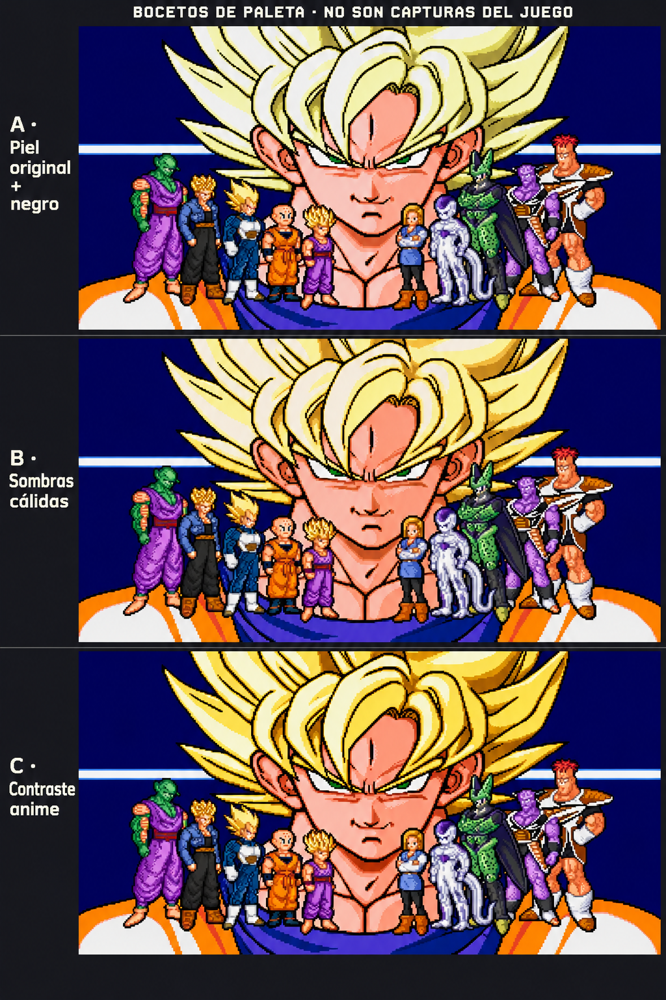

# Bocetos de color cálido para la intro

Imagen generada como estudio visual, no captura del emulador ni recurso listo para insertar en la ROM. La herramienta puede reinterpretar píxeles y formas. No demuestra que estas gamas quepan en las paletas compartidas de la consola.

Referencias: captura original de intro v6.3 para la piel cálida de Goku y captura v6.2 para contornos negros y materiales del reparto. A combina piel original y negro; B propone sombras cálidas; C aumenta el contraste del pelo y del conjunto. Los personajes pequeños siguen las gamas elegidas como referencia visual, sin garantizar correspondencia exacta de sus colores.

**Elegida C: Contraste anime**, el 4 de noviembre de 2026. El usuario indica: «contraste anime me parece correcto». Se conserva piel cálida basada en el original, contorno negro y mayor contraste de pelo y sombras. A y B se guardan como variantes históricas.

La elección corresponde al concepto visual. Su adaptación determinista a los gráficos originales y la validación mediante capturas reales siguen pendientes. La ROM actual sigue siendo v6.3 con presentación e intro originales.
