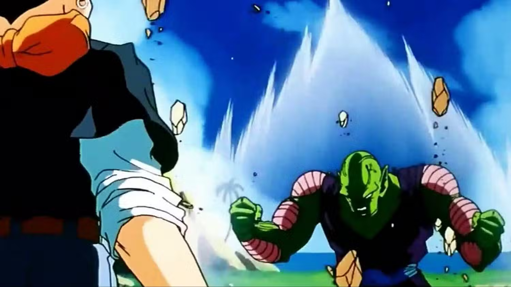
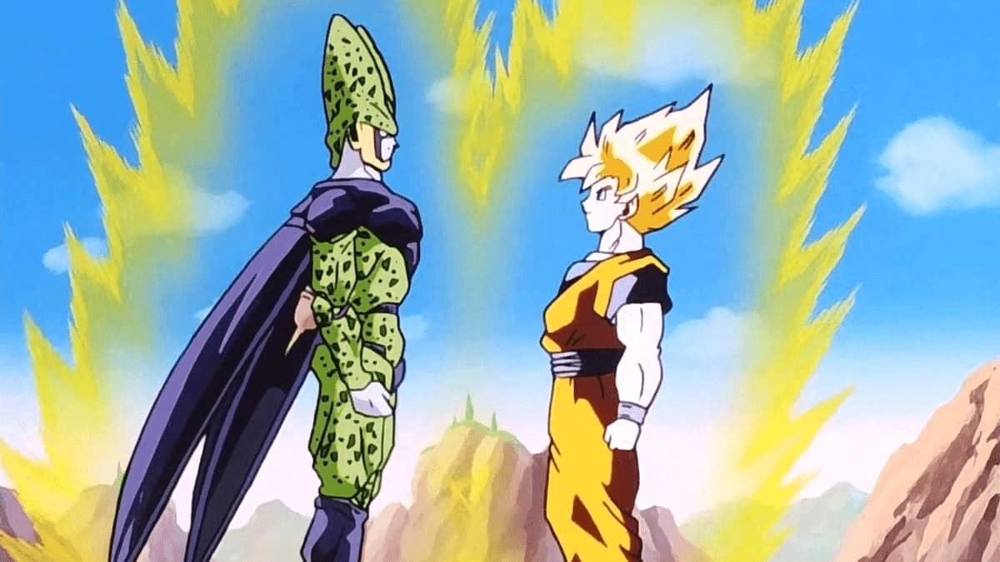
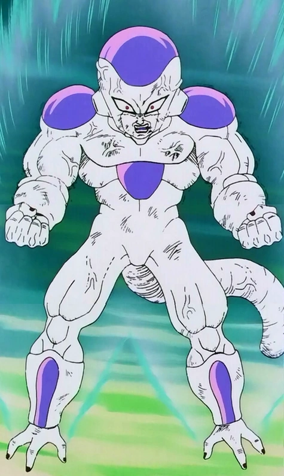
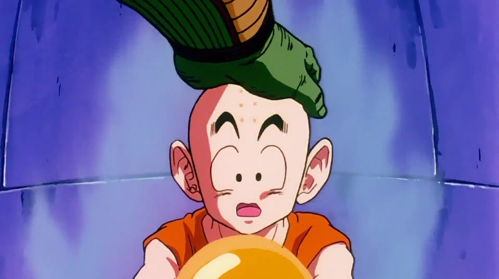
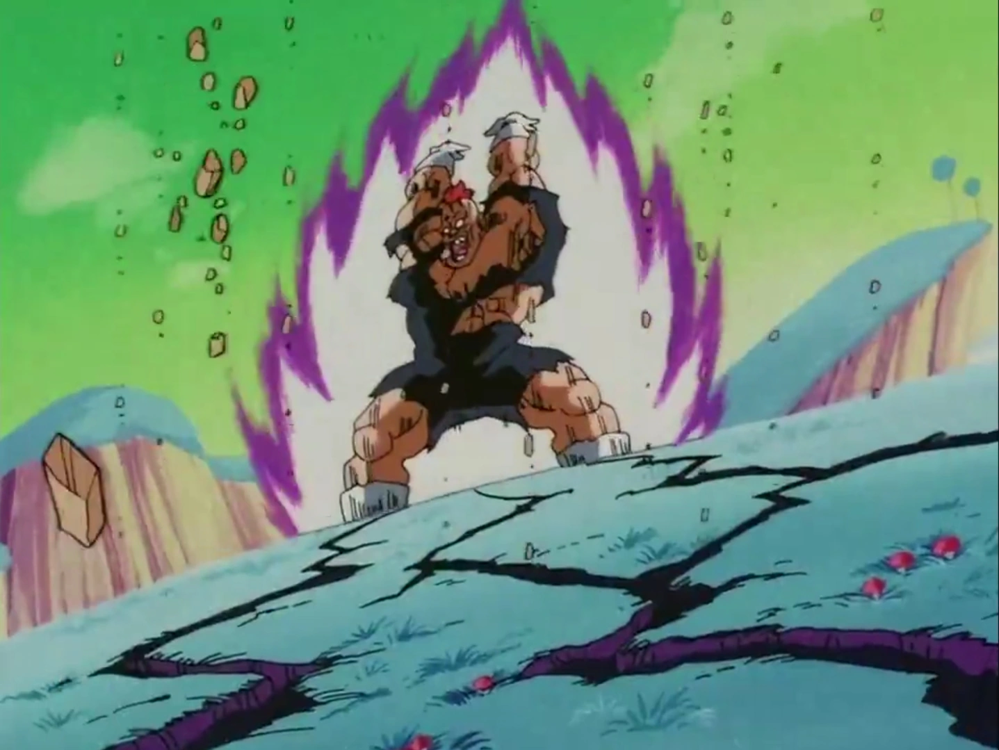

# Referencias de color del aura

La forma C2 v3 está aceptada y todas las auras siguen sin rayos. **Cell usa dorado como los Super Saiyan**, por decisión expresa del usuario. Los siguientes colores son referencias observadas; todavía no se han aplicado a una nueva ROM.

| Personaje | Familia de color | Alcance de la referencia |
| --- | --- | --- |
| Piccolo | Blanco azulado | Aura de cuerpo completo frente a A17. |
| Cell | Dorado | Aura frente a Goku y elección expresa del usuario. |
| Freezer | Blanco azulado / cian claro | Carga hacia el 100%, galería de DBZ 98. |
| Krilin | Blanco luminoso | Potencial liberado por el Gran Patriarca, DBZ 54. |
| Recoome | Blanco con borde violeta | Carga corporal previa a Ultra Fighting Bomber. |
| A18 | Abierto; blanco claro sería una adaptación | No se ha establecido un color exclusivo de carga habitual en DBZ. |
| Ginyu | **Lila, sin rayos** | Elegido por el usuario; núcleo claro propuesto, adaptación a la ROM pendiente. |

La propuesta traslada esas familias a la misma forma de aura. No afirma que todos los fotogramas de cada personaje tengan idéntico color. La iluminación, la técnica y la edición varían.

## Piccolo

Carga de cuerpo completo frente a A17. No implica que todas sus técnicas tengan este color. [Fuente](https://fandomwire.com/top-5-piccolo-aura-farming-moments-in-dragon-ball/).

## Cell

Aura de cuerpo completo frente a Goku. Color elegido expresamente por el usuario. [Fuente](https://wegotthiscovered.com/anime/here-are-all-forms-of-cell-in-dragon-ball/).

## Freezer

Carga hacia el 100% en Namek, identificada por la galería del episodio 98 de DBZ. Propuesta para trasladar esa familia de color a su aura en el mod. [Fuente](https://dragon-ballwiki.com/wiki/a-final-attack/).

## Krilin

Potencial despertado por el Gran Patriarca. La imagen muestra el resplandor y el texto de la sinopsis describe aura blanca; no es una medición de paleta de todos los episodios. [Fuente](https://dragon-ballwiki.com/wiki/gurus-gift/).

## Recoome

Carga corporal previa a Ultra Fighting Bomber. Sirve como referencia visual; no se ha demostrado que toda carga del personaje use siempre ese tono. [Fuente](https://dragon-ballwiki.com/wiki/recoome/).

[Registro completo, fuentes y límites](../research/auras-colors/anime-reference-review.json). Los fotogramas del anime pertenecen a sus titulares; se conservan como referencias de estudio del mod.
