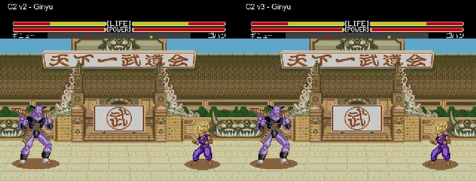

# C2 v3: corrección del contorno (historial)

**Revisión posterior:** contorno aceptado; todos los rayos retirados por petición del usuario. [Versión vigente sin rayos](auras-c2-v3-no-rays.md).

Esta prueba responde a las puntas cortadas y huecos que el usuario detectó en C2 v2. La dirección visual, el tamaño y los rayos de v2 estaban aceptados; **la corrección de contorno v3 está implementada y pendiente de revisión visual**.



[Once personajes](../assets/media/auras-c2-v3/Todas-las-auras-antes-despues.mp4) · [Cell](../assets/media/auras-c2-v3/05-Cell.mp4) · [Gohan SSJ2](../assets/media/auras-c2-v3/01-Gohan-SSJ2.mp4) · [Salida lenta](../assets/media/auras-c2-v3/Salida-Goku-lenta.mp4).

## Qué cambia

La llama mantiene 80 × 128 píxeles. Se ha adaptado el contorno de la referencia SNES aportada a los colores compartidos de Mega Drive. Las piezas conservan sus posiciones relativas: el mapa reconstruye el gráfico completo sin uniones abiertas ni huecos internos. Se mantiene el dorado para los superguerreros, incluido Vegeta; la referencia azul sólo orienta la forma.

Cell y Gohan SSJ2 usan tres formas de rayos blancos; el resto no lleva rayos. El polvo elegido permanece en el suelo. La salida dura doce ticks y apaga gradualmente el dibujo por fotogramas, conservando el contorno entero en cada frame visible. Ya no encoge tiras grandes por separado. El parpadeo y el cierre deben valorarse en las grabaciones reales.

## Verificación y límites

- Los 384 mapas reconstruyen exactamente los 10 240 píxeles del gráfico de referencia adaptado.
- Seis golpes naturales interrumpen el aura sin residuos; también se han probado P2 y cargas repetidas y simultáneas.
- En el pase de 2435 frames se observaron máximos de 72/80 sprites, 16/20 por línea y 216/320 píxeles por línea.
- Los once personajes tienen grabaciones y comprobaciones adicionales del presupuesto gráfico.
- El recurso usa 64 tiles en dos segmentos: `A260..A800` y `A820..AA80`. Se reserva el tile de desplazamiento horizontal `A800..A820`. La memoria de gráficos y el desplazamiento de cámara se han contrastado durante las pruebas.
- Se redirigen los tres puntos de carga del aura; el gráfico temporal de un especial conserva su cargador original. Los puntos de recarga se han verificado estáticamente, sin afirmar que todos se hayan ejecutado durante estas pruebas.

La validación se limita a los casos registrados en Genesis Plus GX. No es una prueba exhaustiva de todos los escenarios, modos, efectos simultáneos o hardware físico.

[Validación de vídeos](../evidence/auras-c2-v3/validation.json) · [Pruebas de ejecución](../evidence/auras-c2-v3/runtime-qa.json) · [Identidad del contorno](../evidence/auras-c2-v3/map-identity.json) · [Análisis de VRAM](../evidence/auras-c2-v3/vram-layout.json).

## Construcción y procedencia

```sh
pnpm build:auras:v3 --rom "ruta/a/original.bin"
```

[Fuente 68000](../src/auras/c2-v3/aura.asm) · [Tiles](../src/auras/c2-v3/tiles.hex) · [Mapas](../src/auras/c2-v3/maps.hex) · [Parche](../patches/auras-c2-v3/auras-c2.ips) · [Manifiesto](../patches/auras-c2-v3/manifest.json).

[Procedencia del gráfico adaptado](../assets/source/auras-c2-v3/provenance.json) y [referencias y créditos SNES](../assets/references/super-butoden-2/references.json). Las versiones C2 v1 y v2 se conservan. Esta ROM combina Jugabilidad v1, Colores v1 y C2 v3. No incorpora aún presentación G, crédito, selección, HUD H4 ni el décimo escenario nevado, que sólo tiene [bocetos de suelo y vuelo](stage10-snow.md).
