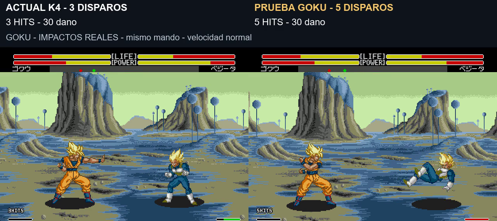

# Prueba: ráfaga de cinco proyectiles de Goku

**8 de noviembre de 2026. Propuesta pendiente de valoración; conserva K4 aprobada.** Solo cambia la ráfaga de Goku, comando **↓ ↘ → + A** mirando a la derecha. Los demás personajes no reciben cinco bolas.

[Vídeo real: tres frente a cinco](../assets/media/barrage-five/comparacion.mp4) · [Manifiesto](../patches/barrage-five/manifest.json) · [Pruebas y límites](../evidence/barrage-five/summary.json)

| Propiedad en el ejemplo | Actual K4 | Prueba de cinco |
|---|---:|---:|
| Proyectiles disparados |3|5|
| Contactos a distancia 120 |3|5|
| Daño total en ese caso |30|30|
| Daño por bola en ese caso |10|6|
| Consumo nominal total de ki |60|60|
| De entrar en la técnica a terminar su animación |3,04 s|3,49 s|

Se reduce el intervalo entre disparos usando las poses originales. La técnica completa dura unos 0,45 s más al incluir dos bolas adicionales y conservar recuperación. Los 5 HITS del juego proceden de cinco contactos reales. Bloquear no suma HITS y en la toma no quita vida. Sonido nativo, velocidad normal y mandos iguales en ambas tomas; el primer ejemplo se repite al final. Los rótulos superiores resumen el resultado completo de cada toma y el contador inferior sigue siendo el HUD nativo.

**Cinco disparos no garantizan cinco impactos.** A distancia 180 la toma del vídeo conecta cuatro, por 24 de daño, mientras que la actual conecta tres por 30. En otros casos lejanos de la matriz conectan tres o cuatro. Se conserva la defensa y recuperación nativa del rival: no se fuerzan contactos ni se amplían colisiones para fabricar cinco golpes. El enlace tras lanzamiento con una espera de 48 frames también se probó, pero las bolas no conectaron en esa situación; no se presenta como combo aéreo resuelto.

El daño neto de cada impacto de esta técnica se multiplica por 3/5 después de la defensa nativa y antes de otros modificadores posteriores. Puede variar por rival y situación. El ki se descuenta a razón de 12 por disparo; la regeneración natural hace que la diferencia visible de la barra no sea exactamente 60. Se mantiene la disponibilidad nativa y se añade una comprobación de energía para la serie completa. En las muestras con ki inicial 20/60/100 no se ejecuta; con 180 y 240 sí. Estas muestras no establecen el umbral nativo exacto. Mantener A después del comando no repite la ráfaga en la prueba acotada.

El motor dispone de tres huecos de proyectil por jugador. La cuarta y quinta reutilizan los primeros dos **solo cuando están libres**. Si todavía están ocupados, se espera antes de avanzar: no se borra una bola viva. La animación mantiene las poses originales y no acelera el vídeo.

Se validaron 32 casos nuevos y 32 de referencia: dos mandos, dos sentidos, distancias 32/64/120/180/240/360, guardia y otro plano. En 32/64/120 conectan cinco en los cuatro mandos/sentidos. Los casos de P2 mirando a la derecha a 240/360 sufren el límite nativo de cámara y fallan también en la base; no prueban el alcance correcto en esas posiciones. Kamehameha y puño de Goku, y patada normal de Vegeta, conservan trazas idénticas antes/después. No se ha auditado todo el resto del juego ni demostrado ausencia de infinitos.

Los datos de derribo y levantamiento K4 son idénticos. La versión K4 aprobada y el build principal anterior se conservan aparte. Pendientes: valoración del usuario, equilibrio prolongado, turbo y consola original.

**v1.0 prueba cinco disparos · build 20261108-125325.** Construcción desde la original japonesa admitida: `pnpm build:review --rom ruta/a/original.bin --version barrage-five`. El repositorio contiene el IPS, código propio y evidencias; no contiene la ROM completa.
