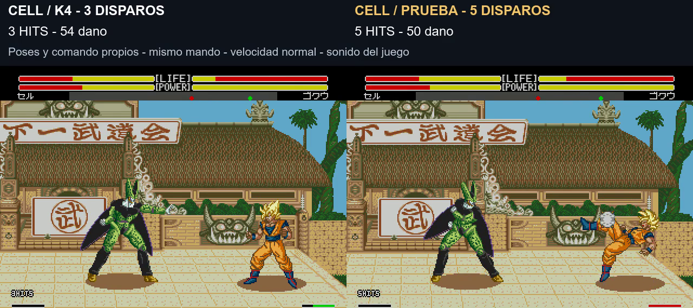

# Ráfagas de cinco: seis personajes sobre K4

**8/11/2026 · build 20261108-135651 · ráfagas aprobadas visualmente por el usuario («kedan bien»).** Se amplían las ráfagas existentes de **Goku, Vegeta, Cell, A18, Krilin y Recoome**. Cada uno conserva sus sprites, colores y comando; se reutilizan y ordenan sus poses originales para cinco disparos reales. K4 de derribos sigue aprobada y sus datos se mantienen idénticos.

[Comparación real de los seis personajes, con sonido](../assets/media/barrage-roster/comparacion.mp4) · [Manifiesto](../patches/barrage-roster/manifest.json) · [Pruebas](../evidence/barrage-roster/validation.json)

## Movimientos y animaciones nuevos

**Ningún movimiento, comando o dibujo nuevo ha sido necesario.** Los seis ya tenían la técnica de ráfaga. Se modifica su secuencia de animación, pasando de tres a cinco lanzamientos con sus poses propias. No se copia el cuerpo ni la animación completa de Goku a los demás. Vegeta alterna sus poses 3B/39; Krilin usa 34/3C; Cell, A18 y Recoome emplean sus propias poses 33/34.

| Personaje | Comando, mirando a la derecha | Cambio |
|---|---|---|
| Goku | ↓ ↘ → + A | Ráfaga existente: tres → cinco |
| Vegeta | Mantener ↓, luego ↓ ↙ ← + A | Ráfaga existente: tres → cinco |
| Cell | Mantener ↓, luego ↓ ↙ ← + A | Ráfaga existente: tres → cinco |
| A18 | Mantener ↓, luego ↓ ↙ ← + A | Ráfaga existente: tres → cinco |
| Krilin | Mantener ↓, luego ↓ ↙ ← + A | Ráfaga existente: tres → cinco |
| Recoome | Mantener ↓, luego ↓ ↙ ← + A | Ráfaga existente: tres → cinco |

Se invierten las flechas mirando a la izquierda. Los cinco personajes nuevos conservan la carga de dirección y el comando originales; no se les aplica automáticamente el reconocedor de Goku. La prueba usó 110 frames de abajo para asegurar la carga; no se presenta como mínimo necesario.

**Registro solicitado:** si una ampliación posterior necesita una técnica, comando o pose nueva, deberá anotarse expresamente aquí y en las decisiones antes de presentarla como integrada. Gohan, Piccolo, Trunks, Freezer y Ginyu **no reciben una ráfaga nueva en esta versión**. Añadírsela sería otro trabajo, sujeto a diseño y pruebas.

## Daño y energía por personaje

| Personaje y rival de la muestra | Daño tres bolas | Daño cinco bolas | Ki nominal total, antes y después |
|---|---:|---:|---:|
| Goku contra Vegeta |30|30|60|
| Vegeta contra Goku |24|20|60|
| Cell contra Goku |54|50|60|
| A18 contra Goku |57|55|30|
| Krilin contra Goku |24|20|45|
| Recoome contra Goku |24|20|60|

Son ejemplos a distancia inicial 120, velocidad normal y vida completa, no valores universales contra todos los rivales. El daño neto por bola se escala a 3/5 con truncamiento entero, por lo que el total puede bajar algo. No se multiplica por cinco el daño original. Cell y A18 usan tipos de proyectil propios (22/21 hex), que también se ajustan: no basta comprobar el tipo 20 de Goku.

El consumo por disparo pasa de 20 a 12 en Goku/Vegeta/Cell/Recoome, de 10 a 6 en A18 y de 15 a 9 en Krilin. Tres disparos antiguos y cinco nuevos gastan el mismo total nominal. La regeneración durante la animación puede ocultar parte de ese gasto en la barra. La técnica mantiene los requisitos nativos y comprueba energía suficiente para la serie.

Cell y A18 conservan daño residual al bloquear, reducido con el daño de la técnica; **ese daño no suma HITS**. En los casos de Cell contra guardia, pasa de tres descuentos de 4 a cinco de 2. No se elimina una propiedad nativa por confundirla con un impacto limpio.

## Prueba y límites

120 casos nuevos y 120 de referencia: seis personajes, dos mandos, dos sentidos, distancias 32/120/180, guardia y cambio de plano como fixture. Todos emiten cinco proyectiles, conservan el movimiento posterior y no sobrescriben una bola activa. A distancia 120 los seis conectan cinco y muestran 5 HITS en ambos mandos/sentidos. A más distancia pueden perderse contactos; no se garantizan cinco impactos ni una conversión aérea tras lanzamiento.

El motor tiene tres huecos por jugador: el cuarto y quinto disparo esperan a que el hueco correspondiente esté libre. La técnica no cancela ni borra proyectiles vivos para crear los nuevos. Se conserva una recuperación tras el último disparo; el ritmo entre bolas es más seguido, pero la secuencia completa puede durar más que la original.

El vídeo contiene seis tomas nativas coordinadas, izquierda tres y derecha cinco. Las cinco tomas con carga direccional recortan 100 frames de preparación iguales en ambas columnas; no se acelera ningún movimiento. Los rótulos superiores resumen el resultado completo; el HUD inferior cuenta dentro del juego. Audio de la propuesta. Las muestras de Kamehameha y puño de Goku y patada normal de Vegeta mantienen trazas idénticas; no se ha auditado exhaustivamente todo el resto de técnicas.

No se demuestra ausencia de infinitos o presión excesiva con estas pruebas acotadas. La aprobación visual no sustituye las pruebas pendientes con mando, equilibrio prolongado, turbo y consola real. No se modifican las colisiones para asegurar cinco contactos ni se introduce una vibración adicional.

Construcción: `pnpm build:review --rom ruta/a/original.bin --version barrage-roster`. El repositorio guarda IPS, código propio, vídeo y evidencias; la ROM completa queda en el paquete local de pruebas. [Prueba anterior, solo Goku](barrage-five.md).
