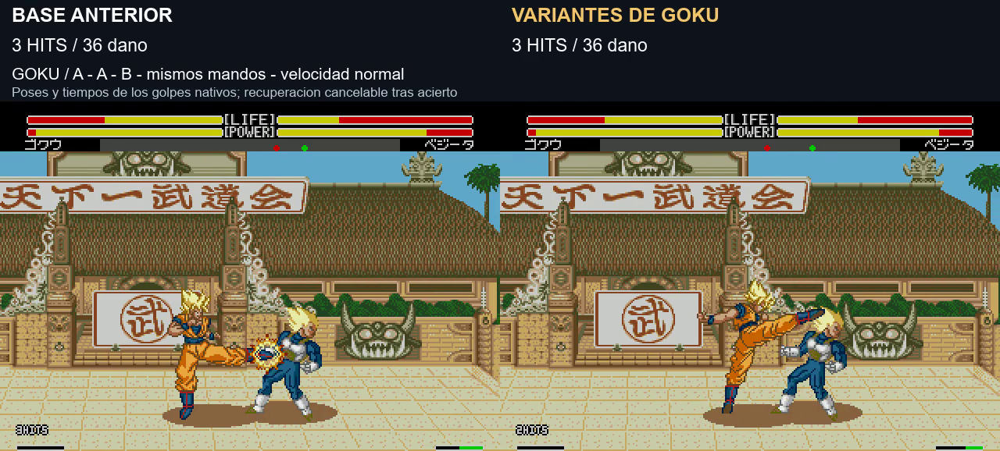
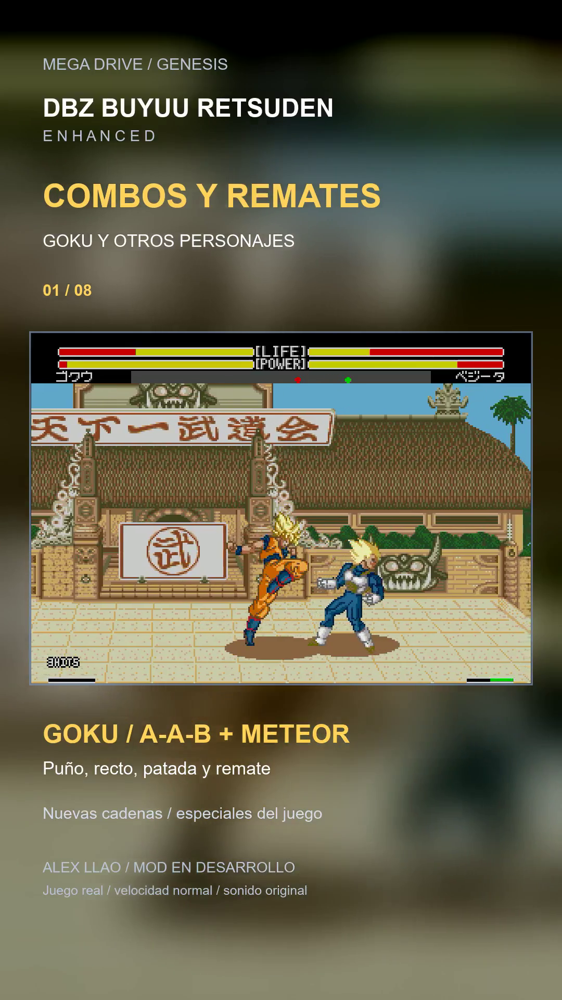

# Variantes de cadenas básicas de Goku y Short de remates

**Aprobado por el usuario el8/11/2026**, junto con las mejoras incluidas en el build200852. Las notas de prueba posteriores conservan el contexto previo a la aprobación.

**8/11/2026 · v1.0 build 20261108-171303 · mejora aprobada por el usuario.** Se empieza por Goku humano a velocidad normal, sobre K4, seis ráfagas y la corrección de daño del lanzamiento. El ensayo de dos saltos sigue separado.

[Short vertical, unos 27 s](../assets/media/basic-chains/short.mp4) · [Comparación de cadenas antes/después, unos 18 s](../assets/media/basic-chains/comparacion.mp4) · [Título y descripción para YouTube](basic-chains-short-texto.txt) · [Manifiesto](../patches/basic-chains/manifest.json) · [Pruebas](../evidence/basic-chains/validation.json)

## Qué cambia

La base ya permitía A → A → B con tres impactos. Esta prueba aporta **variación del segundo puñetazo y una patada de mayor alcance en la tercera entrada B**, usando ataques que Goku ya tenía. No se anuncia como si antes no hubiera combos.

| Entrada tras acertar | Secuencia de la propuesta |
|---|---|
| A → A → B | Puñetazo corto → recto → patada larga/alta |
| A → A → A | Puñetazo → recto → puñetazo |
| A → B → B | Puñetazo → patada cercana → patada larga/alta |
| B → A → B | Patada → recto → patada larga/alta |

Suelta y pulsa cada botón después del contacto. Solo se cambia el arranque de una transición ya confirmada por el asistente: el segundo A que iba a usar 400 pasa a 401/acción21, y el tercer B que iba a usar 403 pasa a 404/acción24. Otros órdenes conservan sus ataques si no cumplen esos casos. Se comprueba personaje, jugador humano, suelo, velocidad normal y estado pendiente de enlace válido.

**No se añade un botón, comando especial ni dibujo nuevo.** Se reutilizan los movimientos y poses nativos. No se modifica ninguna tabla de animación, no se acelera el vídeo y no se reinicia la reacción del rival. Se mantiene la cancelación de recuperación tras acierto ya existente: esto no significa reproducir siempre toda la recuperación del ataque cancelado.

En las ocho cadenas probadas a distancias 24/32/44, la propuesta conecta tres veces. AAB conserva **36 de daño**, igual que la base. ABB y BBB a distancia44 pasan de dos a tres contactos gracias a la tercera patada; no se agrandan sus cajas de colisión. Su alcance procede del ataque nativo elegido. No se modifican la fórmula global de daño ni las estadísticas para fabricar contactos.

## Remates y defensa

Se conserva la opción existente de ordenar una técnica tras los básicos, con su comando y requisitos de ki/distancia. En las muestras de rival neutral, AAB → proyectil suma 4 impactos y46 de daño; → Kamehameha,4 y96; → Meteor,6 y71; → Kiai,4 y44; → Flurry Kick,6 y126. Esos daños de remate y contactos se conservan respecto a la base en los gestos que arrancan correctamente; no se han reequilibrado todos los especiales en esta prueba.

**No todos esos remates son combos inevitables.** Al mantener atrás después del tercer básico, el rival bloquea los remates probados: por ejemplo Kamehameha reduce el total a66 y Meteor a39, mientras el contador queda en los tres básicos. Un gesto lento también puede salir de la ventana; la prueba de Kamehameha con cuatro frames por dirección no lo inicia. No se amplía artificialmente el hitstun para obligar a que todo conecte.

## Límites de repetición y pruebas

Se conserva el máximo de **tres básicos y un remate** del asistente. Los bloqueos y fallos no abren estas variantes. Mantener A da un solo contacto en el caso acotado; pulsar un cuarto A/B inmediatamente después de AAB no añade otro básico asistido en las muestras. La asistencia heredada requiere energía suficiente; con ki20 no se abre la cadena en la prueba.

Eso **no demuestra ausencia universal de infinitos**. La repetición de A durante seis segundos consigue cinco contactos en intentos nativos separados tanto antes como después, con solo dos arranques asistidos. Esquinas, otros rivales, fatiga, defensas y toda secuencia repetida requieren una auditoría de equilibrio aparte.

Se comparan 96 casos antes y96 después: ocho órdenes A/B, dos mandos, dos sentidos, acierto/guardia/fallo. Se añaden las distancias de la exploración, remates a distintos ritmos, defensa después del tercer golpe, pulsación mantenida, repetición y baja energía. Los otros diez personajes conservan los programas, poses, daño y HITS observados en su muestra A-B-A; ocho trazas son idénticas completas y Gohan/Cell presentan variaciones de fase en los frames registrados.

La intervención tiene162 bytes de código propio en3DD000 y un enlace en20B7E, sin RAM nueva. Se conservan byte a byte las tablas de animación de básicos, el cálculo global de daño, K4, las seis ráfagas y la corrección del lanzamiento. No se añade vibración ni se cambia la CPU o el modo turbo mediante estas variantes. No se certifica toda su regresión en hardware, IA o emparejamientos.

## Short solicitado

Ocho escenas del mismo build nuevo, solo versión mejorada: Goku AAB → Meteor; Meteor de Vegeta, Piccolo, A18 y Freezer; cinco disparos de Cell; lanzamiento → Masenko de Gohan; y Goku AAB → Kamehameha. **Solo Goku recibe las variantes nuevas de básicos**: los demás muestran sus técnicas y mejoras anteriores. No se atribuyen esas nuevas cadenas a todo el plantel.

1080×1920, 9:16, H.264/AAC, pantalla completa y HUD nativo dentro de un fondo desenfocado de las mismas imágenes. Se seleccionan y recortan tomas, con audio del juego y pequeños fundidos en cortes; **no se acelera ningún movimiento**. Las secuencias usan rival sin botones y sirven como demostración; no prueban que todos los remates impidan defenderse. El montaje no publica en YouTube ni modifica la ROM.

Pendiente: valoración con mando de esta primera prueba de Goku, equilibrio prolongado, esquinas, otros emparejamientos y consola original. Construcción: `pnpm build:review --rom ruta/a/original.bin --version basic-chains`. El repositorio guarda IPS y código propio; la ROM completa queda en el paquete local de pruebas.
