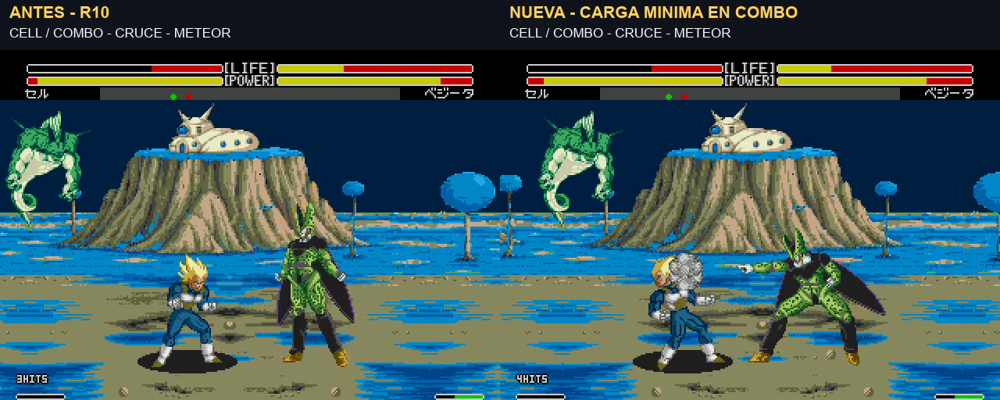

# Carga mínima al enlazar técnicas en un combo

10 de noviembre de 2026 · v1.0 build `20261110-120502` · **ROM experimental pendiente de validar con mando**. Parte de Namek R10 `20261110-094744`, conservando los tres fondos, paletas y mejoras anteriores. La aprobación de R10 no se interpreta como aprobación de este nuevo cambio de jugabilidad.

La petición es generalizar la preparación abreviada a los ataques con carga de todo el plantel, incluido el Meteor de Cell después del cambio de lado. El ajuste anterior de Gohan y Vegeta se conserva como [histórico](combo-startup.md).

## Comportamiento

Al aceptar una técnica, se comprueba que haya impactos confirmados y una ventana de enlace todavía abierta. Se acortan sus fases de preparación y se conserva al menos una actualización de cada gesto, porque algunos inicializan el ataque. Una preparación de un solo gesto conserva tres unidades de reloj nativo; las de varios gestos, una por gesto. No basta con que HITS siga visible.

El catálogo recoge 110 tablas distintas de las rutas de ki `C00–C7E`, incluidas las variantes de ráfagas, y el arranque del Meteor `84A` de Cell. Las tablas de animación originales y su unidad temporal permanecen intactas: se adelanta el reloj de preparación una sola vez por fase. No se acelera la reproducción del vídeo. La carga de ki con A+B y el lanzamiento de una técnica suelta conservan su comportamiento anterior.

El juego rechaza algunos proyectiles durante la reacción al golpe anterior. Se adapta ese filtro exclusivamente para una técnica cuyo enlace rápido ya fue confirmado. En esos casos se recuperan las últimas cajas receptoras **nativas** del mismo personaje, orientación y plano, sin agrandarlas. Guardia, derribos e invulnerabilidades especiales conservan sus filtros. Esta adaptación es necesaria: adelantar solo la carga hacía que Masenko y otros remates atravesaran al rival sin conectar.

## Tiempos medidos

Desde la aceptación del programa hasta el primer proyectil, o hasta el comienzo de la fase de rayos en Cell. Valores de las secuencias concretas grabadas/probadas a velocidad normal, no constantes universales.

| Secuencia | R10 anterior | Nueva candidata | Resultado conservado |
| --- | ---: | ---: | --- |
| Básicos → Super Kamehameha | 134 f | 8 f | 4 impactos, 113 de daño |
| Básicos → Masenko | 26 f | 5 f | 4 impactos, 71 de daño |
| Básicos → Final Flash | 38 f | 8 f | 4 impactos, 88 de daño |
| Básicos → especial de Trunks | 114 f | 18 f | 4 impactos, 59 de daño |
| Básicos → cruce → Meteor de Cell | 78 f | 9 f | 16 impactos, 137 de daño |

El Meteor de Cell conserva sus 13 contactos propios más los tres básicos previos. Los intervalos entre rayos pueden variar unos fotogramas con la actualización nativa, sin acelerar sistemáticamente la ráfaga. Si un comando llega cuando el enlace ya terminó, recupera su preparación normal; eso ocurre en la prueba de doble medio círculo de Goku después de un cruce.

## Vídeo y ROM local

Comparación simultánea de **35,86 s**, cinco personajes: Goku, Gohan, Vegeta, Trunks y Cell. Antes es R10, no la ROM comercial original. Juego y HUD completos, cada panel a escala entera 2×; sonido nativo de la nueva ROM. Mismas entradas programadas desde el primer básico. Las diferencias posteriores de posición y cámara son el resultado del impacto más temprano.

Archivos entregados en `outputs/Cargas-minimas-en-combo/` del espacio de trabajo:

- `Cargas-en-combo-antes-despues-v1.0.mp4`.
- `DBZ_Enhanced_v1.0_Cargas_combo_build_20261110-120502.bin`.
- `version.json`, `LEEME.txt` y el IPS de esta revisión.

El MP4 y la ROM quedan locales. No se han publicado automáticamente ni añadido al repositorio. El [IPS](../patches/combo-charge-all/manifest.json) es **un delta contra el R10 exacto**, SHA-256 `85d7090885e83cba884ecaf161c1913feb80a118d0aa3c86f58f7945de2483cf`; no se aplica directamente a la ROM comercial. El resultado tiene SHA-256 `7c35a85d50855b7b33868b8111158fc86a2cc9a57732e2bf6e7d1595af107d32`. Abrir la BIN desde cero; conservar la anterior y evitar estados guardados de otra revisión.

## Comprobaciones y límites

Se comparan **88 casos por ROM**: un especial representativo de cada uno de los once personajes, ambos puertos, ambos sentidos, suelto y después de básicos. Mismo daño en los 88 pares, retorno al estado libre y ningún ataque suelto con carga rápida. En 42 de los 44 intentos tras básicos había enlace confirmado; dos intentos de P2 no lo tenían y conservaron la carga normal. Los tiempos sueltos varían entre −2 y +3 fotogramas en esta matriz, conservando sus tablas originales.

Otras **24 situaciones por ROM** cubren Kamehameha, Super, Final Flash y Cell: suelto, combo, cruce, intento tardío, básicos bloqueados y básicos fallados. Los daños coinciden y los casos negativos no activan el recorte. En **once pruebas de repetición**, después de terminar el combo y cualquier mareo, el siguiente especial suelto vuelve a su carga normal. Se verifica además arranque desde cero, menú y combate con el hash final.

Las capturas proceden del framebuffer y audio del emulador local. Se preparan distancia/orientación y control humano antes de grabar; HP crítico y energía se obtienen mediante golpes/carga reales en los estados de preparación. Durante las tomas no se escriben posiciones, acciones, vida, energía o temporizadores. Los dos mandos son coordinados; no se presentan como CPU reactiva.

El catálogo general **no equivale a haber probado individualmente las 110 tablas**. Quedan la valoración con mando, variantes aéreas y de pantalla partida exhaustivas, Turbo, CPU y consola real. Tampoco se certifica que todas las cadenas sean inevitables ni que no existan infinitos. HITS/stun conservan sus reglas anteriores; este cambio no pretende resolver toda su auditoría.

[Resultados resumidos](../evidence/combo-charge-all/validation.json) · [24 comparaciones](../evidence/combo-charge-all/comparison.json) · [Procedencia del vídeo](../evidence/combo-charge-all/video.json) · [ASM comentado](../research/combo-charge-all/charge.asm) · [Catálogo](../evidence/combo-charge-all/catalog.json).
