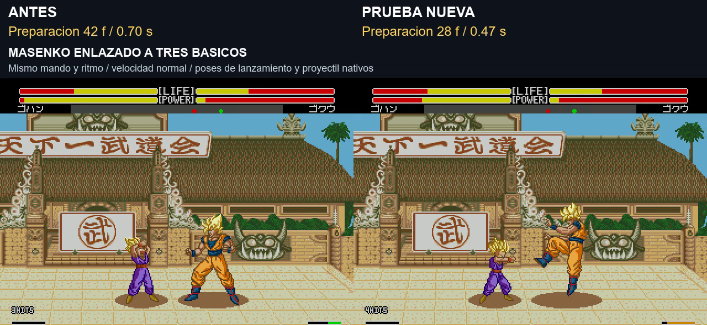

# Preparación abreviada del especial solo al enlazarlo

**8/11/2026 · v1.0 build20261108-200852 · prueba de Gohan y Vegeta pendiente de valorar.** Base: build175044. Se conservan gráficos, K4, seis ráfagas, corrección de lanzamiento y buffer/cadenas de Goku.

[Vídeo simultáneo antes/después,20s](../assets/media/combo-startup/comparacion.mp4) · [Resultados](../evidence/combo-startup/validation.json) · [Manifiesto](../patches/combo-startup/manifest.json)

## Resultado de la prueba grabada

Se mide desde que se acepta el programa de la técnica hasta que aparece su primer proyectil. Mismo estado inicial y mando en ambos lados; velocidad normal y sonido nativo.

| Técnica | Después de A-A-B, antes | Después de A-A-B, prueba | Lanzada suelta, antes/prueba |
|---|---:|---:|---:|
| Masenko de Gohan |42f ·0,70s|28f ·0,47s|41f /41f|
| Final Flash de Vegeta |79f ·1,32s|39f ·0,65s|77f /77f|

Ambas tomas enlazadas conservan4 impactos: Gohan71 de daño total y Vegeta88. Se abrevia la espera de preparación; no se acelera el vídeo, el proyectil ni la fase de lanzamiento. El vídeo repite una vez cada caso enlazado y después muestra las dos técnicas sueltas.

## Cuándo se activa

La decisión se toma al arrancar la técnica. Se exige jugador humano, velocidad normal, suelo, estado de cadena confirmada del asistente, contador abierto y rival todavía en reacción de golpe. Si el rival ya está libre, el especial usa su preparación normal aunque HITS siga visible. Solo se incluyen **Masenko normal de Gohan y Final Flash de Vegeta**.

La decisión se mantiene durante esa ejecución y se vuelve a calcular en la siguiente. Después de un especial rápido, otro lanzado suelto recupera su preparación normal; se comprueba en los dos personajes. Guardia sin acierto, fallo de básicos y un intento tardío no activan el recorte. No se alarga la reacción del rival ni se añaden cancels de técnicas o Meteor.

No se cambia el reconocedor, los comandos ni el límite del asistente de tres básicos y un remate. Este ajuste no acredita que todos los enlaces sean inevitables.

## Implementación y datos conservados

Se elige una tabla alternativa al resolver animaciones de ki. Las tablas originales permanecen byte a byte intactas para la ejecución suelta. Se conserva la unidad temporal y las poses de lanzamiento:

- Masenko: unidad12; peso inicial3→2 y peso de lanzamiento4 sin cambios. Cabecera84→72 para conservar la unidad.
- Final Flash: unidad17; pesos3/1/3→1/1/3. La fase intermedia y la de lanzamiento mantienen sus pesos. Cabecera120→85 para conservar la unidad entera17.

Código/datos propios de310 bytes en `3DF000`; enlace en `20A7A`, dentro de la resolución de ki, y limpieza al iniciar ronda. Estado `F7B0..F7B7`: programa seleccionado y marca de la ejecución para cada jugador. No se usa el espacio nativo de proyectiles. Se conservan las rutinas/tablas de proyectil, daño, hitstun, básicos, auras, K4, ráfagas y los parches anteriores.

## Validación y límites

168 casos antes y168 después: dos personajes, ambos mandos, ambas orientaciones, tres ritmos y siete contextos (suelto, un básico, tres básicos, guardia, fallo, tardío y guardia después del tercero).32 ejecuciones cumplen las condiciones y usan la preparación breve. No hay diferencias de daño ni pérdidas de arranque en los pares; guardia/fallo/tardío/suelto no activan el recorte.

Las tomas sueltas del vídeo coinciden en fotogramas. En la matriz más amplia, las muestras sueltas difieren entre0 y2 fotogramas según puerto/ritmo y fase de actualización nativa; no se han retocado sus tablas. En dos pares, el descenso de ki observado en pantalla varía en1 por su coincidencia con la recuperación pasiva. Los costes nominales y su cálculo permanecen sin cambios; no se afirma igualdad exacta de todo saldo final.

Pasan de nuevo200 variantes de entradas de Goku,10 acordes A+B del Meteor,7 casos de selección/rechazo y5 comprobaciones adicionales de carga/buffer/guardia/fallo. Dos casos consecutivos verifican que el modo rápido no se queda activado en el siguiente especial suelto.

Se descartó un Masenko con preparación más corta: salía durante la invulnerabilidad del golpe anterior y perdía el contacto. También se sustituyó la primera implementación general de poses por el enlace exclusivo de ki, para conservar las entradas rápidas de Goku. El vídeo y la ROM entregados corresponden únicamente al build200852 final.

Pendiente: sensación con mando, más distancias/emparejamientos y balance. No se amplía a todo el plantel ni se certifican turbo/consola original en esta prueba. No se declaran arregladas las discrepancias previas de HITS/stun.

Construcción: `pnpm build:review --rom ruta/a/original.bin --version combo-startup`. Arrancar desde cero, sin estados de otras versiones. La ROM completa queda en el paquete local; el repositorio conserva IPS, ASM comentado, pruebas y vídeo.
