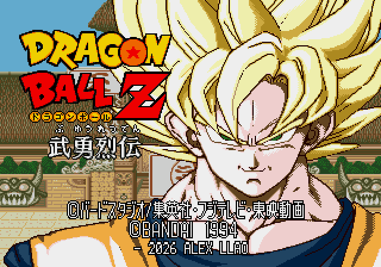

# Revisión de jugabilidad v2

El ensayo con mando detectó que el frenado añadido en v1 impedía activar la carrera con doble toque. El usuario pidió recuperar el doble toque hacia delante o atrás, mantener la carrera mientras se sujeta la dirección y frenar con algo de inercia, como en el original.

Se retira sólo la cancelación anticipada de caminar: vuelve a actuar la locomoción nativa, que ya reconoce la carrera y su salida con inercia. Se conservan la pulsación pendiente, el pequeño ajuste de recuperación de golpes básicos y su transición visual. La velocidad global y el turbo siguen siendo los del juego.

## Menos espera tras un derribo terrestre

Se acorta la última pose tumbada de las dos secuencias largas. Se conserva la caída anterior y la animación de levantarse.

| Secuencia | Personajes de la tabla terrestre | Espera anterior | Espera nueva |
| --- | --- | --- | --- |
| A1 | Todos salvo Piccolo y Cell | 42 ticks | 30 ticks |
| A4 | Piccolo | 54 ticks | 30 ticks |
| A5 | Cell | 30 ticks | 30 ticks, conservados |

Son ticks nativos, no fotogramas de vídeo. En normal se observaron unos 0,77–0,80 s de reposo con A1 y 1,02 s con A4; la propuesta queda en unos 0,55–0,57 s. Se probaron barridos de Goku contra Gohan, Piccolo, Cell y Recoome. Las animaciones de levantamiento conservaron sus 30, 29, 24 y 29 ticks, respectivamente.

Al recuperar antes el control también termina antes la protección asociada a estar derribado: 12 ticks antes en A1 y 24 en A4. No se ha añadido una protección independiente. No se alteraron las rutinas de daño, el hitstop ni las cajas de colisión. Las reacciones aéreas, KO y derribos de cinemáticas quedan fuera de esta prueba.

## Verificación y límites

- Once personajes en normal y turbo: 22 casos de un toque, doble toque con pausas de 2/4/8 fotogramas de presentación, dirección mantenida y soltada.
- Se conserva registrada una limitación: una pausa de un único fotograma de presentación no se captura en tres casos de turbo. No se afirma que se haya corregido esa entrada extrema.
- Pruebas adicionales en la ROM combinada para P1 y para P2 con turbo, arranque desde cero y paso por menús.
- Cuatro comparaciones de derribo, con dos mandos controlados por secuencias de botones; no son combates de CPU. No se ejecutó otra tanda de IA.

[Evidencia de movimiento](../evidence/gameplay-v2/movement-matrix.json) · [Derribos y límites](../evidence/gameplay-v2/knockdown.json) · [Gohan y el avance que cruza](../evidence/gameplay-v2/gohan-cross-side.json).

El repositorio conserva v1 y sus grabaciones como historial. El vídeo anterior de CPU corresponde a la versión anterior, no a esta revisión v5. La sensación con mando y la consola física requieren valoración del usuario.

## Presentación y crédito

La revisión combinada integra la paleta G y añade **- 2026 ALEX LLAO** en una línea propia, conservando **© BANDAI 1994** y la línea japonesa. Los retratos de selección, HUD H4 y escenario 10 siguen pendientes.

## Maniobra propuesta para después

Cambio de lado a corta distancia, sin golpe y para todos los personajes. Está anotado, sin implementar. El High Speed Move original de Goku/Gohan/Cell es una técnica ofensiva distinta y permanece con su comando original.
