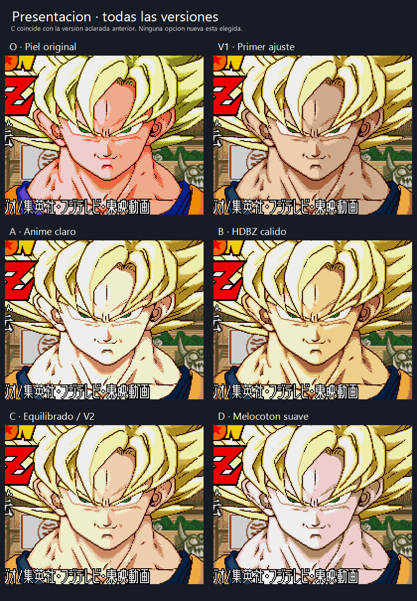
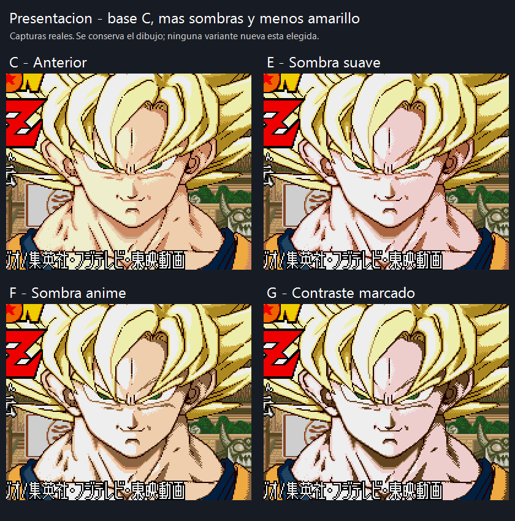
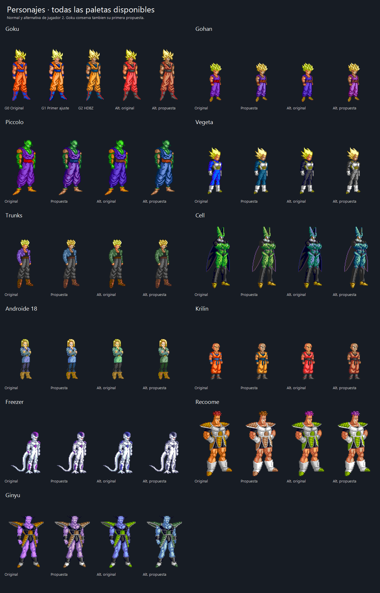
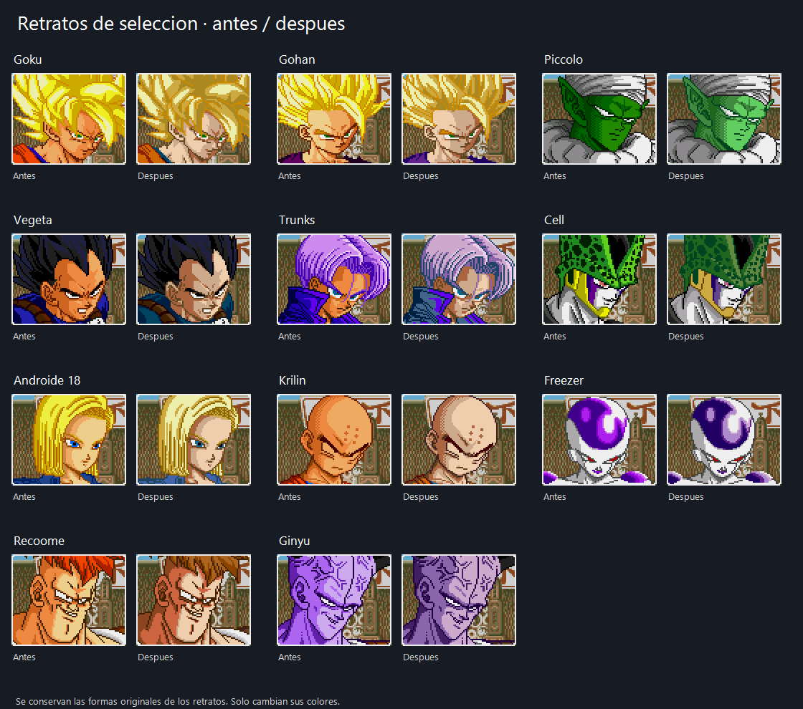
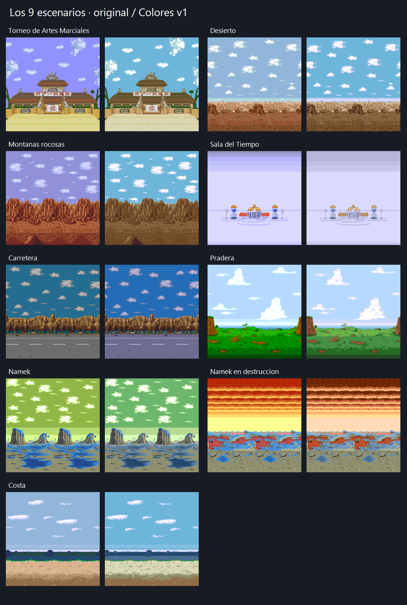
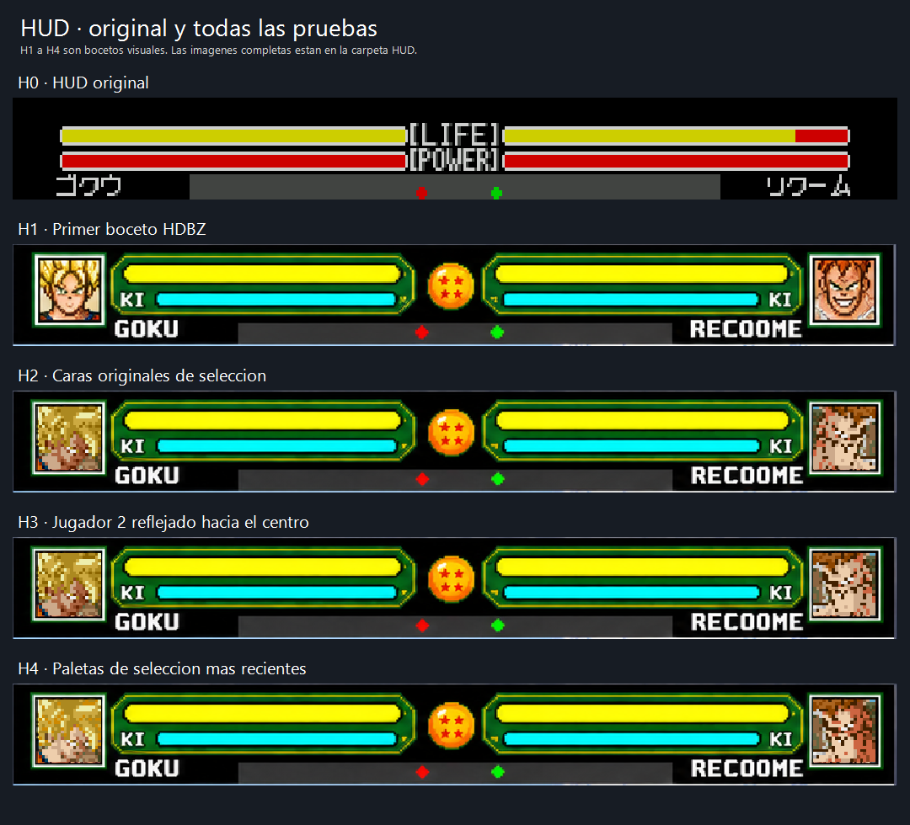
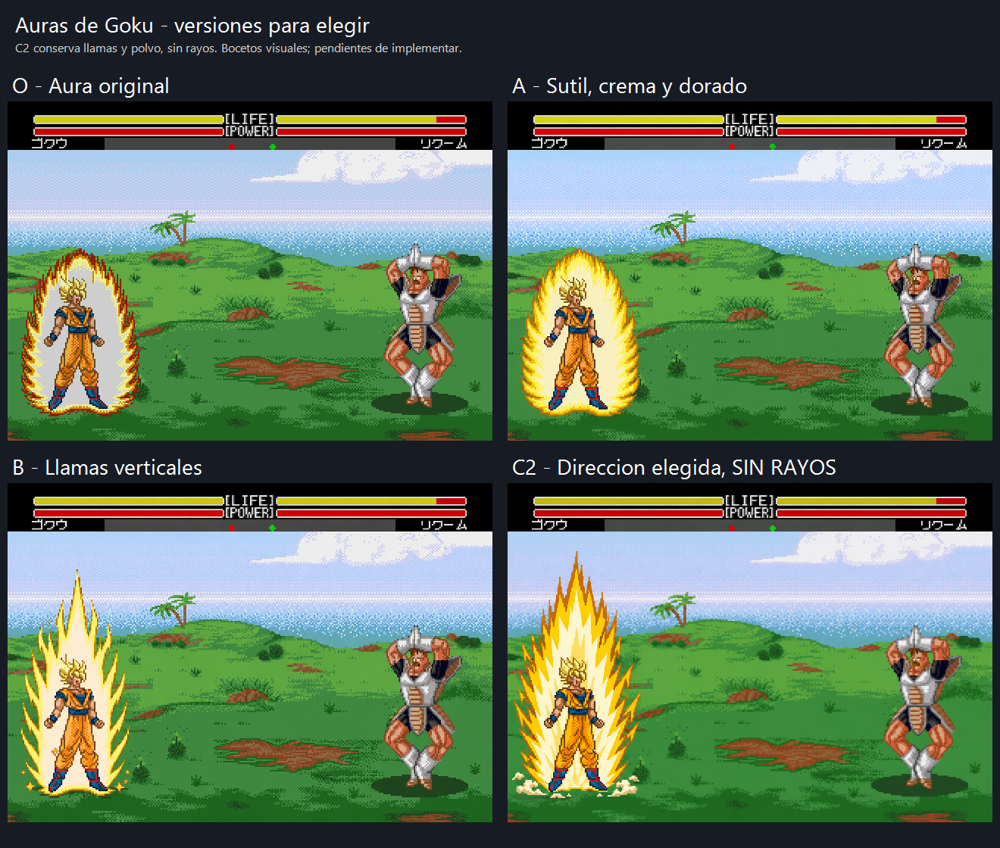

# Galería de variantes

Se conservan **71 imágenes**. El catálogo con rutas y hashes está en [project/graphics.json](../project/graphics.json). Las subcarpetas de [assets/comparisons](../assets/comparisons) contienen imágenes individuales a mayor tamaño.

## Presentación

**Elegida: G — C con contraste marcado**, el 4 de noviembre de 2026. Parte de C, con más sombras y menos amarillo. La captura es real y conserva el dibujo original; falta integrarla en la próxima ROM combinada. B fue la elección anterior y se conserva.

O: original; V1: primer ajuste; A: anime claro; B: HDBZ cálido; C: equilibrado/V2 aclarada; D: melocotón suave. C y V2 son la misma versión.

E: C con sombra suave; F: C con sombra anime; **G: C con contraste marcado, elegida**. Los cuatro colores y los hashes de las ROMs de previsualización están guardados en [title-shadows-v1.json](../research/palettes/title-shadows-v1.json).

Crédito del mod solicitado: **- 2026 ALEX LLAO**, sin pseudónimo. Pendiente implementarlo en los gráficos de presentación.

## Personajes

**Elegida la propuesta para los once personajes; Goku G2 HDBZ**, el 4 de noviembre de 2026. Se conservan originales, propuestas y colores alternativos. Las paletas están disponibles en Colores v1 y en la variante de Jugabilidad v1 con colores.

## Selección y retratos

**Elegida la propuesta v1 de todos los retratos**, el 4 de noviembre de 2026. Pendiente de integrar en el próximo BIN combinado. Se conservan las formas originales; cambia la paleta. Hay pantallas individuales en [portraits](../assets/comparisons/portraits).

## Escenarios

**Elegida la propuesta Colores v1 de los nueve fondos**, el 4 de noviembre de 2026. Disponible en la variante de Jugabilidad v1 con colores.

Nueve fondos: torneo, desierto, montañas rocosas, Sala del Tiempo, carretera, pradera, Namek, Namek en destrucción y costa. A la izquierda, original; a la derecha, Colores v1. Las localizaciones adicionales siguen en espera.

## HUD

**Bocetos, pendientes de implementar.** H1 es el primer concepto; H2 incorpora las caras originales; H3 refleja al jugador 2; H4 actualiza sus paletas. La referencia vigente es **H4**, que conserva el diseño H3 y usa la paleta de los retratos de selección elegidos. H3 se mantiene como alternativa histórica.

## Auras

**La dirección C2 v2 está elegida: tamaño, polvo y rayos aceptados.** El aura pasa de 64 × 112 a **80 × 128 píxeles**. Cell y Gohan SSJ2 llevan rayos blancos de 32 píxeles; Goku y los demás siguen sin rayos. Se añade polvo animado en los pies sólo al cargar en el suelo. C1 y C2 v1 se mantienen como historial.

La paleta compartida nativa se conserva y la retirada dura doce ticks del juego. El dibujo sigue siendo una adaptación del boceto. Hay [grabaciones reales de los once personajes, comparación de los tres tamaños y salida a cámara lenta](auras-c2-v2.md). Tras aceptar la dirección, el usuario detectó cortes rectos y huecos en el contorno, visibles en Ginyu. La reparación de las uniones está en curso; falta revisar el resultado corregido antes de cerrar el apartado gráfico.

## Contorno C2 v3 y escenario nevado

La corrección de huecos y cortes ya está implementada como [prueba C2 v3](auras-c2-v3.md), pendiente de valoración visual. Se conserva el tamaño y la dirección de C2 v2. El [décimo escenario nevado](stage10-snow.md) dispone de bocetos de suelo y vuelo; todavía no está integrado.
