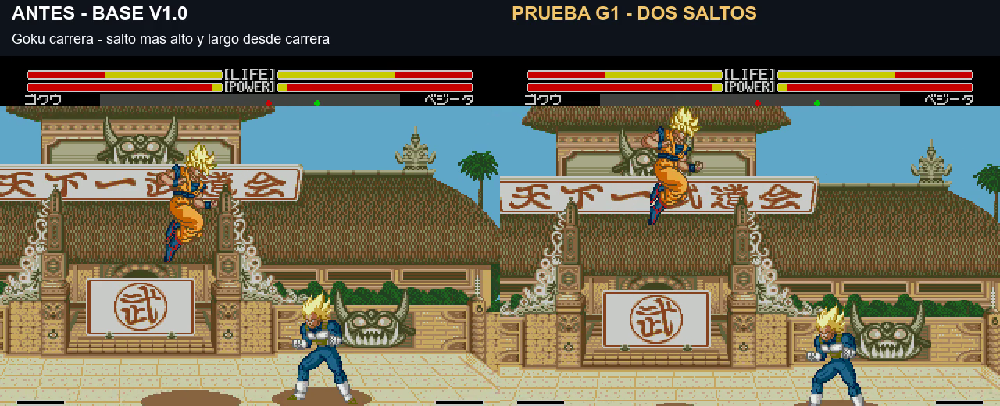

# Prueba G1: dos saltos y trayectoria del Meteor de Piccolo

Prueba solicitada el 6 de noviembre de 2026. **No convenció al usuario por falta de diferencia perceptible; ver [prueba G2 solo Goku](gravity-g2.md)**: no sustituye el build principal 20261106-124607.

[Vídeo simultáneo antes/después, 49 segundos](../assets/media/gravity-g1/Saltos-y-Meteor-antes-despues-G1.mp4) · [Manifiesto G1](../patches/gravity-g1/manifest.json) · [Verificaciones](../evidence/gravity-g1/validation.json)

## Comportamiento propuesto

- Salto normal: arco más bajo para volver antes al combate. Altura medida de 68–72 píxeles según personaje.
- Salto desde carrera: arco más alto, con más recorrido horizontal que el salto normal. Altura de 120–128 píxeles. Conserva el desplazamiento horizontal propio de la carrera del juego.
- Piccolo Meteor: mantiene sus **360 píxeles de altura**, con salida rápida, frenado al subir y aceleración al caer. Conserva 9 HITS y 43 de daño en las pruebas contra Goku.

Con Goku, el salto normal pasa de 87 a 70 píxeles, y el de carrera de 87 a 124. Se reutiliza la marca nativa de salto desde carrera; no hace falta una combinación nueva. Ambos saltos normales usan una curva parabólica y una aceleración calculada común, con distinta velocidad de despegue. El motor sigue actualizando a su cadencia original, por lo que no es una física continua independiente de la animación. El Meteor usa su propio recorrido dirigido, no la gravedad de un salto libre.

## Regresión de carrera corregida en esta prueba

La parada corta al soltar la dirección reiniciaba el estado de caminar antes de que el detector nativo pudiera reconocer el segundo toque. G1 conserva la parada corta y añade una ventana de 16 actualizaciones para volver a pulsar la misma dirección. Arranca la carrera nativa y conserva sus inercias. No activa carrera por mantener una dirección, invertirla o esperar fuera de la ventana.

**Ambos lados del vídeo llevan esa corrección**, para comparar dos carreras reales con los mismos inputs. «Antes» es la base v1.0 con esa reparación, no la ROM original de 1994. «Después» añade G1. No se acelera ni ralentiza el metraje. Sonido del lado derecho; estados deterministas compatibles, mismos mandos y posiciones iniciales. Durante la grabación no se fuerzan posiciones, daño ni impactos.

## Verificación y límites

Se probaron los once personajes: salto vertical, diagonal y desde carrera hacia ambos lados. Otras 154 comprobaciones cubren los once personajes en P1 y Vegeta en P2, aterrizajes, ataques A/B en el aire y falsos dobles toques. Todos terminaron en reposo en el suelo. También se comprobaron 12 casos de Meteor de Piccolo: ambos jugadores y orientaciones, impacto, bloqueo y fallo. Los impactos mantienen 9 HITS/43 de daño; bloqueo y fallo no suman HITS.

En la toma del Meteor, el tramo de programa observado cambia de 194 a 197 fotogramas reales por la sincronización del motor; sus tablas de poses y los tiempos programados no se modifican. No se promete una duración real idéntica. Esta prueba se verificó a velocidad normal en Genesis Plus GX; falta probar turbo, hardware real y cadenas extensas de combate.

## Reproducir

`pnpm build:review --rom ruta/a/original.bin --version gravity-g1`

Genera una ROM identificada como **v1.0 G1 build 20261106-150944**, distinta de la principal. Arrancar desde cero, sin estados de builds anteriores. El repositorio contiene el IPS, ASM propio comentado, código ensamblado en hexadecimal, scripts y evidencia. No contiene ROMs completas ni el núcleo del emulador. Los scripts de investigación conservan las rutas del laboratorio local; no son un paquete autónomo del emulador.
