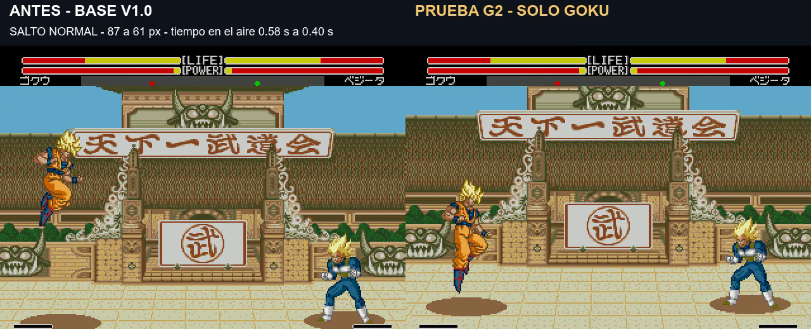

# Gravedad G2: prueba centrada en Goku

G1 no convenció al usuario: no percibía diferencias en el vídeo. La revisión confirmó que el salto vertical de Goku conservaba sus 35 fotogramas en el aire, aunque su altura cambiaba de 87 a 70 píxeles. En el Meteor de Piccolo se conservaba la gran altura y el tiempo apenas cambiaba. Esos datos no bastaban para afirmar una mejora perceptible de fluidez.

G2 es otra prueba, **solo para Goku**. Tampoco convenció al usuario: no percibía el cambio y cuestionó que fuera una gravedad real. No se considera aceptada; queda pendiente replantear el modelo. No reemplaza la ROM principal 124607 ni extiende esta gravedad al resto del plantel.

[Vídeo simultáneo de 19 segundos](../assets/media/gravity-g2/comparacion.mp4) · [Manifiesto](../patches/gravity-g2/manifest.json) · [Pruebas](../evidence/gravity-g2/validation.json)

| Prueba de Goku | Base 124607 con carrera corregida | G2 |
|---|---:|---:|
| Altura vertical normal |87px|61px|
| Tiempo en aire vertical de la toma |35fotogramas, ~0,58s|24fotogramas, ~0,40s|
| Recorrido diagonal normal |164px|109px|
| Altura desde carrera |87px|138px|
| Tiempo en aire desde carrera de la toma |35fotogramas|35fotogramas|
| Recorrido total desde carrera en esa secuencia |218px|218px|

Se acorta el salto diagonal normal para no aumentar su velocidad horizontal al reducir el tiempo. El salto desde carrera conserva su recorrido y duración, con un arco más alto. Se reutiliza la marca nativa de carrera. El módulo comprueba que el personaje sea Goku antes de cambiar su arco o duración. El resto conserva los saltos de 124607. El Meteor de Piccolo también conserva 124607: el ajuste de trayectoria G1 no se incluye aquí.

Cada secuencia se repite tres veces. Grabación real a velocidad normal, mismos mandos y estados iniciales compatibles; no hay cambios de velocidad en la edición ni posiciones forzadas durante la captura. Sonido del lado derecho. La reparación de carrera compartida está en ambos lados para comparar carreras reales.

Veinte comprobaciones desde arranque nuevo cubren Goku en ambos jugadores, mirando a ambos lados, salto normal/diagonal/de carrera y ataques A/B en el aire. Todos terminan en el suelo y en reposo. La sincronización del motor produce variaciones de uno o dos fotogramas entre orientaciones/puertos; la tabla describe la toma concreta, no una garantía de duración idéntica en cualquier situación. No se ha validado turbo, consola real ni todas las interacciones de combate.

Build experimental **v1.0 G2 20261106-164956**, 6 de noviembre de 2026, 16:49:56 Madrid. Arrancar desde cero, velocidad normal y sin estados anteriores.

`pnpm build:review --rom ruta/a/original.bin --version gravity-g2`

El repositorio guarda el IPS, módulo propio ASM/hex, scripts, evidencia y vídeo. Los scripts de laboratorio conservan rutas locales y dependen del entorno de investigación existente; no incluyen ROM ni emulador.
