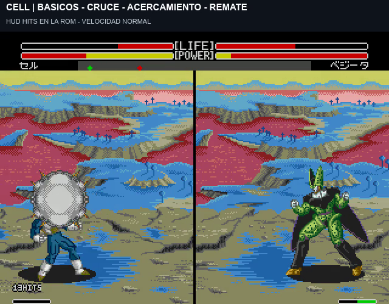
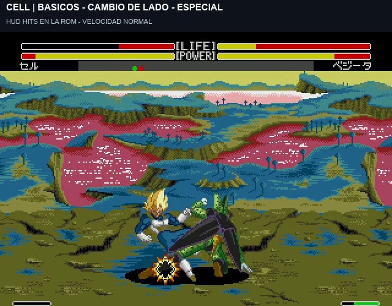

# HUD HITS real y corrección de acumulación de aturdimiento

**El contador ya está integrado en la ROM.** Por la última indicación del usuario, **un golpe suelto no se muestra**: se cuenta por dentro y el panel aparece desde **2 impactos**, hasta 99. No es una superposición del vídeo.

[Ver un minuto de juego real con HITS y sonido](../assets/media/hud-hits-v1/HUD-HITS-y-stun-corregido.mp4) · [Contador de P2](../assets/media/hud-hits-v1/HUD-2-HITS-P2.png).

## Reglas del contador

- Se asocia al atacante y aparece encima de su barra inferior. Al conectar el rival, termina la visualización de la cadena anterior y se usa el otro lado. Las dos barras de aturdimiento siguen presentes, sin texto STUN y sin cambiar sus 32x4 píxeles.
- Cuenta impactos aceptados sin bloqueo de puños, patadas y proyectiles. Los fallos, guardias, daño residual de bloqueo, partículas y poses repetidas no suman.
- Una técnica multigolpe mantiene su cuenta mientras sigue el mismo programa nativo, aunque su reacción no sea un combo cerrado. Entre ataques diferentes, recuperar el control/guardia el defensor cierra la cadena. Por eso una secuencia con huecos puede empezar de nuevo desde 1, que queda oculto.
- Un remate con daño diferido también cuenta el comienzo confirmado de su secuencia de contacto y su impacto dañino final. No se deduce todo del descuento de vida ni se inventa un número de puños mirando partículas. Las fases de proyectiles `88D/88E` no generan un incremento extra por entrar en esa fase.
- Tras la cadena se mantiene brevemente el número y luego desaparece: contador de 90 actualizaciones elegibles, suspendido durante las partes activas verificadas del ataque. No se añade stun para mantenerlo visible.

Ejemplos medidos: Goku llega a 3 con su ráfaga; Cell llega a 13 con Needle Rush; el Meteor de Goku, incluso iniciado solo, registra el contacto confirmado y el remate final; la respuesta de P2 muestra 2 en el lado derecho. El Meteor defendido hace 3 de daño residual pero no activa HITS. No se declara una auditoría exhaustiva de todas las cinemáticas de los once personajes.

## El reinicio de la barra que señaló el usuario

En el vídeo anterior, Cell golpeaba a Vegeta cerca de **1:13**, cruzaba y añadía una patada. La traza muestra acumulación 0→4→8→11 y luego 14. Vegeta **no tenía mareo activo**: temporizador 0. A 1:15,45 el contador periódico original llegaba al límite 600 y borraba 14→0, sin nueva pérdida de vida. **No era el cambio de lado ni la regla de salir del mareo al primer golpe.**

Se corrige el temporizador original `actor+32` para reiniciarlo en cada impacto aceptado y no bloqueado. La acumulación se limpia ahora después de ese límite nativo **sin nuevos golpes recibidos**, conservando velocidad/pausas del motor. La versión nueva mantiene los 14 puntos durante y después de la patada del vídeo. La prueba de espera verifica que sí se borran al llegar al límite de inactividad; no quedan acumulados para siempre.

La regla anterior elegida se mantiene: si ya existe mareo real, el primer impacto conectado lo termina y reinicia su acumulación mediante la limpieza nativa. Cambiar de lado sin golpear no vacía la barra. Las resistencias, carga de stun de cada ataque, daño y animaciones permanecen nativos salvo los ajustes de jugabilidad ya elegidos.

[Momento señalado y diagnóstico](../evidence/hud-hits-v1/stun-reported-timestamp.json) · [Prueba de salida del mareo](../evidence/hud-hits-v1/dizzy-exit-validation.json).

## Integración y pruebas

El panel utiliza sólo tres patrones libres `AFA0..B000`, una tipografía 3x5 con borde oscuro y como máximo un sprite adicional. Comparte la imagen del número entre lados porque una contra termina la cadena anterior. Se omite el panel si la lista nativa no deja ese sprite disponible; no se pisa la ventana del escenario ni los patrones de aura. Los píxeles se actualizan sólo al cambiar el número, en la ruta segura de VBlank.

Estado por actor: bytes `120..125`; se conservan aura `110..116`, ventaja `117` y campo nativo `126`. Al iniciar la ronda se limpian los contadores. La cuenta normal entra después de separar bloqueos en la ruta de impacto aceptado; la cinematográfica usa llamadas verificadas al cambio de programa del defensor. **Las entradas nativas `20B7A` y `20B7E` se conservan intactas** y los envoltorios hacen salto final, respetando la pila especial del motor.

- 88 casos de golpe, patada, guardia y fallo con once personajes, P1 normal y P2 turbo. Se comprueban cuenta interna, ocultación de 1 mediante la lista real de sprites y caducidad del número.
- 374 casos anteriores del cambio de lado siguen pasando.
- Seis tomas con todos los finales de ataque y vuelta al control; guardia y contador de P2 incluidos. Los estados completos se guardan comprimidos con hashes.
- Prueba nativa de limpieza por inactividad y dos pruebas de salida del mareo al primer golpe, normal y turbo.

[Resumen y archivos de evidencia](../evidence/hud-hits-v1/validation.json) · [Comparación estática](../evidence/hud-hits-v1/static-validation.json) · [Meteor sin básicos previos](../evidence/hud-hits-v1/standalone-meteor.json).

Se conserva Ventaja v1, incluida su limitación actual a dos jugadores humanos. HITS utiliza los contactos de ambos actores, independientemente de haber empezado un combo asistido. Las capturas son con mandos coordinados; falta valoración humana, todos los especiales/emparejamientos y hardware original. La ROM no incorpora las propuestas pendientes de Namek.

## Construcción y fuentes

`pnpm build:review --rom ruta/a/original.bin --version hud-hits-v1`

[ASM](../src/hud/hits-v1/hud.asm) · [Fuente gráfica](../src/hud/hits-v1/glyphs.json) · [Manifiesto](../patches/hud-hits-v1/manifest.json). Arrancar desde cero, sin estados de versiones anteriores. El comando sin versión sigue conservando v6.6.
