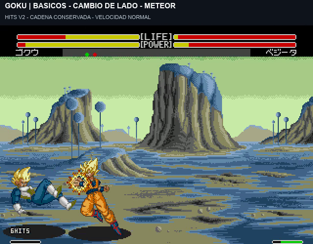

# HITS v2: continuidad, Meteor y mareo

**Historial:** [v3](hud-hits-v3.md) corrige la suma de golpes demasiado separados; el ejemplo anterior de10 HITS ya no representa una cadena vigente.

El contador conserva la cadena si enlazas dentro de la ventana: **golpes → cambio de lado → Meteor**. El cruce no añade impactos. **El Meteor de Goku suma tres contactos**, incluso ejecutado solo, y el tiempo de enlace se pausa durante su ejecución.



[Ver 89 segundos de juego real con sonido](../assets/media/hud-hits-v2/HITS-v2-combos-Meteor-y-mareo.mp4).

## Reglas elegidas

- Se muestra desde **2 impactos**; un golpe suelto se cuenta internamente y queda oculto. Límite 99.
- La ventana mantiene 90 actualizaciones elegibles desde el último contacto. Se **pausa**, sin consumirse, mientras el atacante ejecuta un golpe, especial o cambio de lado. Se reanuda cuando termina.
- También se conserva mientras el defensor tiene mareo activo. El primer golpe posterior termina ese mareo, como ya se eligió, **y se añade al mismo total**. No se alarga el mareo ni la reacción del rival para sostener la cuenta.
- Recuperar el control no borra inmediatamente la cadena: consume el plazo restante para enlazar. Al agotarse, el siguiente contacto inicia otra cuenta.
- Un impacto del rival cierra la cadena del atacante anterior y abre la suya. Cambiar de lado, fallar, bloquear o generar partículas no suma.
- Es un contador de cadenas enlazadas dentro de esta ventana, incluyendo el mareo solicitado. El número no demuestra que todos los enlaces sean imposibles de defender; el comportamiento de defensa sigue siendo el anterior.

## Vídeo y resultados

| Inicio | Prueba | Resultado |
| --- | --- | --- |
|0:00|Meteor de Goku solo|1 interno →2 →3 HITS, manteniendo la cuenta entre contactos.|
|0:09|Tres golpes →cruce →Meteor|6 HITS:3 básicos +3 del Meteor.|
|0:20|Seis golpes →mareo →golpe →Meteor|6 se conserva durante el mareo, el golpe suma 7 y el Meteor termina en10.|
|0:43|Cell: tres golpes →cruce →Needle Rush|16 HITS:3 básicos +13 proyectiles.|
|0:59|Respuesta de P2 →Meteor de Goku|La cadena de P1 termina; P2 muestra3 HITS a la derecha.|
|1:10|Meteor defendido|Sin HITS, aunque existe daño residual nativo.|
|1:16|Tres golpes →espera hasta caducar →Meteor|El Meteor empieza otra cuenta y termina en3.|

Las siete tomas muestran recuperación y control posterior. Son 89,48 segundos de fotogramas de emulador, con sonido nativo y sin acelerar movimientos. Las cartelas superiores explican cada toma; el contador inferior lo dibuja la ROM.

## Corrección técnica y evidencia

La versión1 cerraba la cadena al recuperar el defensor el control y no identificaba la patada intermedia del Meteor de Goku. Ahora el plazo de enlace es independiente de esa recuperación y se congela en las condiciones anteriores. El punto nativo `162F0` identifica la patada con sprite41 y sonido de contacto, sólo durante `83F` con defensor en `884`; un bit de estado evita repetirla durante varios cuadros. El inicio confirmado y el remate final mantienen sus rutas anteriores. No se cambia el daño diferido del Meteor para contar sus tres contactos.

Se reutiliza el estado del HUD y su tipografía anterior, sin nuevos patrones, sprites o paletas. Las tablas de animación, daño, controles, combo asistido, ventaja y barras quedan conservadas. La corrección anterior de acumulación por inactividad sigue activa.

- 88 casos con once personajes: puño, patada, guardia y fallo; P1 normal y P2 turbo.
- 374 pruebas del cambio de lado siguen pasando.
- Siete secuencias verificadas cuadro a cuadro. En el Meteor solo, la separación de contactos supera 150 cuadros sin que se consuma el plazo. Durante 120 cuadros de mareo grabado se mantienen 6 HITS y el mismo plazo; el primer golpe posterior suma 7 y termina el mareo.
- Limpieza de acumulación por inactividad y salida del mareo al primer impacto, normal y turbo.
- Parche reconstruido desde la ROM japonesa y cotejado por SHA256.

[Validación](../evidence/hud-hits-v2/validation.json) · [Cambios de bytes](../evidence/hud-hits-v2/static-validation.json) · [Fuente ASM](../src/hud/hits-v2/hud.asm) · [Manifiesto](../patches/hud-hits-v2/manifest.json).

La prueba no cubre todos los especiales y emparejamientos ni hardware original. La ventaja del cruce sigue limitada a dos mandos humanos. Las propuestas de Namek siguen sin aplicar.

## Construcción

```sh
pnpm build:review --rom "ruta/a/original.bin" --version hud-hits-v2
```

El comando predeterminado sin versión conserva v6.6. La revisión v1 se guarda como historial. El ensamblador y fuente de caracteres están documentados en [v1](hud-hits-v1.md); la fuente binaria usada es idéntica y se regenera con su generador. Las herramientas de investigación usan rutas locales `work/`; no forman parte de la construcción normal por IPS.
