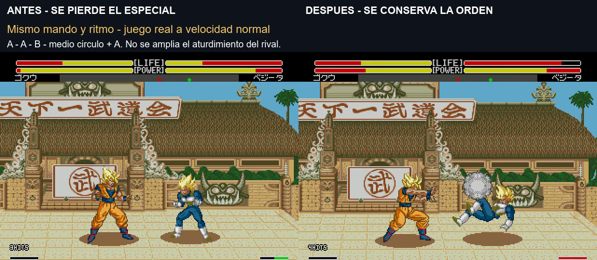

# Buffer de especiales al terminar básicos

**8/11/2026 · v1.0 build 20261108-175044 · ROM de prueba pendiente de valorar con mando.** Sobre las variantes de Goku del build171303, K4, seis ráfagas y corrección del daño de lanzamiento. El ensayo de dos saltos continúa separado.

[Vídeo real antes/después, unos10s](../assets/media/input-links/comparacion.mp4) · [Resultados](../evidence/input-links/validation.json) · [Parche y hash](../patches/input-links/manifest.json)

## Fallo reproducido y cambio

Al introducir medio círculo+A después de A-A-B, el reconocedor podía producir el token correcto de Kamehameha justo al acabar la recuperación de la patada. El despacho no iniciaba la técnica en esa actualización y, como el gesto ya estaba consumido, después salía un puñetazo. Reconocer una orden y llegar a ejecutarla eran dos pasos distintos.

Se conserva durante **un máximo de seis actualizaciones del reconocedor** un especial reconocido durante un básico de Goku o su transición inmediata a neutral. Solo se vuelve a entregar la orden al estar libre el personaje; la técnica sigue comprobando sus condiciones nativas. No se reinicia la recuperación del rival ni se amplía la ventana del asistente de combos. Un especial ya iniciado, recibir daño, morir, volar o cambiar de orientación descarta la orden pendiente; el inicio de ronda limpia el estado. Las reglas de cancel por acierto y su límite de tres básicos y un remate se conservan.

La intervención es para **Goku humano a velocidad normal**. No se han cambiado comandos, daño por impacto, animaciones, cajas, saltos o espera K4. Se reutilizan tres bytes libres de cada bloque de estado del reconocedor: token, duración y marca de básico anterior (`F72D..F72F` y `F73D..F73F`). Código propio en `3DE000`, con cuatro enlaces a las nuevas etiquetas. El archivo ASM incluye comentarios en castellano.

## Comprobaciones

- 180 enlaces de referencia y180 con la propuesta: Goku contra Goku, dos mandos, dos orientaciones, cinco ritmos, tres pausas tras el tercer contacto y Kamehameha/Super/Meteor. **160 → 180 técnicas iniciadas**, sin perder ningún caso que ya arrancaba. Se prueba rival neutral y ki suficiente; no es una tasa de éxito universal.
- Pasan de nuevo las200 variantes de entradas desde reposo,7 casos de selección/rechazo,10 combinaciones A+B del Meteor y2 elecciones de técnica tras carga. También las5 comprobaciones adicionales de carga/buffer/caducidad/guardia/fallo.
- 96 casos de básicos con ambos mandos: acierto, guardia y fallo. Se conservan contactos, daño y límites en mantener A, cuarto A/B, guardia tras tercer golpe, repetición durante seis segundos y ki bajo. La muestra A-B-A de los otros diez personajes mantiene daño y HITS.
- El buffer se observa y caduca sin iniciar Kamehameha al introducirlo demasiado pronto después de un puño fallado o bloqueado. En esas dos pruebas no causa daño ni abre el cancel por contacto.
- Tras tres básicos y guardia del rival, Kamehameha puede bloquearse en los cinco ritmos muestreados:66 de daño total, incluidos30 residuales de bloqueo, y el contador permanece en3. Con rival neutral, el ejemplo grabado pasa de36 a96 de daño y de3 a4 impactos porque ahora llega a salir el ataque, **no porque se haya aumentado su daño**.

## Vídeo y límites

Izquierda build171303; derecha build175044. Mismo estado inicial, mando, ritmo y distancia. A-A-B, pausa de tres fotogramas y medio círculo con cuatro fotogramas por dirección+A. Sonido nativo, velocidad normal y HUD del juego; la toma de unos cinco segundos se repite una vez. El vídeo demuestra ese fallo concreto, no todos los enlaces.

**Quedan casos por investigar.** En la exploración independiente contra Vegeta, el Kamehameha con cinco fotogramas por dirección después de AAB aún no arranca contra rival neutral. El resultado180/180 pertenece únicamente a la matriz descrita. Tampoco se certifican mando humano, turbo, consola original, todos los emparejamientos, esquinas o ausencia universal de infinitos. No se declaran arregladas las discrepancias pendientes de HITS/stun.

Construcción: `pnpm build:review --rom ruta/a/original.bin --version input-links`. IPS, código, pruebas y vídeo en el repositorio; la ROM completa queda en el paquete local. Arrancar desde cero, sin estados guardados de otra versión.
