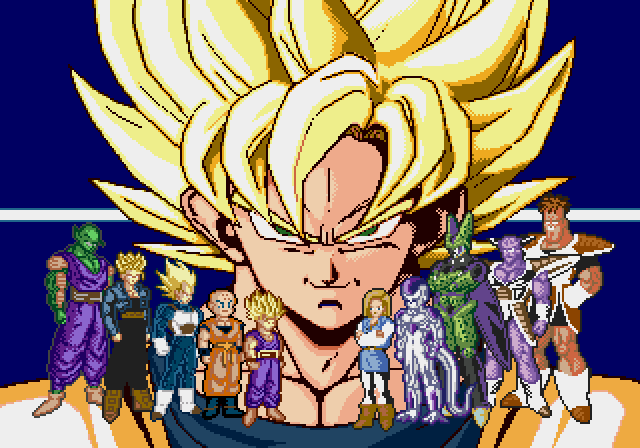
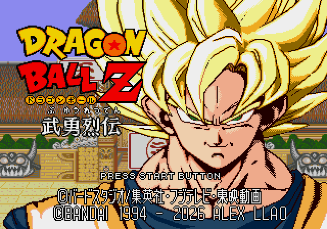

# C: Contraste anime en intro y título, v6.4

> Historial: el usuario aprobó el Goku grande pero rechazó el reparto por errores. La corrección de personajes está en [v6.5](intro-refined-v6-5.md); la cara y el título se conservan exactamente.

El usuario eligió el concepto C y pidió el mismo tratamiento para la pantalla de BANDAI y ALEX LLAO. Esta es su adaptación a los colores reales de Mega Drive. **La elección del boceto no implica aprobación de estas nuevas capturas: la revisión visual del resultado nativo sigue pendiente.**

Se mantiene el tono base de piel original de Goku (`08AE`), se usan luces crema cálidas, sombras coral y contornos oscuros. El pelo recibe más contraste dorado. Intro y título comparten las mismas quince entradas visibles de Goku; cada pantalla conserva su fondo. El fondo del título mantiene la copia de paleta original separada de los escenarios de combate que se introdujo en v6.3.

Los personajes completos de la apertura reutilizan los materiales de combate adaptados en v6.2: tres bancos, 43 colores, 27 fusiones documentadas de tonos secundarios y trece gamas principales protegidas. No se modifican los sprites ni las paletas de los personajes durante el combate. BANDAI y ALEX LLAO conservan la fuente y posición de v6.2.

El boceto generado es una referencia visual; sus cambios de formas o píxeles no se copian al juego. La adaptación conserva los gráficos nativos y las limitaciones documentadas del montaje v6.2.

Se verificó un arranque en frío sin botones ni escrituras de RAM, hasta la transición al combate en el fotograma 2205. Las paletas activas en los fotogramas 960 y 1800 coinciden con la especificación. Se verifican sin cambios las paletas de combate y escenarios, los bloques de controles y cambio de lado y los recursos del crédito. No se repite una partida completa ni se prueba hardware original. El mapa ASM modificado de estudio anterior sigue correspondiendo exclusivamente a v6.2.

Construir: `pnpm build:review --rom ruta/a/original.bin`. Versiones anteriores disponibles con `--version v6.3`, `--version v6.2` y las opciones históricas. Arrancar sin cargar estados de otra versión.

[Operaciones y paleta exacta](../src/intro/anime-c-v1/operations.json) · [Verificación nativa](../evidence/intro-anime-c-v6-4/validation.json) · [Manifiesto](../patches/review-v6-4/manifest.json).
