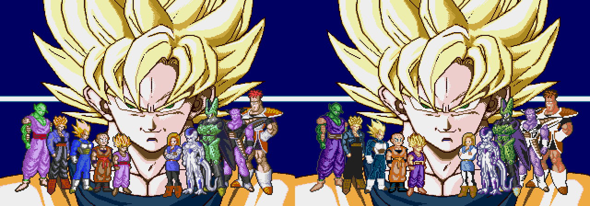
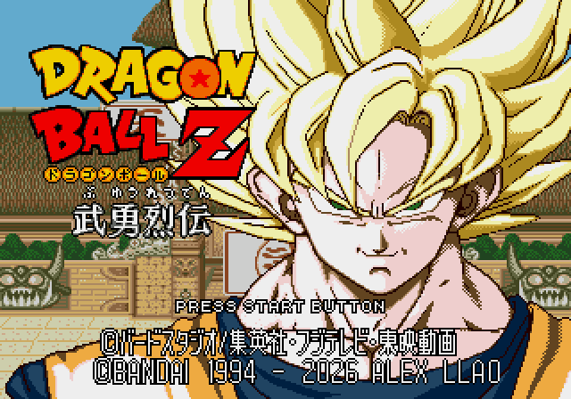

# Apertura y créditos: revisión v6.2

La cara grande G de Goku aprobada se conserva exactamente. Se corrigen los personajes completos de la apertura, que en v6.1 sólo habían recibido una armonización común de piel. Ahora sus materiales toman los colores de las paletas de combate elegidas. **Los personajes de esta pantalla y la fuente ajustada quedan pendientes de revisión visual del usuario.**

Son capturas reales del arranque en frío de Genesis Plus GX, sin botones ni cambios de RAM. El fotograma combinado coincide exactamente con el candidato auditado de personajes.

## Adaptación a Mega Drive

Se conservan las siluetas originales. Las tres paletas de los cuerpos contienen 43 colores; se documentan 27 fusiones de tonos secundarios dentro de la paleta del mismo personaje. Se mantienen trece gamas principales de tres tonos. Algunas sombras grises y detalles de armadura se simplifican: no se afirma reproducir todos los tonos de combate sin adaptación.

La escena se recompone con un fondo y 58 piezas transparentes. Usa 611 de los 768 tiles disponibles. En las capturas verificadas alcanza 68 de 80 sprites, 14 de 20 por línea y 232 de 320 píxeles de sprites por línea. La paleta y los píxeles de la cara grande quedan intactos.

## Crédito junto a Bandai

Se conservan © BANDAI 1994 y los gráficos japoneses originales. El texto añadido comparte celda de 8 × 16, altura visible y trazo de un píxel con el crédito nativo. Se reutilizan los glifos nativos disponibles y se dibujan los que faltan siguiendo esas medidas; no se ha recuperado un alfabeto completo original.

## Comprobaciones y construcción

La jugabilidad y las auras no cambian. La cara grande coincide píxel a píxel en el fotograma 720. En el título del fotograma 1800 sólo cambia la franja del crédito. El arranque alcanza la transición hacia combate sin bloqueo; no se ha repetido la comparación CPU completa. El trabajo de carga y dibujo añade seis fotogramas, aproximadamente 100 ms, a la intro; no se modifican sus constantes de tiempo.

Generar desde la ROM japonesa admitida: `pnpm build:review --rom ruta/a/original.bin`. Arrancar sin estados guardados de otra versión.

[Manifiesto y hashes](../patches/review-v6-2/manifest.json) · [Verificación final](../evidence/intro-v2/combined-validation.json) · [Auditoría del candidato de personajes](../evidence/intro-v2/validation.json) · [Operaciones de personajes](../src/intro/characters-v2/operations.json) · [Operaciones de fuente](../src/title/credit-v2/operations.json).
