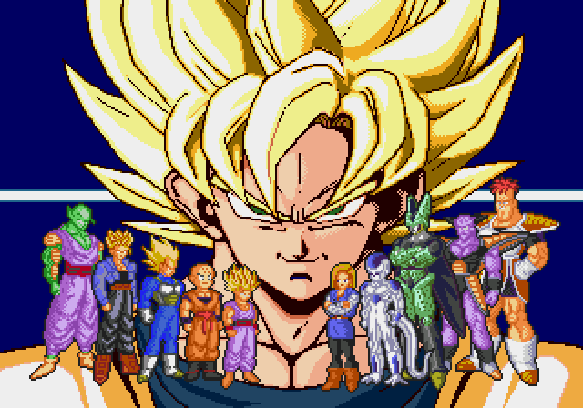
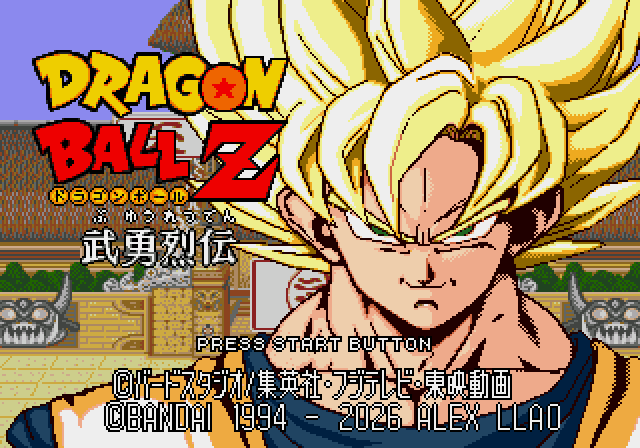

# Personajes pequeños originales y Goku cálido: v6.6

El usuario pide dejar los personajes pequeños de la intro como en el juego original. Se restauran sus tres bancos de paleta, los recursos originales y sus cuatro punteros de carga. Las propuestas anteriores se conservan como historial.

El Goku grande mantiene la paleta cálida C que el usuario vio bien. El título con BANDAI y ALEX LLAO queda exactamente como en v6.4/v6.5. Las paletas durante el combate y de los escenarios, las auras y la jugabilidad se conservan.

Se ha comprobado un arranque en frío en Genesis Plus GX, sin botones ni escrituras de RAM, hasta la transición al combate en el fotograma 2200. En el fotograma 960 todos los píxeles de la máscara original de personajes coinciden con la ROM original, y los de fuera de esa máscara coinciden con v6.5. Los fotogramas 720 y 1800 coinciden íntegramente con v6.5. No es una nueva prueba de partida completa ni de hardware original.

Construir: `pnpm build:review --rom ruta/a/original.bin`. Las revisiones históricas siguen disponibles con `--version`. Arrancar sin estados guardados de otra versión. El mapa ASM modificado de estudio entregado para v6.2 sigue siendo específico de aquella ROM.

[Manifiesto](../patches/review-v6-6/manifest.json) · [Restauración y verificaciones](../evidence/intro-original-lineup-v6-6/restoration.json).
