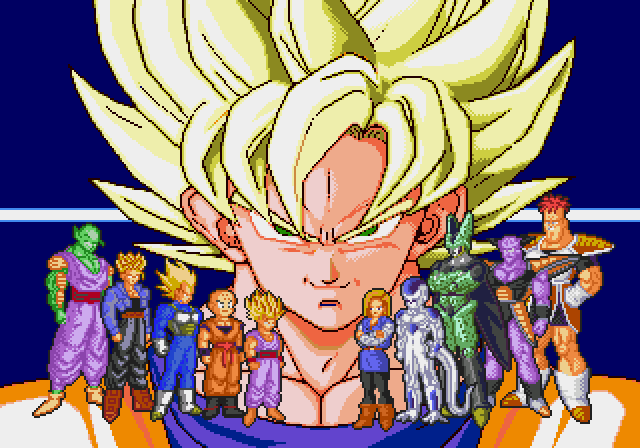
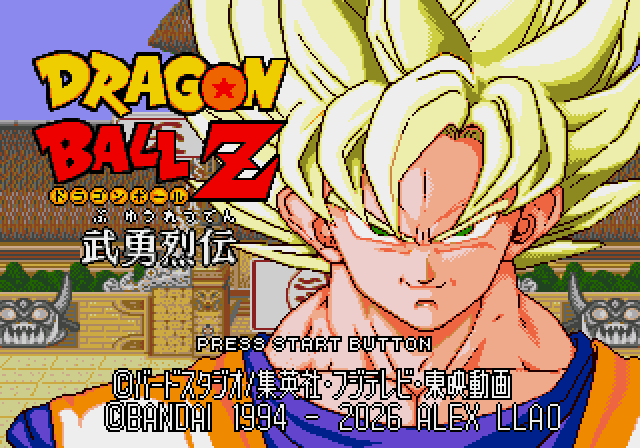

# Colores originales de presentación e intro: v6.3

El usuario pide volver a los colores originales para revisar el conjunto: la cara de Goku de la variante G le sigue pareciendo pálida. La elección anterior de G queda retirada. Las variantes y comparaciones históricas se conservan.

Se restauran las cuatro paletas de apertura y la de Goku en el título. El fondo del título recibe una copia independiente de su paleta original de 64 bytes: su cargador usa esa copia y el escenario del torneo conserva su paleta modificada durante los combates. También se restituyen los recursos y punteros originales del montaje de personajes, para que los colores correspondan a sus dibujos originales. Se mantienen los créditos de BANDAI y ALEX LLAO en la misma línea, con la fuente ajustada de v6.2.

Las capturas son arranques reales en Genesis Plus GX, sin botones ni modificaciones de RAM. El montaje de la intro coincide píxel a píxel con la ROM original en el fotograma 960. La parte del título situada por encima de los créditos coincide con el original en el fotograma 1800. Se alcanza la transición al combate sin bloqueo; no se ha repetido una sesión completa de juego.

Los colores de combate y escenarios, las auras y la jugabilidad del mod se conservan. El mapa ASM modificado de estudio entregado para v6.2 sigue correspondiendo a esa versión histórica; no debe tratarse como un mapa de v6.3.

Construcción actual: `pnpm build:review --rom ruta/a/original.bin`. Para conservar otra revisión se puede usar `--version v6.2`, `--version v6.1`, `--version v6` o `--version v5.2`. Arrancar sin cargar estados de otra ROM.

[Manifiesto](../patches/review-v6-3/manifest.json) · [Restauración y verificaciones](../evidence/intro-original-v6-3/restoration.json).
