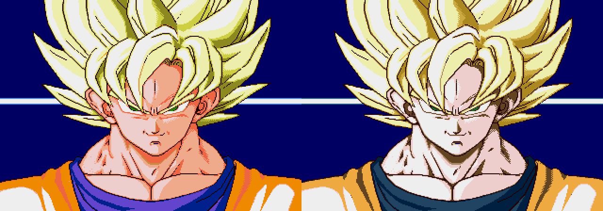
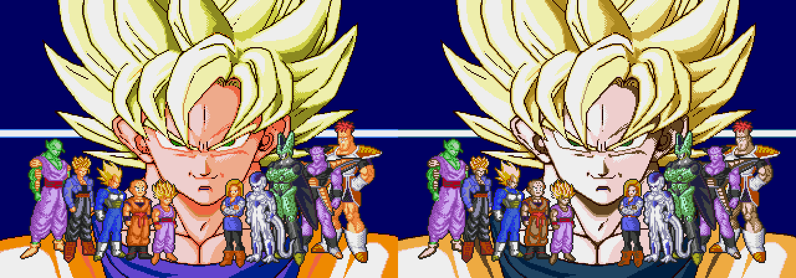

# Paleta G desde la primera pantalla: v6.1

> Revisión histórica: el usuario pidió restaurar los colores originales de la cara, presentación e intro. La versión actual es [v6.3](intro-original-v6-3.md); la aprobación anterior de G ya no está vigente.

**La cara grande de Goku queda aprobada. Los personajes completos no están aprobados:** el usuario pide que coincidan con las paletas de combate elegidas. La primera armonización de piel de v6.1 se conserva como historial y requiere revisión.

La cara de Goku que aparece al arrancar seguía naranja, aunque la pantalla de título posterior ya tenía la paleta G elegida. El juego carga dos copias distintas de esa paleta: la apertura usa `0x1ADDB2` y el título posterior usa `0x1ADE32`. La revisión v6 sólo había actualizado la segunda.

Ahora la primera cara utiliza exactamente los mismos quince colores visibles de G. Se conserva su entrada de fondo azul. También se adaptan seis entradas compartidas de piel de los personajes completos, usando las luces, medios tonos y sombras de esa misma cara. Los verdes, morados, blancos y negros propios de los personajes se conservan.

## Capturas reales: antes a la izquierda, después a la derecha

Son capturas de Genesis Plus GX desde un arranque en frío, con el mismo número de fotogramas y sin pulsar botones ni escribir en la RAM. La pantalla posterior del título, con Bandai y ALEX LLAO, coincide píxel a píxel con v6.

## Alcance

Cambian 31 bytes, incluido el checksum. No se cambian gráficos, mapas, animaciones ni código. El cambio de lado, el frenado con inercia, el reposo terrestre de 12 ticks y el ki v4 se conservan con los mismos bytes.

Las figuras de cuerpo completo comparten paletas; no disponen de una paleta independiente por personaje en esta escena. Las entradas de piel también pueden sombrear algunas botas o piezas de armadura. Esta revisión armoniza esa gama con la cara elegida sin rehacer los dibujos.

[Cambios exactos](../src/palettes/intro-v1/changes.json) · [Rutas de carga originales](../evidence/intro-v1/static-source.json) · [Verificación del arranque y paletas](../evidence/intro-v1/validation.json).

Esta revisión histórica se genera con `pnpm build:review --rom ruta/a/original.bin --version v6.1`. La versión predeterminada actual es [v6.2](intro-characters-v2.md). Las anteriores se conservan con `--version v6` o `--version v5.2`. Arranca sin cargar estados guardados de otra ROM.
