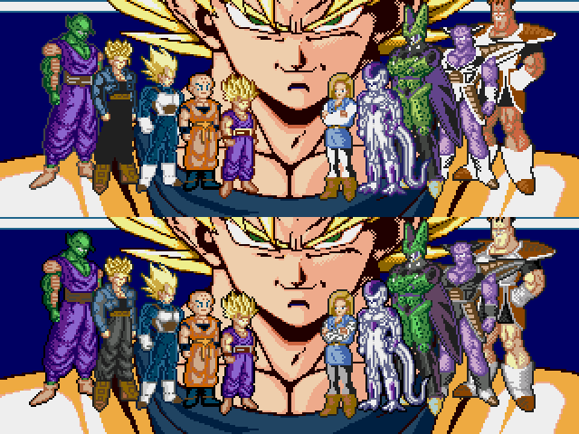
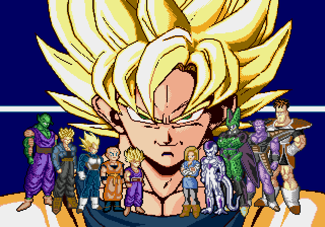

# Personajes completos de la apertura: corrección v6.5

El usuario ve bien el Goku grande de v6.4, pero señala errores en los personajes pequeños. **Goku y el título con BANDAI y ALEX LLAO se conservan exactamente.** Esta corrección del reparto sigue pendiente de valoración visual.

## Comparación real: antes arriba, después abajo

La conversión anterior había fusionado sombras de pantalones y armaduras: algunos grises pasaron a negro o a blanco. Eso reducía la legibilidad de Trunks, Vegeta, Ginyu, A18 y Recoome aunque los colores pertenecieran a sus paletas de combate. Se recuperan esas gamas de gris en lugar de aplanarlas.

Para encajar la escena se armonizan pequeños tonos de contorno casi negros y detalles secundarios. Cell comparte los verdes de Piccolo, manteniendo una gama de tres tonos. Recoome usa la gama humana de piel de otros personajes del mod para separar luces, medios tonos y sombras. Son adaptaciones específicas de esta pantalla, no cambios en los personajes durante el combate.

La escena usa 41 colores de cuerpo repartidos en tres bancos. El blanco y el gris oscuro se duplican en los bancos para reducir la necesidad de capas. Se usan 673 de 768 tiles. En el arranque real se alcanzan 75 de 80 sprites, 17 de 20 por línea y 280 de 320 píxeles por línea. Los píxeles opacos y las siluetas originales se conservan: no se ha redibujado la anatomía.

## Verificación y límites

En los fotogramas 960, 1080 y 1200 los cambios de imagen quedan dentro de la máscara original del reparto. Los fotogramas 720, 840 y 1800 son idénticos a v6.4. La captura real de cada personaje coincide con el objetivo de color documentado, sin diferencias de RGB.

Las paletas de combate y escenarios, los bloques de controles y cambio de lado y los recursos del crédito permanecen iguales. El arranque se comprobó sin botones ni escrituras de RAM durante 2000 fotogramas; no es una nueva prueba de partida completa ni de hardware original. El mapa ASM modificado de estudio entregado para v6.2 corresponde a aquella ROM.

Construir: `pnpm build:review --rom ruta/a/original.bin`. Versiones anteriores disponibles con `--version v6.4`, `--version v6.3` y las demás opciones históricas. Arrancar sin estados guardados de otra revisión.

[Operaciones y colores](../src/intro/body-refined-v1/operations.json) · [Verificación nativa](../evidence/intro-refined-v6-5/validation.json) · [Manifiesto](../patches/review-v6-5/manifest.json).
