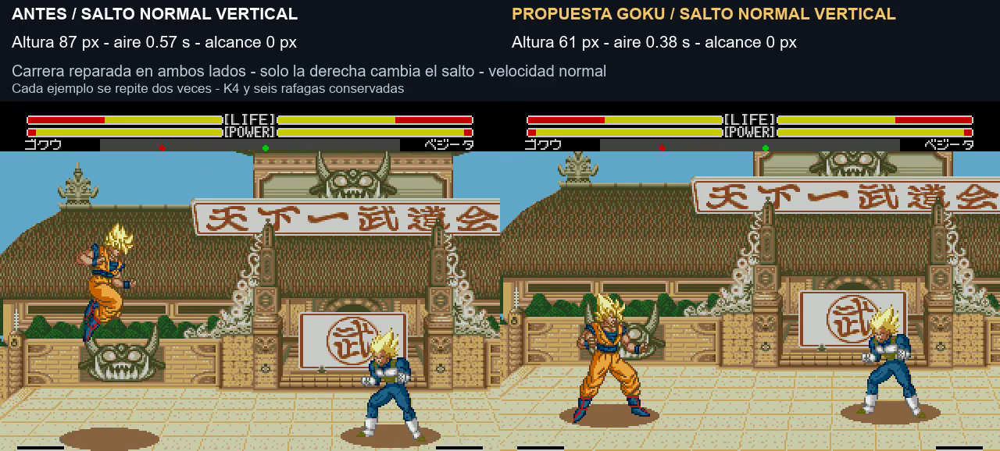

# Prueba de dos saltos: solo Goku

**8/11/2026 · v1.0 build 20261108-143706 · pendiente de valoración.** Parte de K4 con las seis ráfagas aprobadas. Salto normal más bajo y corto; desde carrera, más alcance horizontal conservando la altura anterior. No se añaden botones, comandos de especiales ni dibujos nuevos.

[Vídeo simultáneo, con sonido](../assets/media/jump-two/comparacion.mp4) · [Manifiesto](../patches/jump-two/manifest.json) · [Pruebas](../evidence/jump-two/validation.json)

| Toma del vídeo | Antes | Propuesta |
|---|---:|---:|
| Normal vertical: altura |87 px|61 px|
| Normal vertical: tiempo en aire |0,57 s|0,38 s|
| Diagonal normal: alcance |157 px|109 px|
| Desde carrera: altura |87 px|87 px|
| Desde carrera: alcance |218 px|267 px|
| Desde carrera: tiempo en aire sin ataque |0,60 s|0,60 s|

En una medición con más espacio libre, el diagonal anterior recorre 164 px y el de carrera 213 px; rival, límites y fase de motor pueden variar los valores de la toma. No se mezclan esas medidas con las del vídeo.

## Uso y corrección de carrera

**Arriba**, parado o caminando: salto normal. **Doble toque adelante o atrás, mantener la dirección y saltar**: salto largo. No hace falta otro botón. El modo se elige con la marca nativa de carrera; no se fuerza con una modificación de RAM durante la grabación.

La secuencia de doble toque comprobada en el build aprobado seguía produciendo caminar. Se recupera el reconocimiento para Goku humano en ambos mandos. La corrección está **en ambos lados del vídeo**: la izquierda conserva los parámetros anteriores de salto y la derecha aplica los nuevos. Así el ejemplo de carrera compara dos carreras reales. La ROM base aprobada se conserva aparte; no se oculta que esta prueba incluye también esa reparación. La ventana de doble toque se guarda en F740..F74F y se limpia al reiniciar ronda. No se amplía este ajuste de carrera al resto de personajes en esta prueba.

## Curvas y animación

El salto normal de Goku pasa a una duración nominal de 22 unidades y el de carrera conserva 33 antes del escalado nativo. La altura normal se reduce a 7/10 de la anterior; la de carrera mantiene aproximadamente 87 px. El recorrido diagonal normal se escala a 2/3 y el de carrera a 5/4. Las rutas horizontales hacia delante y atrás reciben el mismo criterio solo para Goku.

La altura se describe mediante una parábola ligada al avance de la secuencia del motor. **Es un ajuste de arco, alcance y duración, no la sustitución de todo el juego por un motor físico.** Se mantienen sus estados, ataques y pausas. Los ataques en el aire pueden prolongar la permanencia: en la toma con patada desde carrera, se observan 0,65 s antes y 0,77 s después, sin daño al rival. No se afirma que cualquier ataque conserve el mismo tiempo de vuelo.

Las poses y las técnicas existentes se conservan. Los cuadros del vídeo usan la misma secuencia de mando y el mismo estado inicial compatible; cada ejemplo se repite dos veces a velocidad normal. No se ralentiza ni acelera el juego en la edición. Los rótulos expresan alturas y recorridos leídos de las coordenadas del juego. El audio procede de la propuesta.

## Comprobaciones y límites

40 casos por variante, en los dos mandos y sentidos: vertical, diagonales, carrera hacia delante/atrás, A/B aéreos, A/B desde carrera y C hacia vuelo. Todos los saltos probados terminan en el suelo y reposo; C mantiene el paso al vuelo a Y160. No se fuerzan daño, reacciones ni colisiones para grabar.

Se contrastaron siete personajes ajenos a Goku: Gohan, Piccolo, Vegeta, Cell, A18, Krilin y Recoome. Seis conservan la traza completa idéntica. A18 conserva la secuencia de posiciones/programas al eliminar frames repetidos, con un frame de diferencia de sincronización en la toma; no se cambian sus datos de salto. Trunks, Freezer y Ginyu no se incluyeron en esta regresión dinámica.

Las seis ráfagas vuelven a emitir cinco bolas y contar cinco impactos en el caso medio; las rutinas y datos de ráfagas y los datos de derribo K4 son idénticos byte a byte a la base aprobada. La tabla compartida de distancias no se modifica. Los arcos de los Meteor no se ajustan y no se añade vibración.

Pendiente: valoración con mando, colisiones en más situaciones, equilibrio de ataques aéreos, IA, turbo y consola original. Las pruebas acotadas no certifican ausencia de infinitos ni garantizan la misma sensación con cualquier entrada. No se promueve esta prueba como aprobada hasta recibir valoración.

Construcción: `pnpm build:review --rom ruta/a/original.bin --version jump-two`. El repositorio contiene IPS, ASM propio, evidencia y vídeo. La ROM completa queda en el paquete local de pruebas. [Ráfagas aprobadas](barrage-roster.md) · [K4 aprobada](knockdown-k4.md). Los experimentos G1/G2 anteriores siguen como historial sin considerarse aceptados.
