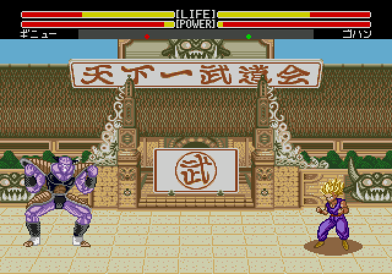

# Ki por personaje: colores v4 para validar

Los once vídeos son grabaciones reales de la ROM de prueba. Cada secuencia muestra carga, retirada y vuelta al movimiento. El contorno C2 v3 aceptado, su tamaño y el polvo se conservan; **ningún personaje tiene rayos de aura**. Falta la aprobación visual de estas paletas concretas.

[Recopilación antes/después](../assets/media/ki-colores-v4/Ki-todos-antes-despues.mp4) · [Las once salidas a cámara lenta](../assets/media/ki-colores-v4/Salida-ki-todos-lenta.mp4) · [Descargar y abrir la galería](../assets/media/ki-colores-v4/Validacion-ki.html)

| Personaje | Color de esta prueba | Vídeo |
| --- | --- | --- |
| Goku SSJ | Dorado | [Antes/después](../assets/media/ki-colores-v4/00-Goku-SSJ.mp4) · [Sólo nuevo](../assets/media/ki-colores-v4/Solo-nuevo/00-Goku-SSJ.mp4) |
| Gohan SSJ2 | Dorado | [Antes/después](../assets/media/ki-colores-v4/01-Gohan-SSJ2.mp4) · [Sólo nuevo](../assets/media/ki-colores-v4/Solo-nuevo/01-Gohan-SSJ2.mp4) |
| Piccolo | Blanco azulado | [Antes/después](../assets/media/ki-colores-v4/02-Piccolo.mp4) · [Sólo nuevo](../assets/media/ki-colores-v4/Solo-nuevo/02-Piccolo.mp4) |
| Vegeta SSJ | Dorado | [Antes/después](../assets/media/ki-colores-v4/03-Vegeta-SSJ.mp4) · [Sólo nuevo](../assets/media/ki-colores-v4/Solo-nuevo/03-Vegeta-SSJ.mp4) |
| Trunks SSJ | Dorado | [Antes/después](../assets/media/ki-colores-v4/04-Trunks-SSJ.mp4) · [Sólo nuevo](../assets/media/ki-colores-v4/Solo-nuevo/04-Trunks-SSJ.mp4) |
| Cell | Dorado | [Antes/después](../assets/media/ki-colores-v4/05-Cell.mp4) · [Sólo nuevo](../assets/media/ki-colores-v4/Solo-nuevo/05-Cell.mp4) |
| A18 | Blanco azulado | [Antes/después](../assets/media/ki-colores-v4/06-A18.mp4) · [Sólo nuevo](../assets/media/ki-colores-v4/Solo-nuevo/06-A18.mp4) |
| Krilin | Blanco | [Antes/después](../assets/media/ki-colores-v4/07-Krilin.mp4) · [Sólo nuevo](../assets/media/ki-colores-v4/Solo-nuevo/07-Krilin.mp4) |
| Freezer | Blanco azulado | [Antes/después](../assets/media/ki-colores-v4/08-Freezer.mp4) · [Sólo nuevo](../assets/media/ki-colores-v4/Solo-nuevo/08-Freezer.mp4) |
| Recoome | Blanco y violeta | [Antes/después](../assets/media/ki-colores-v4/09-Recoome.mp4) · [Sólo nuevo](../assets/media/ki-colores-v4/Solo-nuevo/09-Recoome.mp4) |
| Ginyu | Lila | [Antes/después](../assets/media/ki-colores-v4/10-Ginyu.mp4) · [Sólo nuevo](../assets/media/ki-colores-v4/Solo-nuevo/10-Ginyu.mp4) |

La izquierda usa el efecto de ki nativo junto a Jugabilidad v1 y Colores v1. No es la ROM intacta en todos sus apartados. La derecha usa el nuevo contorno con colores individuales. Las tomas se arrancan por separado y reciben la misma secuencia de botones; no se afirma una alineación exacta de cada pose entre motores de carga gráfica. Los vídeos no tienen audio. La retirada lenta es reproducción al cuarto de velocidad, identificada en pantalla.

## Pruebas realizadas

- Once cargas completas con su retirada y desplazamiento posterior. Las 176 muestras de paleta y atlas coinciden con lo previsto; las 2860 muestras de las grabaciones respetan los límites de dibujo registrados.
- Cuatro arranques adicionales verifican las paletas corporales y gráficos de Recoome, A18 y Ginyu, incluidos combates espejo: 1540 fotogramas, 3080 muestras de actor, cero discrepancias observadas frente a los colores corporales aceptados.
- Dos parejas con auras distintas comprueban P2, cargas simultáneas, repetidas y separación/vuelo. En 1430 muestras normales, los atlas coinciden, el polvo se omite en el aire y los máximos observados son 78/80 sprites, 18/20 por línea y 232/320 píxeles por línea.
- Los 768 punteros de estados usan la misma geometría y píxeles de contorno que la fuente aceptada, con los índices de color reasignados. No se añaden rayos.
- Las regiones de geometría, rutinas de colisión y selección de golpe cercano/lejos examinadas conservan sus bytes originales.

## Implementación y límites

Se reservan dos atlas de llama, uno por jugador. A18 y Recoome reasignan índices de colores equivalentes para conservar el aspecto corporal y disponer de un tono para el aura. Ginyu aprovecha dos índices no utilizados por sus poses corporales verificadas. Recoome conserva sus gráficos alternativos originales cuando ambos jugadores lo eligen.

La ROM se amplía a **4 MiB** para almacenar los recursos. La memoria gráfica adicional incluye una zona que no usan los mapas de los nueve escenarios, pero sí un efecto temporal nativo. Se conserva ese cargador y se difiere la restauración del aura hasta que sus dos indicadores de escena se desactivan.

Los dos efectos temporales se han ejecutado con estados sintéticos controlados y sus gráficos se conservan mientras están activos. La restauración posterior se ha comprobado **forzando y declarando una transición a estado normal**. No se ha validado en esta revisión el último fotograma de un especial completo iniciado naturalmente. Tampoco es una prueba exhaustiva de todas las técnicas, escenarios, modos, turbo o hardware físico. Es un prototipo para validar el ki, no una ROM final del proyecto.

No incorpora todavía presentación G, crédito, retratos de selección, HUD H4 ni el escenario nevado.

## Construcción y evidencia

`pnpm build:auras:v4 --rom ruta/a/original.bin`

[Manifiesto](../patches/auras-c2-v4/manifest.json) · [Fuente de ensamblador](../src/auras/c2-v4/aura.asm) · [Recursos](../src/auras/c2-v4/resources.json) · [Vídeos y sus hashes](../evidence/auras-c2-v4/validation.json) · [Cuerpos y alternativas](../evidence/auras-c2-v4/character-runtime.json) · [Dos colores simultáneos y efectos temporales](../evidence/auras-c2-v4/mixed-runtime.json) · [Análisis de memoria gráfica](../evidence/auras-c2-v4/vram-extra.json) · [Referencias del anime](aura-color-references.md).
