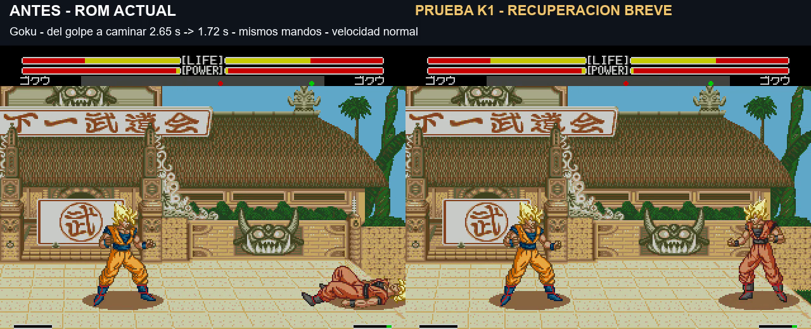

# Derribos K1: caída y recuperación más breves

**Comentario del usuario:** la incorporación parece un poco demasiado rápida. Se conserva K1 como referencia; [K2 alarga únicamente la incorporación](knockdown-k2.md), pendiente de validar.

Prueba del 7 de noviembre de 2026, pendiente de validación visual del usuario. **La ROM principal 174207 no cambia.** Se pidió recortar bastante el tiempo sin control después de un derribo y mostrar vídeos antes/después.

[Comparación simultánea real — 19 segundos](../assets/media/knockdown-k1/comparacion.mp4) · [Manifiesto K1](../patches/knockdown-k1/manifest.json) · [Pruebas y tiempos](../evidence/knockdown-k1/validation.json)

## Resultado de las grabaciones

Tiempo desde el impacto hasta el primer desplazamiento voluntario del personaje derribado. Ambos lados reciben el mismo barrido de Goku y mantienen la misma dirección hacia el centro desde el cuadro 20. No se acelera ni ralentiza el vídeo.

| Personaje derribado | ROM actual 174207 | Prueba K1 |
|---|---:|---:|
| Goku |2,65s|1,72s|
| Trunks |2,39s|1,64s|
| Piccolo |2,82s|1,85s|
| Cell |2,85s|1,74s|
| Recoome |2,84s|1,89s|

El vídeo incluye la caída, el rebote, la incorporación y el movimiento posterior. Sonido del lado derecho. La duración no es una constante garantizada: depende de la animación y la sincronización del motor. En las mediciones separadas con dirección introducida al empezar a levantarse, los once personajes pasan de 2,37–2,90s a 1,55–1,84s. En el vídeo, mantener la dirección antes produce valores ligeramente distintos, consignados arriba.

## Cambios de la variante

Se modifican solo datos de reacciones normales en el suelo A1/A4/A5 y de incorporación BF/C0/C1/C2. La unidad temporal de derribo pasa de 6 a 4 y se acortan las últimas fases de espera. Las incorporaciones usan unidad 3, conservando las tres poses originales. Los marcadores que esperan a la llegada al suelo se mantienen.

El movimiento nativo recalcula su desplazamiento con esa unidad temporal: la caída y el rebote ocurren más deprisa dentro de la ROM. No es una edición que simplemente elimine cuadros del metraje. No introduce el modelo G1/G2 de saltos. El daño de cada toma coincide con la base y siguen fuera las sacudidas añadidas de Meteor.

Volver antes al control también termina antes la protección que el juego liga al estado de derribo/incorporación. No se añaden cuadros nuevos de invulnerabilidad. Queda pendiente valorar la presión del rival al levantarse y el equilibrio en combate.

## Verificación

33 mediciones: once personajes, tres fases iniciales del mando. Otras 9 comprueban Goku/Piccolo/Cell derribados desde el primer mando, cubriendo las tres familias de reacción. En las 42 mediciones, el personaje llega al estado de incorporación con Y de suelo y conserva las tres poses de levantarse. Se comprueba el primer movimiento voluntario con dirección hacia el centro, evitando que una pared falsee el resultado.

Las 33 primeras usan una cabecera interna de laboratorio. Sus bytes desde 0x200 hasta el final son exactamente los de la entrega K1 identificada; nueve mediciones del primer mando y las cinco grabaciones usan la ROM final. Los dos hashes y la comprobación de equivalencia quedan guardados.

Alcance: un barrido normal de Goku a velocidad normal en emulador. No es una auditoría de todos los agarres, Meteor, reacciones aéreas, KO, turbo ni consola original. Esos casos y el combate prolongado necesitan revisión antes de convertir K1 en la versión principal.

## Identificación

**v1.0 K1 build 20261107-094832**, 7 de noviembre de 2026, 09:48:32 Madrid. Cabecera UTC 08:48Z. Arrancar desde cero, a velocidad normal, sin estados de otras versiones.

`pnpm build:review --rom ruta/a/original.bin --version knockdown-k1`

IPS, cambios de datos, scripts y evidencia conservados. Los scripts dependen del laboratorio local; no distribuyen ROM completa ni emulador.
