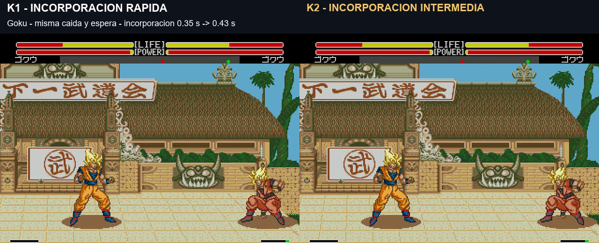

# K2: incorporación intermedia

El usuario considera que en K1 se levantan un poco demasiado rápido. K2 conserva la caída, el rebote y la espera corta de K1, y alarga únicamente la animación de incorporarse. **Pendiente de validación visual. La ROM principal 174207 no cambia.**

[Vídeo K1 a la izquierda / K2 a la derecha — 19 s](../assets/media/knockdown-k2/comparacion.mp4) · [Manifiesto](../patches/knockdown-k2/manifest.json) · [Verificaciones](../evidence/knockdown-k2/validation.json)

| Personaje | Incorporarse K1 | Incorporarse K2 | Del golpe a caminar K2 |
|---|---:|---:|---:|
| Goku |0,35s|0,43s|1,82s|
| Trunks |0,33s|0,42s|1,70s|
| Piccolo |0,37s|0,43s|1,92s|
| Cell |0,30s|0,38s|1,82s|
| Recoome |0,38s|0,43s|1,94s|

Son valores de las tomas, a velocidad normal y con sonido del lado derecho. Se parte de los mismos estados nativos compatibles para aislar el ajuste. Las posiciones, programas, cursores y daño del rival coinciden en todos los cuadros hasta el inicio de la incorporación de las cinco parejas. No hay cambio de velocidad en la edición.

Solo cambian las cuatro duraciones BF/C0/C1/C2: unidad base 3→4. Las poses y sus pesos se conservan. A1/A4/A5, datos de caída/rebote, espera y todo el código permanecen como en K1. La variación medida depende también de la sincronización y escalado temporal del motor.

Once comprobaciones adicionales, una por personaje, verifican llegada al suelo, las tres poses de incorporación y movimiento posterior. Alcance: un barrido normal en emulador a velocidad normal; otros golpes, turbo, hardware y presión al levantarse siguen pendientes. La protección asociada al estado de incorporación dura algo más que en K1; no se añade un mecanismo nuevo de invulnerabilidad.

**v1.0 K2 build 20261107-100046**, 7 de noviembre de 2026, 10:00:46 Madrid. Cabecera UTC 09:00Z. Arrancar desde cero y sin estados anteriores.

`pnpm build:review --rom ruta/a/original.bin --version knockdown-k2`

K1 se conserva para comparar y la versión principal sigue siendo 174207. Los scripts de investigación dependen del laboratorio local; no distribuyen ROM completa ni emulador.
