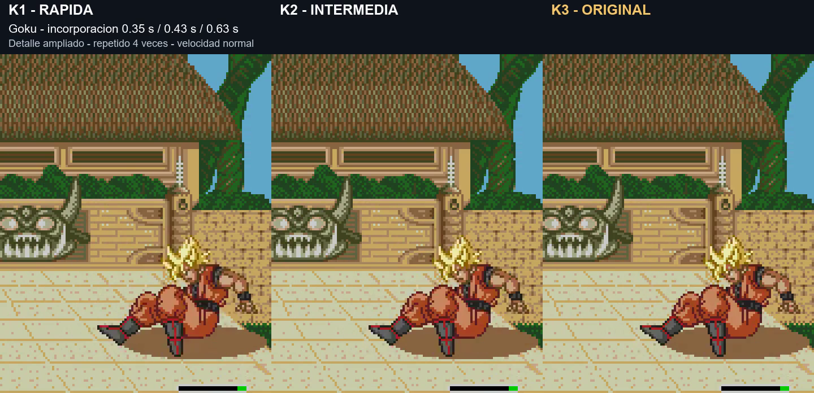

# K3: incorporación con tiempos originales

K2 no mostraba una diferencia suficiente para el usuario. En lugar de otro ajuste de pocas centésimas, K3 recupera los datos originales de duración de incorporación BF/C0/C1/C2 y mantiene la caída, rebote y espera corta de K1. **Prueba pendiente de validar; principal 174207 sin cambios.**

[Vídeo: juego y detalle ampliado K1/K2/K3](../assets/media/knockdown-k3/comparacion.mp4) · [Manifiesto](../patches/knockdown-k3/manifest.json) · [Pruebas](../evidence/knockdown-k3/validation.json)

| Incorporación de la toma | K1 rápida | K2 intermedia | K3 original |
|---|---:|---:|---:|
| Goku |0,35s|0,43s|0,63s|
| Cell |0,30s|0,38s|0,53s|

Del golpe a caminar, K3 tarda 2,02s con Goku y 1,97s con Cell en estas tomas, frente a unos 2,65/2,85s de la ROM principal. Los tiempos medidos pueden variar por la sincronización del motor aunque los datos de incorporación coincidan con los originales.

El vídeo muestra primero K2/K3 con la pantalla completa y después las tres incorporaciones ampliadas, repetidas cuatro veces a velocidad normal. Los recortes y ampliación solo facilitan ver el gesto. No hay cámara lenta ni aceleración de las animaciones en la edición. Sonido de K3. Se usan los mismos estados iniciales compatibles, posiciones y mandos; las trazas coinciden hasta empezar a incorporarse.

Los originales BF/C0/C1/C2 se copian exactamente desde 174207. Sus duraciones son 24/30/24/30; las poses no cambian. A1/A4/A5 permanecen como en K1. Trunks y Ginyu ya usaban la duración original BF en K2; para ellos no se pretende un cambio adicional frente a K2.

Se comprobaron los once personajes con el barrido normal: llegada al suelo, tres poses de incorporación y movimiento posterior. La espera y la protección asociada al estado de incorporación duran más que en K1/K2 para quienes usan C0/C1/C2. No se inventa otro sistema de invulnerabilidad.

Pendientes: otros tipos de derribo, turbo, consola real y presión prolongada al levantarse. La versión principal no se sustituye sin valorar esta prueba.

**v1.0 K3 build 20261107-101421**, 7 de noviembre de 2026, 10:14:21 Madrid. Cabecera UTC 09:14Z. Arrancar desde cero a velocidad normal y sin estados anteriores.

`pnpm build:review --rom ruta/a/original.bin --version knockdown-k3`

Scripts de laboratorio y evidencia conservados; dependen del entorno local y no distribuyen ROM completa ni emulador.
