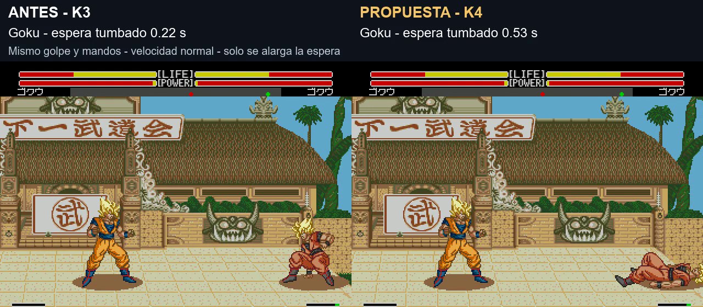

# K4: más espera tumbado antes de levantarse

El usuario aclara que quiere alargar **la espera tumbado**, no el gesto de incorporarse. K2/K3 estaban ajustando la fase equivocada para esa sensación. K4 parte de K3 y añade tiempo exclusivamente a la última pose de suelo de A1/A4/A5, manteniendo sus segmentos anteriores y los datos de incorporación BF/C0/C1/C2.

[Comparación simultánea K3/K4](../assets/media/knockdown-k4/comparacion.mp4) · [Manifiesto](../patches/knockdown-k4/manifest.json) · [Mediciones](../evidence/knockdown-k4/validation.json)

| Espera desde quedar definitivamente en el suelo hasta empezar a levantarse | Antes K3 | Propuesta K4 |
|---|---:|---:|
| Goku |0,22 s|0,53 s|
| Cell |0,20 s|0,52 s|

Tomas reales a velocidad normal, mismo estado inicial y mandos. Caída, rebote y posición coinciden hasta el momento en que K3 empieza a levantarse. Cada toma se repite dos veces. No se ralentiza el vídeo. La imagen compara el mismo instante: Goku de K3 ya se está incorporando y el de K4 sigue tumbado.

En once personajes con el barrido de Goku a velocidad normal, la espera aumenta 18–19 fotogramas del emulador (aproximadamente 0,30–0,32 s). Los arranques independientes pueden diferir en 1–2 fotogramas de fase; las dos comparaciones de vídeo usan estados idénticos. Los datos del gesto de levantarse son idénticos a K3, aunque su duración medida puede variar unos fotogramas por el motor. No se atribuye esa variación a un cambio deliberado del gesto.

Cambio de datos: último peso de A1/A4/A5 +4; cabecera de duración +16 para conservar la unidad nativa de 4. Marcador aéreo, pesos anteriores y poses sin cambios. Cabecera identificada como **v1.0 K4 build 20261107-102624**. El código de daño, hitstop y filtros de colisión permanece igual. Como la protección nativa depende del estado de reacción, alargar la espera también prolonga ese estado: no se garantiza una protección independiente idéntica.

**Pendiente de validación del usuario. La ROM principal 20261106-174207 sigue igual.** Se conserva K3 como historial. No se ha probado turbo, consola real, presión prolongada ni otros derribos; A4 se modifica por la estructura de sus datos pero el barrido usado no activa esa rama.

Construcción: `pnpm build:review --rom ruta/a/original.bin --version knockdown-k4`. El repositorio distribuye el parche IPS y evidencia, sin ROM completa.
