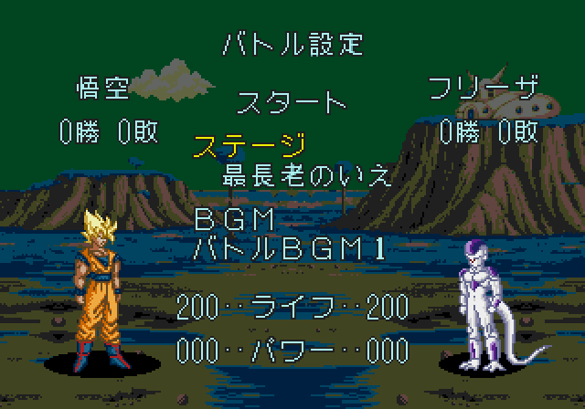
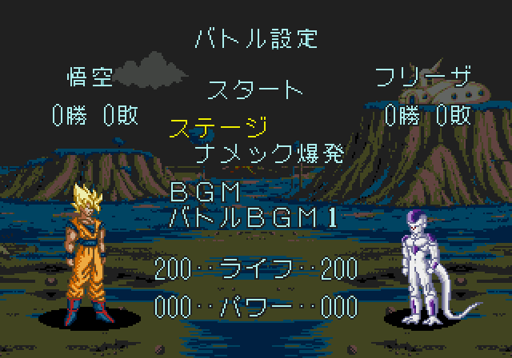
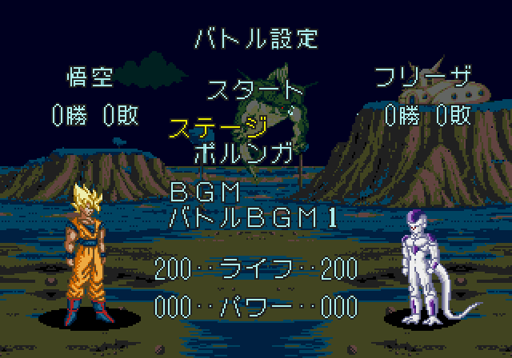

# Tres Namek extra con nombres japoneses nativos

10 de noviembre de 2026 · v1.0 build `20261110-173703`. Se sustituyen NUEVO/RUINAS/DRAGON por nombres japoneses usando **el cargador de texto y los glifos originales del juego**, con su tamaño, contorno y colores. No se usa una fuente de PC ni texto superpuesto a las capturas.

| Nombre en el selector | Escenario |
| --- | --- |
| 最長老のいえ | Casa del Gran Patriarca |
| ナメック爆発 | Namek en explosión, variante devastada |
| ポルンガ | Namek nocturno con Porunga |

Los **nueve escenarios originales y los tres extra** siguen disponibles. [Namek original en el mismo selector](../assets/media/menu-japanese/original.png). Las tres variantes conservan los gráficos R10 aceptados. También se mantiene íntegro el cambio de [cargas mínimas dentro del combo](combo-charge-all.md) del build120502; esta revisión solo cambia la presentación de los nombres y la identificación del build.

## Implementación y comprobaciones

La ruta de los extras deja de copiar un atlas latino propio mediante1780 y llama al cargador nativo1FEE, igual que los escenarios originales. Los recursos usan palabras del diccionario de fuentes original; ポ y ガ se componen con el modo4 y la tabla6A44 del juego. Se mantienen las seis celdas reservadas de16×16: las sobrantes se rellenan con un glifo vacío original para no dejar letras del nombre anterior.

Se comprueba el recorrido por las doce entradas y la vuelta al punto inicial, entrada al combate en los tres fondos, y selección de Porunga en P1–CPU, dos jugadores y CPU–CPU. Las capturas se obtienen con botones desde el menú nativo. No se escriben IDs de escenario ni se dibujan rótulos fuera de la ROM. Los recursos de los tres fondos, fuentes originales y código de combate —incluido el nuevo ajuste de cargas— permanecen byte a byte iguales al padre. Consola física y valoración del usuario, pendientes.

ROM y capturas locales en `outputs/Selector-Namek-japones/`. Archivo de juego: `DBZ_Enhanced_v1.0_Namek_JP_build_20261110-173703.bin`. Arrancar desde cero y conservar la versión anterior. SHA-256 `666135fff3069ecd06d25bab945b43970d929fea5d3493b88ff1fe6a54ca1f7f`.

El [IPS](../patches/menu-japanese/manifest.json) es un delta sobre la ROM de cargas en combo `20261110-120502`, SHA-256 `7c35a85d50855b7b33868b8111158fc86a2cc9a57732e2bf6e7d1595af107d32`; no se aplica a la ROM comercial original. Se reaplica y verifica cada byte del resultado al empaquetar. La ROM no se añade al repositorio.

[Fuente del cambio](../research/menu-japanese/build.py) · [Recorrido y combates](../evidence/menu-japanese/validation.json) · [Tres modos nativos](../evidence/menu-japanese/validation-modes.json) · [Procedencia de capturas](../evidence/menu-japanese/captures.json).
