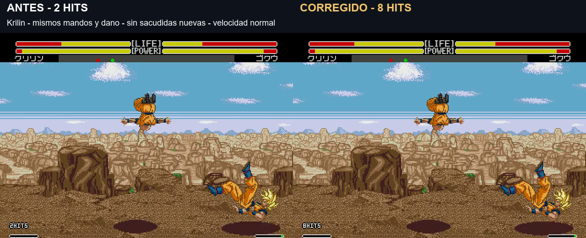

# Revisión de HITS de todos los Meteor · v1.0 build 20261106-174207

Corrige contactos omitidos en Krilin, Freezer, A18 y Trunks. **Sin las sacudidas añadidas de la prueba Impact**: retiradas por petición del usuario. Se conserva únicamente la vibración nativa del juego. No se incluyen las propuestas G1/G2 de gravedad.

[Vídeo real antes/después y ejemplos de Cell — 44 s](../assets/media/release-v1-0-build-20261106-174207/Meteor-HITS-corregidos-y-Cell-11-13.mp4) · [Manifiesto](../patches/release-v1-0-build-20261106-174207/manifest.json) · [Validación](../evidence/release-v1-0-build-20261106-174207/validation.json)

## Contactos revisados

| Meteor completo de la prueba | HITS antes | HITS actuales | Daño conservado |
|---|---:|---:|---:|
| Goku |3|3|35|
| Gohan |5|5|34|
| Piccolo |9|9|43|
| Vegeta |8|8|49|
| Trunks |2|3|40|
| Cell, Needle Rush contra Goku con 200 HP |13|13|78|
| A18 |2|3|33|
| Krilin |2|8|32|
| Freezer, Tail Buster |2|3|32|
| Recoome |2|2|36|

Estos son resultados de secuencias completas en las condiciones registradas, no números asignados por pulsar el comando. Se suma al ejecutar cada contacto confirmado. Ginyu intercambia cuerpos: no se añaden golpes ficticios a ese movimiento.

Krilin tenía seis reacciones intermedias de la víctima que no pasaban por el contador. Se registran una a una; la reacción final 3F y el daño final no vuelven a sumarse como otro golpe. Freezer añade el contacto 3B, conservando el remate 55 ya cubierto por el motor. A18 añade el contacto de fase 4 y conserva la fase 6 final sin duplicarla. Trunks registra su contacto intermedio con la víctima capturada.

Las condiciones exigen el programa correcto de atacante y víctima. Los puntos nativos ya protegen el contacto con CB.0 o un avance de fase; no se inventan golpes por poses, botones, auras, sonidos ajenos a esos puntos o sacudidas.

## Cell: por qué pueden verse 11 o 13

En las pruebas con Goku a 200 HP, Needle Rush conecta 13 veces: cada proyectil quita 6 y se observa 78 de daño. El contador coincide con esas 13 pérdidas de vida. Se probaron 18 variantes de guardia mantenida/liberada, que en estos casos no interrumpieron la secuencia capturada: siguieron conectando 13. No se ha usado esa variación de guardia para justificar el 11.

Se preparó después una situación natural con Goku a 63 HP, recibiendo golpes antes de grabar. El Meteor conecta diez proyectiles de 6 y un último de 3, que provoca KO. Resultado: **11 contactos y 11 HITS**, sin contar proyectiles después del KO. No se escribe vida durante el ataque ni se fija el contador a 11/13.

Esto demuestra una causa válida de 11 frente a 13, pero no establece que fuera la causa de la observación anterior del usuario. Si ocurrió con el rival vivo al terminar, se necesita reproducir ese caso concreto.

## Pruebas y alcance

**120 casos:** diez Meteor × dos orientaciones × acierto/guardia/distancia × dos mandos. Segundo mando desde arranque nuevo para cada pareja; ki y vida crítica mediante acciones nativas. Las condiciones de guardia registran daño reducido cuando corresponde, sin convertirlo en un HIT. El contador de Cell se contrasta con los impactos de daño completo; el ejemplo de KO incluye también el último impacto parcial.

Daño, animaciones, tablas temporales, lectura del mando y reglas de stun sin cambios. La ROM parte de 124607, sin el módulo Impact ni sus hooks de vídeo/interrupción. La revisión del modelo de gravedad y la auditoría general de stun/ventanas de combo siguen pendientes. Validado en Genesis Plus GX a velocidad normal; falta turbo, consola original y combinaciones extensas entre técnicas.

## Compilación

**v1.0 build 20261106-174207**, 6 de noviembre de 2026, 17:42:07 Madrid. Cabecera UTC: 16:42Z. Arrancar desde cero, a velocidad normal, sin estados anteriores.

`pnpm build:review --rom ruta/a/original.bin --version v1.0`

El código propio comentado, IPS, pruebas y vídeo se conservan en el repositorio. Los scripts de investigación dependen del laboratorio local; no incluyen ROM completa ni emulador.
