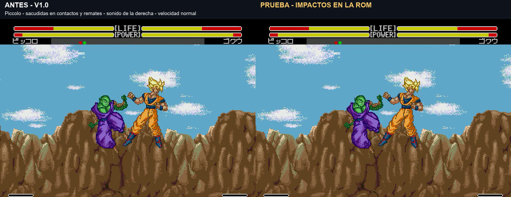

# Impacto de los Meteor dentro de la ROM

**DESCARTADA por petición del usuario el 6/11/2026.** No percibía la sacudida y pidió quitarla. La [ROM actual 174207](meteor-hits-v2.md) conserva solo la vibración original; este documento y vídeo quedan como historial.

Prueba solicitada el 6 de noviembre de 2026: una sacudida en cada contacto del Meteor, para todos los personajes que tienen ese remate. **Variante experimental, pendiente de validación visual.** No sustituye el build principal 124607.

[Vídeo real antes/después — 1:10](../assets/media/meteor-impact-v1/comparacion.mp4) · [Manifiesto y versión](../patches/meteor-impact-v1/manifest.json) · [Pruebas](../evidence/meteor-impact-v1/validation.json)

## Qué cambia

Sacudidas horizontales cortas en contactos intermedios, hasta 2 píxeles nativos, y hasta 4 al registrar daño. No es un efecto añadido al montaje: la ROM mueve las posiciones gráficas de los objetos y el desplazamiento del escenario. El HUD superior queda fijo y los sprites nuevos de HITS/barras se añaden después del desplazamiento de objetos.

La imagen superior conserva su scroll original; una interrupción horizontal aplica el impulso a partir de la línea 32. Se reserva F760..F77B para estado del efecto. Se modifica la lista gráfica al acabar de preparar el frame, fuera de la transferencia crítica de vídeo. No se escriben posiciones de combate, colisiones, daño, animaciones ni sus tablas de tiempo.

Se combinan contactos aceptados con el sonido nativo 47, solo si el rival está realmente capturado en un Meteor. Se evitan duplicados próximos. Esto cubre contactos que el contador actual todavía omite. La sacudida **no repara HITS ni stun**: siguen pendientes. Por ejemplo, Krilin tiene pulsos intermedios aunque el HUD actual siga marcando 2 HITS.

| Personaje / remate probado | Pulsos gráficos de la toma | HITS conservados | Daño conservado |
|---|---:|---:|---:|
| Goku |4, incluido impacto final/caída|3|35|
| Gohan |5|5|34|
| Piccolo |9|9|43|
| Vegeta |8|8|49|
| Trunks |3|2|40|
| Cell, Needle Rush |13|13|78|
| A18 |3|2|33|
| Krilin |8|2|32|
| Freezer, Tail Buster |4|2|32|
| Recoome |2|2|36|

Ginyu intercambia cuerpos; no se inventan golpes ni sacudidas para ese movimiento. La propuesta general anterior de vibración para básicos y bloqueos sigue aparte. Esta prueba se limita a los remates cinematográficos y sus impactos.

## Verificación

Sesenta casos para estos diez remates, en ambos sentidos, con acierto, guardia mantenida o distancia de fallo. En 34 casos sin daño no se produce ningún pulso. Mantener guardia no garantiza bloquear un agarre o cualquier proyectil de la secuencia: se valida lo que realmente conecta.

Otros 12 casos desde arranque nuevo cubren Gohan y Piccolo en el segundo mando, en ambas orientaciones, acierto/guardia/fallo. La sacudida siempre termina. En 57 fotogramas de impacto con estado comparable se verificaron los 32 píxeles superiores del HUD: coincidencia exacta con la base. Las diez grabaciones conservan daño y HITS; terminan con ambos actores en reposo.

Se mantienen velocidad normal y sonido del juego; el montaje no acelera ni ralentiza. Los tiempos medidos del estado Meteor varían entre 0 y 6 fotogramas frente a la base por el coste de dibujado/sincronización. No se promete una duración real idéntica. No están validados turbo, hardware original, todas las colisiones de partículas ni todas las combinaciones de combate.

## Versión y reproducción

**v1.0 Impact, build 20261106-172551**, 6 de noviembre de 2026, 17:25:51 Madrid. Se basa en 124607. No incluye G1/G2 de gravedad ni cambios nuevos de input o HITS/stun. Arrancar desde cero, a velocidad normal y sin estados anteriores.

`pnpm build:review --rom ruta/a/original.bin --version meteor-impact-v1`

Código propio ASM/hex, scripts y evidencia guardados. Los scripts conservan rutas del laboratorio local; no distribuyen el emulador ni ROMs completas.
