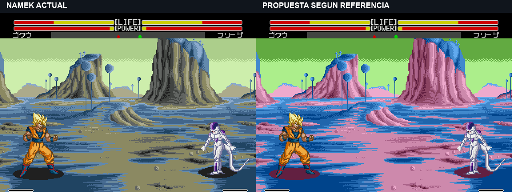
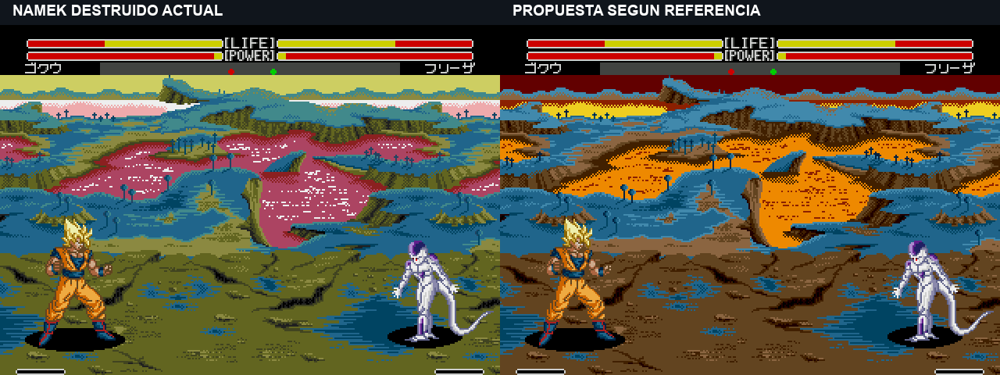

# Namek: paletas según las referencias del anime

El usuario aportó tres imágenes del anime: cielo verde, terreno azul y roca rosada para Namek; cielo rojo oscuro y lava naranja/amarilla para su destrucción. **Estas propuestas están pendientes de elección y no se incluyen en la ROM stun-break-v2.** Las versiones anteriores se conservan.

## Namek

## Namek en destrucción

Son capturas reales del emulador, con Goku y Freezer. Las propuestas se cargan desde una ROM con las palabras de color modificadas. Las comparaciones sólo añaden una cabecera externa y colocan las imágenes juntas; no repintan píxeles del juego. Para capturar se prepara el índice del escenario antes de la carga nativa y se mantienen ambos mandos en control humano.

Se cambian los 22 colores propios de cada escenario y las cuatro fases ambientales y dos fases de lava de Namek en destrucción. Se mantienen sus tiempos, estructura, paletas de personajes y colores comunes del HUD. Las fases ambientales conservan variación de luminosidad. No es una prueba de toda la animación en vuelo o de todos los efectos.

El escenario original comparte colores entre cielo, lava y otras superficies: una propuesta sólo de paleta tiene ese límite. Se adaptan sus gráficos existentes, sin añadir poblados, soles ni elementos nuevos de las referencias.

[Colores exactos y procedencia de capturas](../research/palettes/namek-anime-v1.json) · [Cambios limitados a palabras de color](../evidence/stun-break-v2/namek-proposal-validation.json).
