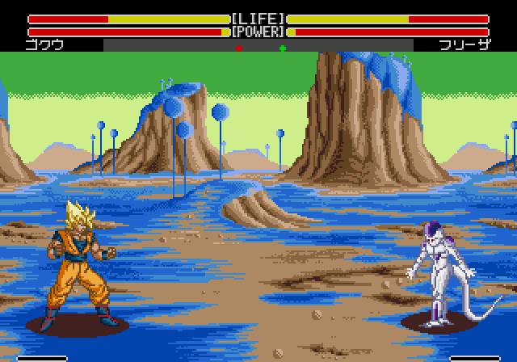

# Namek: segunda propuesta según nuevas referencias

La propuesta anterior de Namek y su destrucción no gustó al usuario. Se conserva como historial. Esta nueva prueba afecta sólo a **Namek normal**, con las tres nuevas referencias aportadas: suelo y copas de árboles azules, roca ocre/beige y cielo verde con luces amarillentas. Se retira la roca rosada de la prueba anterior.

Captura de Genesis Plus GX con Goku y Freezer: los colores están cargados desde la ROM de propuesta, sin repintar la imagen. Cambian únicamente las 22 palabras propias de la paleta del escenario 6 y el checksum. Los personajes, HUD, gráficos y Namek en destrucción se conservan. La geometría y la distribución de superficies siguen siendo las del escenario original.

**Pendiente de elección; no aplicada a la ROM de jugabilidad entregada.**

[Registro de colores, hashes y procedencia de captura](../research/palettes/namek-anime-v2.json) · [Generador de la prueba](../research/namek-anime-v2/build.py) · [Propuestas anteriores descartadas](namek-anime-v1.md).
