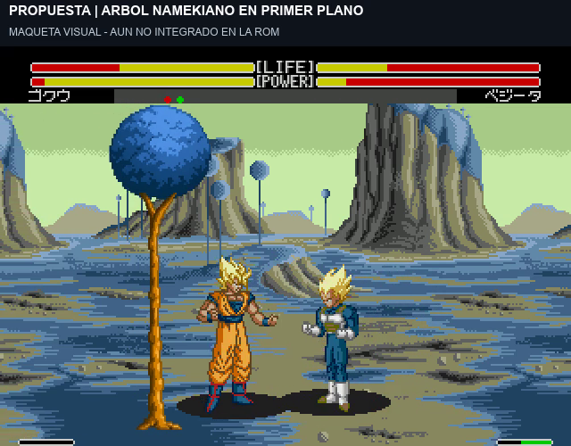

# Namek: prueba de árbol en primer plano

[Ver 23 segundos de actual y propuesta](../assets/media/namek-foreground/Namek-arbol-prueba-en-movimiento-v1.mp4).

El usuario quiere un detalle cercano a la cámara, como la palmera de Street Fighter, aplicado a Namek. Se propone un árbol namekiano con tronco estrecho y copa azul, que entra y sale del encuadre al desplazarse la cámara.

**Estado: maqueta visual, pendiente de validar. El árbol no está integrado en la ROM.** Las dos pasadas usan la misma grabación de HUD HITS v3: paseo, básicos y cambio de lado, con sonido original y sin acelerar. En la segunda se superpone el árbol transparente generado con la herramienta de imágenes. El scroll se sigue por comparación de los píxeles del fondo y se amplifica 1,15 veces para simular un plano más cercano. No se ha probado todavía un nuevo plano nativo ni su coste gráfico.

El HUD permanece despejado. La prueba es de suelo: no valida vuelo, movimiento de copa, sombras, colisiones nuevas ni funcionamiento en consola original. La selección de paletas de Namek continúa pendiente y no se cambia con esta prueba.

[Comparación estática anterior](../assets/concepts/namek-foreground/Namek-arbol-antes-despues-v1.png) · [Prompt del árbol](../research/namek-foreground/prompt-arbol-transparente-v1.txt) · [Registro del montaje](../evidence/namek-foreground/manifest.json).

## Nave de Capsule Corp como referencia aceptada

El usuario acepta como ejemplo la nave mostrada, extraída del escenario oficial de Namek de HDBZ, de Daeron. Es **Capsule Corp**, no la nave de Freezer que se mencionó inicialmente. Se guardan sus gráficos originales y su isla/suelo.

La propuesta de capas es: paisaje y nave **detrás de los personajes**; árbol **delante**, pudiendo ocultar parcialmente un luchador al cruzar el tronco; HUD por encima de todo. Ambos objetos deben quedar anclados al mundo: al volver al mismo punto reaparecen en el mismo sitio, y su desplazamiento responde a la profundidad elegida. El vídeo del árbol sólo aproxima ese scroll; aún no valida el anclaje nativo, el vuelo o la incorporación de la nave.

**Se acepta como referencia, no como integración terminada.** Pendientes escala, paleta, colocación y recursos de Mega Drive. [Procedencia y hashes](../research/hdbz-namek-ship/source.json).
