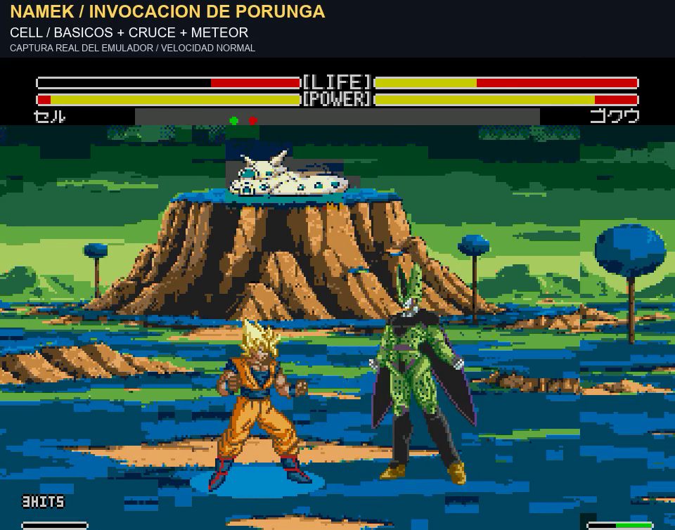

# Namek: cuatro vídeos con fondos cargados por la ROM

9/11/2026. El usuario pide ver cómo quedarían realmente los escenarios en Mega Drive, señala que la casa de la aldea era más pequeña, propone escenarios extra en el selector y sugiere dithering. Después concreta la entrega: **vídeos espectaculares en el fondo original y en los tres nuevos; la ROM todavía no hace falta**.

## Vídeos solicitados

Todos duran aproximadamente 51 segundos y muestran Goku, Gohan, Vegeta y Cell: básicos enlazados con Kamehameha o Masenko, Meteor de Vegeta, cambio de lado y Meteor de Cell, vuelo/aterrizaje y Kamehameha grande con pantalla partida. Cada montaje abre con una toma distinta. Audio original y movimientos a velocidad normal.

- [Namek original](../assets/media/namek-native-v1/promo-original.mp4): se conserva el fondo original; la jugabilidad es Enhanced, no la ROM original sin modificar.
- [Namek con casa del Gran Patriarca](../assets/media/namek-native-v1/promo-normal.mp4).
- [Aldea devastada](../assets/media/namek-native-v1/promo-aldea.mp4).
- [Invocación de Porunga](../assets/media/namek-native-v1/promo-porunga.mp4).

**Estas imágenes sí salen del framebuffer del emulador ejecutando los recursos integrados en la ROM. El fondo no se compone en posproducción.** El vídeo añade rótulos y amplía por vecino más próximo. La [simulación anterior](namek-three-v1.md) queda archivada como concepto: su aspecto no era una garantía de fidelidad al hardware. Esta primera adaptación nativa reduce colores y detalle respecto a ella.

Los combates se coordinan para demostración. La selección de escenarios usa mandos reales del emulador. Antes de cada toma se preparan controles humanos, distancia y orientación; la energía se carga con botones y la vida baja de Vegeta/Cell se obtiene recibiendo golpes y esperando su recuperación. No se fuerzan acciones, daño, impactos o velocidad durante las tomas. No se certifican todos los enlaces como inevitables. En las muestras: Goku4 HITS/88 de daño, Gohan4/71, Vegeta11/74 y Cell16/105; se registra la transición de cambio de lado de Cell en los cuatro montajes. Las cinematografías vuelven a su estado normal.

## Casa compartida y tramado

Se genera una única casa aislada y tres panoramas sin casa. El compilador reutiliza el mismo recurso a **58×32 píxeles del panorama artístico**, en la posición345,190. La proyección vertical al mapa nativo es común. La máscara de la casa y sus índices de color coinciden exactamente entre las tres variantes; no se escala por separado cada casa.

[Recurso compartido](../assets/concepts/namek-native-v1/house.png), [prompts de edición mediante image_gen](../assets/concepts/namek-native-v1/prompts.json) y [comprobación de igualdad](../evidence/namek-native-v1/house-consistency.json). El alfa se discretiza al codificar los tiles, sin conservar el halo semitransparente de la salida artística.

Se prueba un tramado Bayer4×4 únicamente en transiciones suaves del cielo. La casa se mantiene sin ese tramado. [Comparación nativa sin/con tramado · 12 s](../assets/media/namek-native-v1/dithering.mp4). Los estados de ambos actores coinciden en los737 fotogramas comparados. El tramado y la reducción de patrones comparten el presupuesto de tiles, por lo que también pueden modificar el detalle representado.

## Escenarios extra y modos

La versión interna añade **NUEVO, RUINAS y DRAGON** a las nueve entradas originales. Los índices virtuales9–11 se resuelven al motor físico de Namek6, con una variante aparte; se conserva el ID interno9 que el juego usa en otra transición. El Namek original sigue disponible.

Menú principal → versus → izquierda/derecha para1P–CPU,1P–2P o CPU–CPU → personajes → parámetros → bajar a escenario → **B** retrocede, **A/C** avanza → esperar la recarga del fondo → **START** confirma.

Se verifican las nueve combinaciones entre los tres escenarios y los tres submodos versus. **No se ha añadido un modo práctica independiente:** no aparece entre los tres submodos nativos revisados. Se puede practicar en1P–2P dejando el rival quieto. La petición de un modo formal de práctica queda aparte.

[Prueba del selector y CPU–CPU · 49 s](../assets/media/namek-native-v1/escenarios-cpu.mp4), grabada seleccionando desde el menú y dejando actuar a la IA nativa, sin escrituras de estado. Se comprueban los gráficos y la paleta al entrar y después de900 fotogramas por escenario.

## Prueba técnica y límites

Build interno **v1.0 `20261109-050003`**, SHA256 `f45950acb6b7cc7ea7f5a272c1cd17c1ca98fb9bcc7a3bc49370c15a076e0e43`, basado en el aprobado200852. El título de cabecera incluye versión y fecha. **No se entrega ROM ni parche en esta revisión**, según la última petición del usuario. El último build aprobado sigue siendo200852; el nuevo acabado visual queda pendiente de valoración.

- Cada fondo se codifica como mapa de512×512, tres franjas repetidas, **736 tiles** dentro del área nativa reservada antes de0x5C00. Los patrones se reducen manteniendo los de la casa y la zona de Porunga.
- **22 entradas propias de paleta**, diez colores comunes preservados y una paleta por tile. Se comprueban los bytes cargados en VRAM y los valores de CRAM.
- Recorrido de las doce entradas y vuelta al inicio; regreso al Namek original con gráficos idénticos a su recurso original; CPU hasta KO y revancha conservando variante; historia limpiando una variante residual. El caso de historia inyecta solo esa variable residual antes de confirmar para comprobar la limpieza.
- Los24 fragmentos de los montajes verifican por fotograma el escenario físico y la variante. Regresan de las cinematografías y se decodifican íntegros con FFmpeg sin errores.
- Comprobación ABI: al regresar al código nativo en0xA3FA, A0 se sobrescribe antes de leerse; los enganches no dependen de su valor anterior.

Validado en el emulador local Genesis Plus GX. **La consola física todavía no se ha probado.** El humo y Porunga pertenecen al fondo estático; no se han añadido animaciones ambientales. No se cambia la jugabilidad del padre aprobado, las paletas de personajes o el HUD con esta prueba.

[Resultados de modos y variantes](../evidence/namek-native-v1/matrix-modes-variants.json) · [Regresiones](../evidence/namek-native-v1/regression.json) · [Datos de las tomas](../evidence/namek-native-v1/promo-validation.json) · [Manifiesto de vídeos](../assets/media/namek-native-v1/promos-manifest.json) · [Scripts y ASM](../research/namek-native-v1/README.txt).
