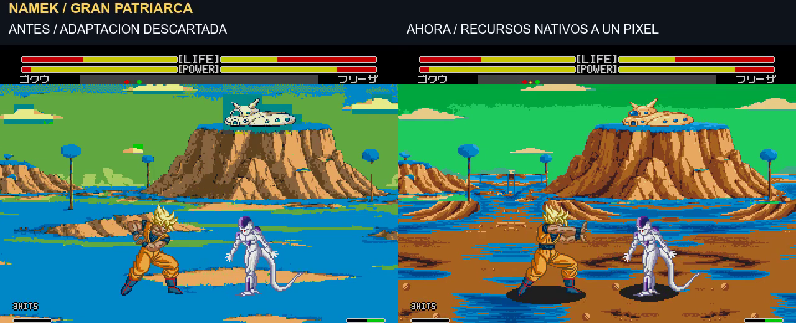

# Namek: revisión de la definición nativa

**Revisión posterior:** el usuario considera bastante mejor la definición, pero pide tierras menos rojizas, casa marfil y quitar la franja del cielo. Esos ajustes se presentan en [V4](namek-native-v4.md), pendientes de valoración.

9/11/2026. El usuario rechaza los parches de la primera adaptación y la excesiva pixelación de la segunda prueba. Pide trabajar sin mostrar más avances hasta tener un resultado comprobado. **V1 y V2 quedan descartadas. V3 es una nueva prueba técnica y visual; todavía no está aprobada por el usuario.** La última versión general aprobada sigue siendo200852.

[**Antes/ahora de los tres escenarios · unos37 s**](../assets/media/namek-native-v3/comparacion.mp4). Izquierda: adaptación V1 descartada; derecha: V3. Ambas son capturas del emulador con recursos cargados por la ROM, a velocidad normal. Se comparan las mismas rutas de vuelo y básicos/Kamehameha; no se garantiza que la fase de animación de cada actor coincida exactamente. Se escucha la captura nueva.

## Demostraciones completas

- [Gran Patriarca](../assets/media/namek-native-v3/promo-normal.mp4).
- [Aldea devastada](../assets/media/namek-native-v3/promo-aldea.mp4).
- [Invocación de Porunga](../assets/media/namek-native-v3/promo-porunga.mp4).
- [Escenario original como referencia](../assets/media/namek-native-v1/promo-original.mp4): la grabación anterior sigue siendo válida como referencia; fondo original con jugabilidad Enhanced.

Cada demostración nueva dura unos51 s: Goku, Gohan, Vegeta y Cell; básicos, Kamehameha, Masenko, Meteor, cruce, vuelo/aterrizaje y ataque grande con pantalla partida. Son tomas coordinadas a velocidad normal, no partidas espontáneas ni una certificación de combos inevitables. No hay sustitución del fondo en posproducción, filtros de suavizado ni aumento de la velocidad de los movimientos.

## Qué cambia en la adaptación

La prueba V2 reducía el panorama a256 y parte del cielo a128 antes de ampliarlo al mapa512. Eso hacía que los píxeles del fondo fuesen mayores que los de los personajes. Se abandona ese procedimiento.

V3 trabaja directamente sobre la rejilla final. Reutiliza una franja de textura del terreno nativo, de128 píxeles de ancho, con espejo y repetición alineados a tiles. **No amplía sus píxeles.** La paleta se adapta al azul del terreno y a las tierras cálidas de los diseños. El primer plano desde Y376 conserva exactamente los índices y el detalle del módulo nativo; no se sustituye por representantes aproximados. La transición al horizonte conserva las bases de las montañas.

Se mantienen el encuadre general de las montañas y la casa compartida, pero **el primer plano cambia al reconstruirlo por módulos**: no es una copia exacta del concepto. Los escombros del primer plano de la ilustración de la aldea no están reproducidos íntegramente en esta revisión. Su ambiente, humo y ruinas del horizonte permanecen como variante. Esta diferencia necesita valoración visual y no se presenta como una decisión aprobada.

Las montañas se remuestrean por área directamente a su tamaño final. La casa mide58×23 en el mapa nativo, en345,291, con exactamente los mismos colores en las tres variantes. El color de cielo y terreno no elige un banco distinto cada8 píxeles. Las regiones del cielo y del terreno se comprimen por separado; colores planos, casa y terreno del primer plano quedan protegidos. En las aproximaciones restantes se conserva el contorno de los materiales y se ponderan más los bordes y la luminosidad.

En Porunga se extrae una nube completa como recurso de200×72, repetido tres veces sin escalar y con espejo. Tiene dos verdes sobre azul nocturno. Se conservan las transiciones verdes del horizonte y la figura mediante máscaras de color; no se conserva un rectángulo artificial alrededor del dragón. **Porunga sigue estático.** La sugerencia de convertirlo en sprite flotante queda pendiente: no se ha añadido esa animación ni un enganche de sprites.

## Comprobaciones

Build interno **v1.0 `20261109-081031`**, SHA256 `af4a56b9918576303e5a86c593e4d104a5cadbce84f7da82b8ba29c118584381`. Padre aprobado: `68f838f7ce1fcf0f237d56c09826a359d26931d331cc1ec9716b9d321654ffab`.

| Recurso | Patrones finales | Cambios de textura tras cuantizar | Cambios en el primer plano nativo |
| --- | ---: | ---: | ---: |
| Gran Patriarca | 732 | 0 píxeles | 0 |
| Aldea devastada | 736 | 2051 píxeles | 0 |
| Porunga | 736 | 2637 píxeles | 0 |

Las tres variantes respetan el límite736, las22 entradas propias de paleta, los diez colores comunes y el área anterior a VRAM0x5C00. Todos los píxeles del mapa usan índices opacos. La casa tiene el mismo hash de color en las tres. Las medidas parten del montaje nuevo ya cuantizado; **no son porcentajes comparables directamente con el dibujo de V1**, porque el terreno de entrada cambia.

- Gráficos y22 palabras de CRAM comprobados byte a byte en suelo, vuelo de uno y ambos personajes, aterrizaje y carga de energía.
- Nueve selecciones desde el menú con mandos: tres escenarios por tres modos versus. Sin escrituras de escenario o variante durante la selección.
- Dieciocho tomas nuevas: escenario físico y variante comprobados en cada fotograma; vuelta a estado normal después de las cinematografías. En las muestras: Goku4 HITS/88 de daño, Gohan4/71, Vegeta11/74 y Cell16/105. No se cambia su lógica en esta revisión.
- Los quince archivos de gráficos, mapa y paleta se reproducen idénticos desde el compilador guardado.
- Los vídeos se decodifican completos con FFmpeg. Se conserva el escenario original y no se modifica el código de combate del padre aprobado.

[Build y límites de escritura](../evidence/namek-native-v3/integrated-build.json) · [Reproducibilidad](../evidence/namek-native-v3/reproducibility.json) · [Nueve selecciones](../evidence/namek-native-v3/matrix-modes-variants.json) · [Tomas y datos](../evidence/namek-native-v3/promo-validation.json) · [Manifiesto de vídeos](../assets/media/namek-native-v3/manifest.json) · [Fuentes de investigación](../research/namek-native-v3/README.txt).

**Entrega solo de vídeos, imágenes y fuentes. No se entrega ROM ni parche.** Probado en Genesis Plus GX local; consola física pendiente. El menú conserva NUEVO/RUINAS/DRAGON y los tres submodos versus. No se ha creado un modo práctica independiente. Las versiones anteriores se conservan como historial, sin mezclarlas con lo aprobado.
