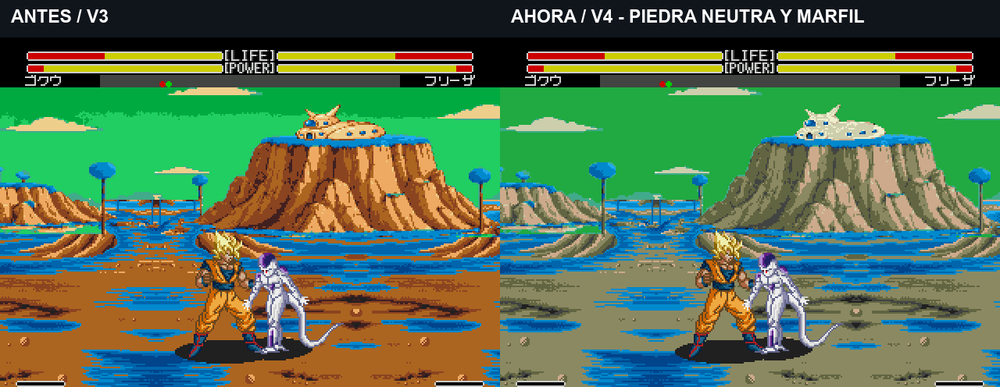

# Namek V4: piedra neutra, casa marfil y cielo continuo

9/11/2026. El usuario considera bastante mejor la definición de V3, pero pide quitar el rojizo de montaña/casa y corregir la franja horizontal del cielo. **La revisión de color V4 está pendiente de valoración visual.** La última versión general aprobada continúa siendo200852.

[**Comparación en movimiento: suelo, vuelo y combate · unos12 s**](../assets/media/namek-native-v4/comparacion.mp4). Capturas reales del emulador, velocidad normal y sonido de la toma nueva. El fondo está cargado por la ROM interna; no se sustituye en edición. Las rutas son equivalentes, sin prometer sincronización exacta de cada fase de animación.

[Namek normal](../assets/media/namek-native-v4/normal.mp4) · [Aldea devastada](../assets/media/namek-native-v4/aldea.mp4) · [Porunga](../assets/media/namek-native-v4/porunga.mp4). Cada clip nuevo dura unos13 s y muestra vuelo/aterrizaje y básicos con Kamehameha. Las demostraciones largas anteriores se conservan en [V3](namek-native-v3.md).

## Cambios

- Tierras más neutras: luces beige, medios de piedra y sombras grises, reduciendo el exceso de rojo. Los mismos colores se comparten con el terreno, que también pierde el rojizo.
- Casa en marfil con sombras beige, manteniendo ventana, líneas, máscara, tamaño y posición. Se cambian348 índices de color dentro de su máscara y cero fuera de ella. El mismo recurso y hash de color se usan en las tres variantes.
- La franja del Namek normal venía del salto entre dos verdes de la paleta. Ambas entradas pasan al mismo verde9-bit `(1,5,2)`. En los596 pares de píxeles verticales inspeccionados que cruzaban esa transición, la diferencia de color queda en cero. El cielo nocturno de Porunga y el ambiente gris de la aldea mantienen su intención propia.
- Se parte directamente de los índices de V3: no hay nuevo escalado ni reducción de resolución. El nuevo empaquetado solo deduplica patrones idénticos por simetría, sin aproximaciones. Los dibujos y las texturas conservan su detalle; los cambios espaciales de índices se limitan a recolorear la casa.

| Entrada de paleta | V3: RGB de0 a7 | V4: RGB de0 a7 |
| --- | --- | --- |
| 6 | 7,5,3 | 6,5,4 |
| 7 | 5,3,1 | 4,4,3 |
| 8 | 4,2,1 | 3,3,2 |
| 9 | 2,1,1 | 2,2,2 |
| 14 | 7,6,4 | 6,6,5 |

La casa reasigna6→15,7→14,8→6 y9→8 dentro de su máscara. Los dos verdes del cielo normal,11 y12, quedan iguales. Los diez colores comunes y las paletas de personajes se conservan.

## Verificación y entrega

Build interno **v1.0 `20261109-083420`**, SHA256 `50d3e3a96b178ee81c0aa4953b7ee67aef9a11b9692038e7077558e66e7bf228`. Se mantienen la jugabilidad aprobada y el Namek original disponible. **Porunga sigue estático.** No se entrega ROM ni parche; la consola física continúa pendiente.

- 730 tiles en normal y733 en aldea/Porunga, dentro del límite736.
- Reconstrucción exacta de todos los índices tras empaquetar; fuera de la máscara de casa no cambia ningún índice de color.
- Gráficos y22 entradas propias de CRAM comprobados en suelo, vuelo individual/doble, aterrizaje y aura, en las tres variantes. Las dos entradas verdes iguales se comprueban también en CRAM durante las cinco situaciones del escenario normal.
- Tres escenarios seleccionados desde el menú con mandos antes de preparar las tomas. Durante las seis grabaciones se comprueban escenario/variante por fotograma; Goku mantiene4 HITS y88 de daño en la muestra.
- Los vídeos se decodifican completos con FFmpeg; no se aceleran los movimientos.

[Build y límites](../evidence/namek-native-v4/integrated-build.json) · [Verificación del cielo en CRAM](../evidence/namek-native-v4/normal-runtime-check.json) · [Datos de grabación](../evidence/namek-native-v4/captures.json) · [Manifiesto](../assets/media/namek-native-v4/manifest.json) · [Fuentes](../research/namek-native-v4/README.txt).
