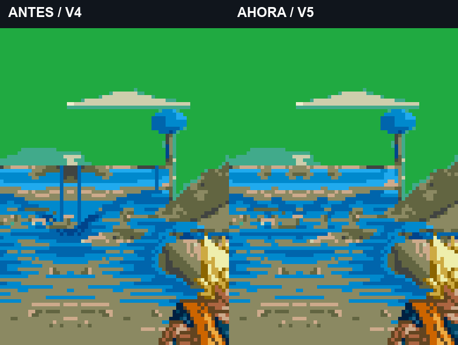

# Namek V5: troncos recortados corregidos en las tres variantes

9/11/2026. El usuario aprueba el color de V4 («el color perfecto»), señala elementos recortados en el terreno y pide aplicar la corrección también a los demás tipos de Namek. **Se fija la paleta V4. V5 corrige los restos gráficos en normal, aldea devastada y Porunga; el acabado nuevo queda pendiente de valoración.**

[**Antes/después de los tres escenarios · unos39 s**](../assets/media/namek-native-v5/comparacion.mp4). Comparación V4/V5, con vuelo/aterrizaje y combate a velocidad normal. Capturas nativas del emulador; no se sustituye el fondo en edición. La imagen de detalle amplía un recorte de la captura para localizar el defecto.

Clips nuevos completos: [Namek normal](../assets/media/namek-native-v5/normal.mp4) · [Aldea devastada](../assets/media/namek-native-v5/aldea.mp4) · [Porunga](../assets/media/namek-native-v5/porunga.mp4), unos13 s cada uno.

**PNG completos para inspección,512×512 y sin HUD/personajes:** [normal](../assets/media/namek-v5-fullmaps/normal.png) · [devastado](../assets/media/namek-v5-fullmaps/aldea.png) · [Porunga](../assets/media/namek-v5-fullmaps/porunga.png). Copias4x sin suavizado: [normal](../assets/media/namek-v5-fullmaps/normal-4x.png) · [devastado](../assets/media/namek-v5-fullmaps/aldea-4x.png) · [Porunga](../assets/media/namek-v5-fullmaps/porunga-4x.png). Son los mapas base completos que reutiliza el scroll, decodificados de los recursos del build093419; no son recortes del juego. Se usa la misma conversión RGB565 que las capturas nativas, verificada en57.373 píxeles visibles de fondo por variante. [Procedencia y hashes](../assets/media/namek-v5-fullmaps/manifest.json).

## Causa y corrección

El módulo de suelo reutilizado conservaba fragmentos de dos árboles del dibujo antiguo. Al usar solo su parte inferior desdeY352, faltaban sus copas. El espejo y la repetición del módulo duplicaban esos trozos; uno aparecía como dos palos verticales unidos por la base.

Se limpia el módulo antes de repetirlo: tres tiles del primer fragmento y un tile del segundo se sustituyen por suelo vecino del mismo recurso, a escala1:1. La limpieza se aplica a todas sus repeticiones, protegiendo las laderas del diseño y las columnas de árboles ya conectados por encima del empalme. No se amplían píxeles ni se suaviza la imagen.

| Variante | Píxeles corregidos | Patrones finales | Paleta respecto a V4 |
| --- | ---: | ---: | --- |
| Normal | 495 | 728 | Idéntica |
| Aldea devastada | 456 | 732 | Idéntica |
| Porunga | 468 | 732 | Idéntica |

Las48 bytes del recurso de paleta coinciden exactamente con V4 para cada variante. La casa mantiene el mismo hash de color, tamaño y posición. No cambia ningún índice fuera de la máscara de limpieza del terreno. Los patrones se empaquetan sin pérdida y se respeta el límite736 y el área anterior a VRAM0x5C00.

## Pruebas y alcance

Build interno **v1.0 `20261109-093419`**, SHA256 `ed28bb56d207f0d0fd12f1cd1e6eff5597c0f8344e6a7bcf39c8b4017c89f2a8`. Continúa sobre el padre aprobado200852; la aprobación del color no se interpreta como aprobación general de esta ROM experimental.

- Gráficos y22 entradas de CRAM exactos en suelo, vuelo individual/doble, aterrizaje y carga, en las tres variantes. Los dos verdes del cielo normal siguen iguales.
- Tres escenarios seleccionados desde el menú nativo antes de las tomas.
- Seis trazas de grabación comparadas con V4: entradas y estados de ambos actores coinciden **fotograma a fotograma**, incluidas posición/altura, plano de vuelo, vida, energía, HITS y estados de combate. Goku mantiene4 HITS/88 de daño en las muestras.
- Los vídeos se decodifican completos con FFmpeg. Las paletas de personajes, la jugabilidad y el escenario original conservan su base anterior.

[Auditoría de estados/paletas](../evidence/namek-native-v5/audit.json) · [Build y límites](../evidence/namek-native-v5/integrated-build.json) · [Datos de las tomas](../evidence/namek-native-v5/captures.json) · [Manifiesto de vídeos](../assets/media/namek-native-v5/manifest.json) · [Fuentes](../research/namek-native-v5/README.txt).

**Entrega de imágenes, vídeos y fuentes, sin ROM ni parche.** Probado en Genesis Plus GX; consola física pendiente. Porunga sigue estático. Se conserva el alcance artístico de V4: esta revisión limpia los fragmentos señalados, no añade nuevos escombros ni un modo práctica independiente.
