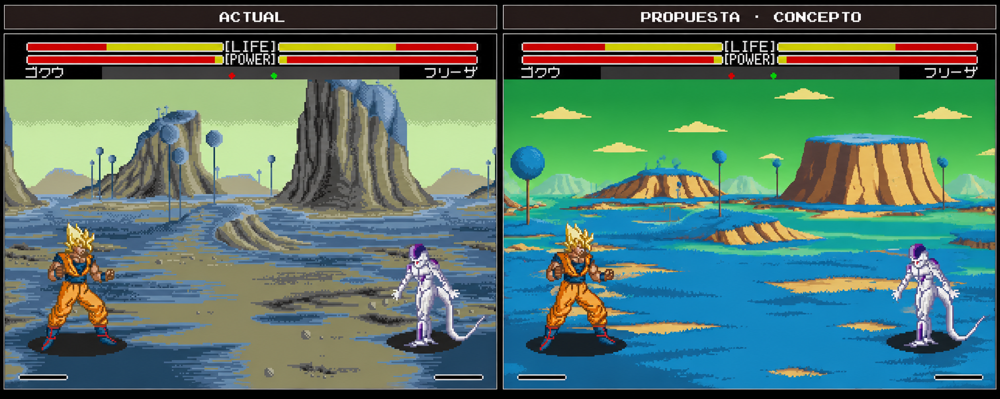

# Namek: redibujado conceptual y preferencia por el original

9/11/2026. El usuario solicita una prueba visual de un fondo más elaborado y plantea después compararlo en el juego, tanto en suelo como volando. Se genera un concepto a partir de una captura real, con cielo verde, vegetación azul, roca cálida y nuevas formas del paisaje.

[Referencia real utilizada](../assets/concepts/namek-redraw-v1/Referencia-real.png).

**Decisión del usuario:** «parece un poco mejor en tema de color pero me gusta mas el antiguo». Se conserva el escenario antiguo. Esta propuesta se archiva sin integrarla en la ROM.

El usuario no identifica aún el motivo de la preferencia. Como hipótesis de diseño, el original tiene grandes masas rocosas verticales, sombras más duras y una textura que encaja con los personajes; el concepto introduce formas más bajas y redondeadas, color más saturado y superficies más limpias. No se registran estas hipótesis como preferencias confirmadas del usuario.

La comparación completa se generó con image_gen. **Ambos paneles son una recreación aproximada**, incluso el rotulado «ACTUAL»: la referencia real está enlazada aparte. No se garantizan píxeles idénticos del HUD o personajes, resolución lógica320×224, paleta compatible, tiles, capas o integración nativa. No se afirma que pueda insertarse esta imagen directamente en el juego.

Si se retoma la mejora, la dirección propuesta es conservar formas y composición originales y probar ajustes pequeños de sombra/profundidad. La comparación nativa de suelo y vuelo sigue siendo un requisito para valorar una futura integración; no se ha producido ese vídeo ni se ha cambiado el escenario en la ROM aprobada200852.
