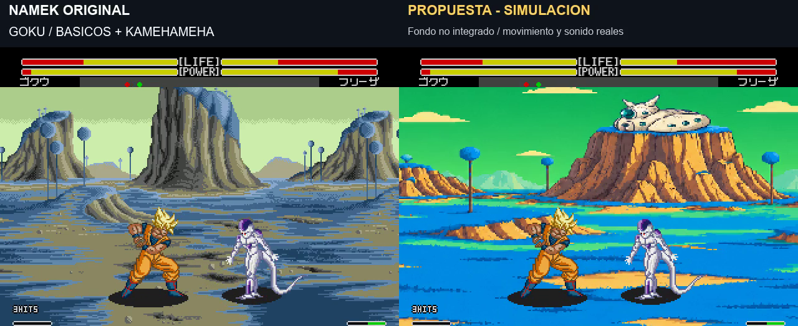
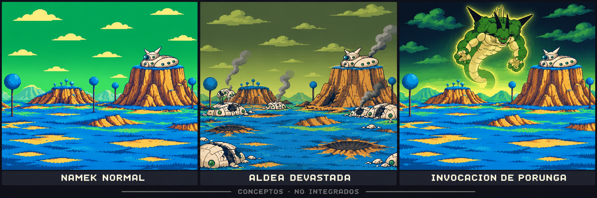

# Namek: simulación en pixel art con combate y vuelo

9/11/2026. El usuario acepta la dirección general del concepto y pide retocar las dos montañas y colocar la casa del Gran Patriarca sobre una de ellas. La referencia posterior corrige la casa: forma baja y alargada, ventanas verdes y cuernos. Pide expresamente pixel art y ver personajes haciendo cosas sobre el fondo.

[Vídeo comparativo de 51 segundos](../assets/media/namek-simulation/comparacion.mp4). Izquierda: fondo nativo de Namek. Derecha: propuesta compuesta sobre las mismas imágenes. **Ambos lados utilizan la jugabilidad del build aprobado, no se comparan aquí dos versiones de la jugabilidad.**

## Qué se muestra

- Vuelo de los dos personajes, desplazamiento y regreso al suelo.
- Goku: básicos y Kamehameha.
- Gohan: básicos y Masenko.
- Vegeta: básicos y Meteor.
- Cell: básicos, cambio de lado y Meteor.
- Kamehameha grande a distancia, con la cámara y pantalla partida nativas.

Velocidad normal, aproximadamente 59,923 fps, sonido original. Los sprites, HUD e impactos se conservan de las imágenes reales del emulador; no se generan personajes ni contadores con IA. Las secuencias se coordinan para demostración y no se certifican como combos inevitables. Las situaciones iniciales se preparan antes de cada toma; no se fuerzan acciones o daño durante la captura.

## Alcance de la simulación

**El fondo todavía no está integrado en la ROM.** Se compone en posproducción un panorama creado con image_gen, sobre capturas del build v1.0 `20261108-200852`, SHA256 `68f838f7ce1fcf0f237d56c09826a359d26931d331cc1ec9716b9d321654ffab`. La ROM aprobada permanece igual.

El compositor lee las capas y el desplazamiento del VDP del emulador local para conservar personajes y efectos. Para las franjas de cámara de la cinematografía se registran patrones del fondo nativo contra su mapa original. El encuadre vertical propuesto utiliza una adaptación artística: `y = 130 + (y_original - 248) × 1,4`, limitada al panorama. Esto no constituye una implementación del escenario en hardware ni una emulación completa de todos los límites de sprites por línea.

El panorama se muestrea a una cuadrícula de 512×512 sin interpolación, se compone a 320×224 por vista y se amplía por vecino más próximo. **La estética pixel art no prueba compatibilidad con el presupuesto de paleta, tiles, VRAM o capas de Mega Drive.** Esos límites requieren una fase posterior de adaptación nativa; no se entrega un parche de escenario con este vídeo.

## Alternativas solicitadas

Se conservan tres conceptos: Namek normal, aldea devastada con casas rotas y humo, e invocación de Porunga con cielo oscuro y resplandor verde. Son propuestas, no escenarios añadidos al juego. La aldea devastada representa destrucción de la localización; una variante volcánica del planeta en su destrucción final queda por diseñar.

[Panorama con la casa corregida](../assets/concepts/namek-redraw-v2/Panorama-casa-correcta.png). [Boceto anterior](../assets/concepts/namek-redraw-v2/Comparacion-concepto-v2.png), conservado aunque su casa fue reemplazada. [Primera propuesta y comentarios históricos](namek-redraw-v1.md).

Las referencias visuales de manga y anime las aporta el usuario. El dibujo artístico se genera con image_gen; Python se utiliza para decodificar y componer capas reales y FFmpeg para el montaje. No se presentan los conceptos generados como capturas nativas.
