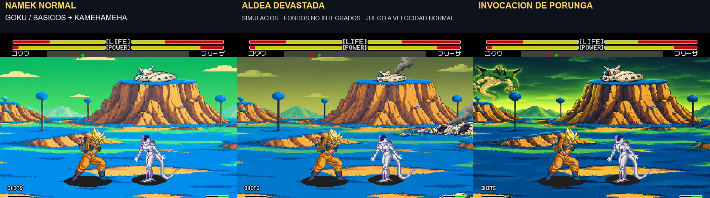

# Namek: tres variantes en movimiento y casa más pequeña

9/11/2026. El usuario considera correcta la simulación anterior y solicita dos ajustes: reducir un poco la casa del Gran Patriarca respecto a su montaña y ver las tres variantes con personajes actuando. Se conserva la montaña; la casa del panorama normal se reduce aproximadamente al 75–80 % de sus dimensiones previas. Las variantes derivan de este panorama revisado.

[**Ver las tres variantes simultáneamente · 51 segundos**](../assets/media/namek-three-v1/tres.mp4)

Vídeos individuales, con mayor tamaño de imagen:

- [Namek normal](../assets/media/namek-three-v1/normal.mp4): cielo verde, terreno azul y casa reducida.
- [Aldea devastada](../assets/media/namek-three-v1/aldea.mp4): casas rotas, cráteres, escombros y humo, con cielo oliva.
- [Invocación de Porunga](../assets/media/namek-three-v1/porunga.mp4): cielo oscuro, iluminación verde y dragón al fondo. Su posición se ajusta para que se vea con el encuadre de suelo; se conserva aparte la primera versión, más grande y alta.

## Combate, vuelo y comparación

Las tres vistas utilizan los mismos 3.057 fotogramas de combate: vuelo y aterrizaje de ambos jugadores; Goku con básicos y Kamehameha; Gohan con Masenko; Vegeta con Meteor; Cell con cambio de lado y Meteor; y Kamehameha grande con pantalla partida. Se reproducen los mandos de la toma anterior y se compara el estado de ambos personajes en cada fotograma con el registro original. El manifiesto guarda el resultado de esa comprobación.

Movimiento a velocidad normal, aproximadamente 59,923 fps, sonido nativo, mismos sprites, efectos, HUD e impactos en las tres variantes. Las situaciones se preparan antes de cada toma y los combates se coordinan para mostrar las posibilidades; no se certifican secuencias inevitables. No se aceleran animaciones.

## Qué está integrado

**Estos fondos siguen siendo una simulación en posproducción sobre imágenes reales del juego. No están integrados en la ROM.** La aprobación del aspecto anterior no se registra como aprobación final de las tres variantes revisadas: quedan disponibles para que el usuario las valore.

La ROM aprobada v1.0 build `20261108-200852` permanece intacta, SHA256 `68f838f7ce1fcf0f237d56c09826a359d26931d331cc1ec9716b9d321654ffab`. La lectura de capas y scroll del VDP, y el encuadre artístico vertical, siguen el [método de la simulación anterior](namek-redraw-v2.md). No se ha validado todavía el presupuesto de colores, tiles, VRAM o capas de estos escenarios para Mega Drive.

El arte es pixel art y se muestrea sin interpolación a un panorama de 512×512 para componer cada vista a 320×224. Los vídeos individuales amplían por tres hasta 960×672, más los rótulos; el vídeo simultáneo amplía por dos cada vista. El humo y Porunga pertenecen a panoramas estáticos: en esta prueba se mueven los combatientes, los efectos nativos y la cámara, no esos elementos del fondo.

## Archivos y procedencia

- [Panorama normal con la casa reducida](../assets/concepts/namek-three-v1/normal.png).
- [Aldea devastada](../assets/concepts/namek-three-v1/aldea.png).
- [Porunga con encuadre revisado](../assets/concepts/namek-three-v1/porunga.png).
- [Primera colocación de Porunga, archivada](../assets/concepts/namek-three-v1/porunga-encuadre-anterior.png).
- [Prompts de los tres panoramas](../assets/concepts/namek-three-v1/prompts.json) y [ajuste de Porunga](../assets/concepts/namek-three-v1/prompt-ajuste-porunga.json), generados mediante la herramienta integrada image_gen.
- [Manifiesto, hashes y comprobación de las tomas](../assets/media/namek-three-v1/manifest.json).
- [Registro de scripts locales](../research/namek-three-v1/README.txt). Requieren los recursos privados del entorno de trabajo y no constituyen una distribución autónoma de la ROM o del emulador.

Se mantienen la [comparación anterior contra el fondo original](namek-redraw-v2.md) y los bocetos previos, sin sobrescribirlos.
