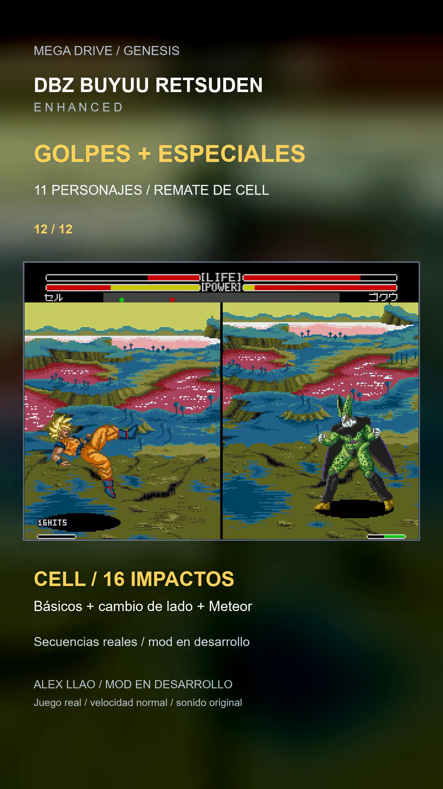

# Once personajes y cierre largo de Cell

**8/11/2026 · Short de45s · 1080×1920 · build20261108-175044.** Grabaciones nuevas de la ROM válida, con sonido nativo y velocidad normal. No se ha publicado en YouTube ni cambiado la ROM.

[Ver Short](../assets/media/short-roster-links/short.mp4) · [Cell: toma completa sin cortes,14s](../assets/media/short-roster-links/cell-toma-completa.mp4) · [Portada de Cell](../assets/media/short-roster-links/portada-cell.png) · [Título y descripción](short-once-personajes-texto.txt) · [Pruebas](../evidence/short-roster-links/validation.json)

## Contenido del Short

| Personaje | Secuencia grabada |
|---|---|
| Goku | Tres básicos + Kamehameha |
| Gohan | Tres básicos + Masenko |
| Piccolo | Puño + Makankosappo |
| Vegeta | Tres básicos + Final Flash |
| Trunks | Tres básicos + Burning Attack |
| Cell | Tres básicos + Makankosappo |
| A18 | Puño + Energy Flame |
| Krilin | Tres básicos + Kamehameha |
| Freezer | Puño + Mega Buster |
| Recoome | Tres básicos + Eraser Gun |
| Ginyu | Tres básicos + Terra Smash |
| Cierre de Cell | A-A-B + cambio de lado + Meteor:16 impactos en la toma |

Cada toma usa sus comandos y técnicas; se comprueba el arranque del programa esperado y al menos un contacto adicional al de los básicos. Piccolo, A18 y Freezer muestran un solo básico antes del especial: no se anuncian tres contactos donde esa ruta no los logra. La edición conserva toda la pantalla y el HUD del juego. Los cortes son entre tomas independientes, sin acelerar animaciones ni añadir contadores de impactos en edición.

## Qué ocurre con el buffer de los otros personajes

El arreglo175044 conserva una orden que podía perder el lector nuevo de Goku. Los otros diez usan el parser original, que ya conserva el token reconocido durante estas secuencias. La revisión de referencia muestrea240 casos con P1 mirando a la derecha y240 con P2 mirando a la izquierda:223 y224 arranques del especial principal solicitado, respectivamente. Los gestos rápidos aún pueden producir otra técnica o fallar; esos números no acreditan controles perfectos.

Se ensayó una extensión común del buffer, pero no superó la revisión de utilidad/regresión y **no se integra**. No se presenta como una mejora aplicada a todo el plantel. Short y tomas finales usan exclusivamente el build válido175044, SHA-256 `7e60aa9b967f9c647bfd77992afbcca2e8261f5e2f63a6534838872aa02c7cc4`. El prototipo no se utiliza para vídeos ni entregas de ROM. La siguiente mejora de entradas de los demás debe atender sus fallos concretos de reconocimiento, no copiar sin más el parche de Goku.

## Propuesta larga: Cell

**A → A → B → adelante/atrás/adelante+C → Meteor nativo.** En la toma,3 básicos de9 de daño y13 contactos del Meteor de6 suman105 de daño y16 HITS nativos. Cell parte con42 de vida y237 de ki, de un estado preparado anteriormente con golpes/carga reales; se fijan al comienzo posición y orientación. No se escriben HP, ki, acciones o impactos durante la grabación. Se respeta el requisito nativo de la técnica y su duración. El código de la ROM no cambia por componer esta ruta.

La toma completa dura14,17s e incluye el final y el control devuelto. El Short conserva desde los básicos hasta después del último impacto del remate, a velocidad normal.

**No es una cadena inevitable:** mantener atrás después del tercer básico no evita el Meteor en la muestra (16 impactos/105 de daño); mantener arriba permite saltar antes de su entrada (3 impactos/27 de daño; Meteor no inicia). Por tanto existe un hueco de respuesta. Ver16 HITS en el HUD no demuestra que toda la secuencia sea un combo sin escapatoria.

También se probó la propuesta de Goku: A-A-B, cruce y Meteor alcanza6 HITS/71 de daño. No se ha conseguido añadir después Kamehameha en los ocho momentos probados; el hecho de ver al actor con acción neutral no acredita por sí solo que ya admita órdenes durante el final del remate. Esa continuación queda pendiente y no se muestra como conseguida. Para el cierre largo se elige Cell.

Se conservan K4, seis ráfagas, corrección de lanzamiento y buffer de Goku. No se cambian condiciones del Meteor, daño, hitstun, animaciones, saltos o reglas de HITS/stun para fabricar el vídeo.
