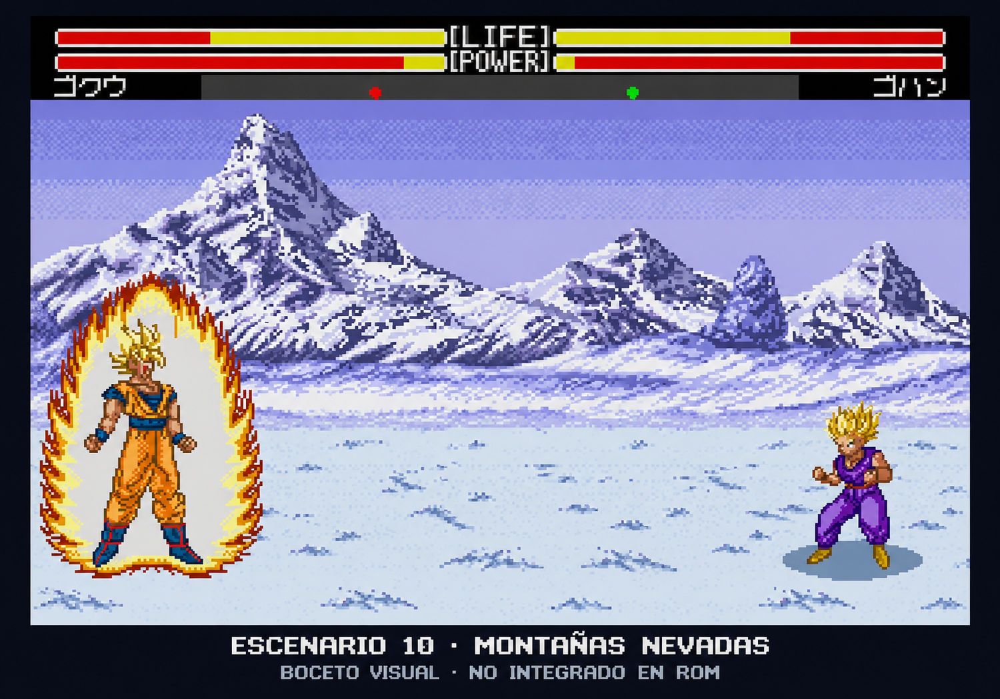
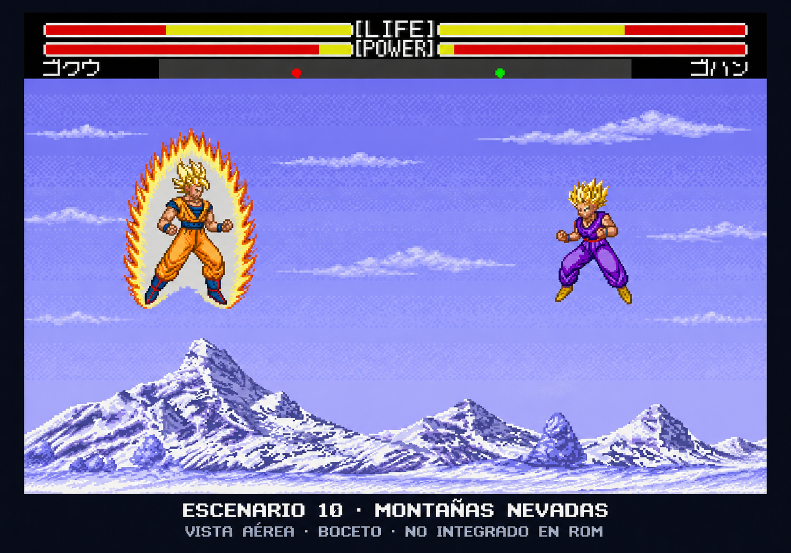

# Escenario 10: montañas nevadas — propuesta visual

El usuario ha elegido **montañas nevadas** para la primera prueba visual de una posible décima localización. Esta elección autoriza el boceto; **todavía no se ha añadido un escenario a la ROM ni se ha implementado un nuevo ID**.

| Vista desde el suelo | Combate en el aire |
| --- | --- |
|  |  |

La propuesta combina picos nevados con sombras azul-violeta, cielo frío y un plano de nieve legible bajo los luchadores. Toma como referencia los fondos de *Dragon Ball Z: Super Butoden 2* aportados por el usuario, adaptándolos visualmente al aspecto de Buyuu Retsuden.

La imagen se generó con `image_gen` a partir de una [captura real de Buyuu Retsuden](../assets/concepts/stage10-snow/Base-Buyuu.png), conservando de forma aproximada el HUD, Goku, Gohan, sus posiciones y la escena de combate. **No conserva exactamente todos sus píxeles y no es una captura de un escenario nuevo funcionando en el emulador.** La compatibilidad de paleta, tiles, planos y memoria de Mega Drive aún no está verificada. El rótulo visible indica «BOCETO VISUAL · NO INTEGRADO EN ROM».

## Cómo se vería al volar

El segundo boceto muestra el mismo lugar en un combate aéreo: mucho más cielo, la cordillera nevada baja y distante, y Goku y Gohan suspendidos en el aire. Se mantiene la dirección azul-violeta y blanca de la primera propuesta. Desaparece el amplio suelo de combate y no hay sombras de contacto ni polvo bajo los personajes.

Es una **vista lateral de combate en el aire**, no una cámara cenital. El rótulo indica «VISTA AÉREA · BOCETO · NO INTEGRADO EN ROM». Las poses y el HUD son aproximaciones generadas: **no se ha implementado el vuelo en este escenario, un cambio de cámara ni capas nuevas en el motor**. Los dos bocetos sólo definen la intención visual de las vistas de suelo y aire.

[Abrir la vista aérea](../assets/concepts/stage10-snow/Nieve-vuelo-propuesta-v1.png) · [Prompt de la vista aérea](../assets/concepts/stage10-snow/Prompt-vuelo.txt) · [Procedencia, hash y revisión](../assets/concepts/stage10-snow/provenance-vuelo.json).

## Referencias y créditos

Se conservan los archivos originales del usuario y los créditos visibles en las láminas:

- [Backgrounds.gif](../assets/references/super-butoden-2/Backgrounds.gif): extracción acreditada a **Bonzai**. [Recorte de nieve utilizado](../assets/references/super-butoden-2/Nieve-fondo-referencia.png).
- [Mini Backgrounds.gif](../assets/references/super-butoden-2/Mini%20Backgrounds.gif): extracción acreditada a **Son-Gohan**. [Panorama nevado utilizado](../assets/references/super-butoden-2/Nieve-mini-referencia.png).
- [Lámina aportada por el usuario](../assets/references/super-butoden-2/Sheet-usuario.png): extracción acreditada a **Krmlack**, con personajes y elementos de Super Butoden 2.

Son créditos de extracción leídos de las propias imágenes, no una atribución de la autoría original del juego ni una participación en este mod. Dragon Ball, los juegos y sus gráficos originales pertenecen a sus respectivos titulares.

[Metadatos y hashes de las referencias](../assets/references/super-butoden-2/metadata.json) · [Prompt final](../assets/concepts/stage10-snow/Prompt.txt) · [Procedencia, hash y revisión del boceto](../assets/concepts/stage10-snow/provenance.json).

## Siguiente decisión

Revisar las dos vistas y su coherencia. Si se aceptan, estudiar cómo añadir una localización sin perder los nueve escenarios existentes, comprobar sus recursos y cómo cambia la vista durante el combate aéreo, y hacer una prueba real en la ROM. Estos bocetos no demuestran que esa integración esté resuelta.
