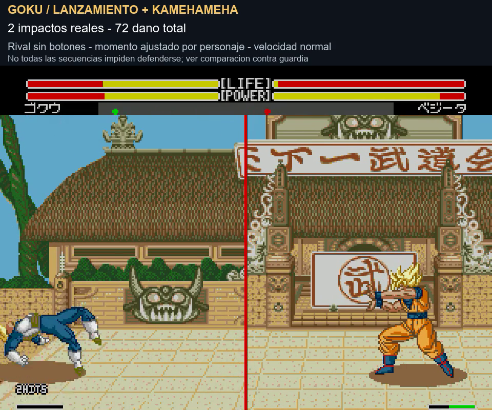
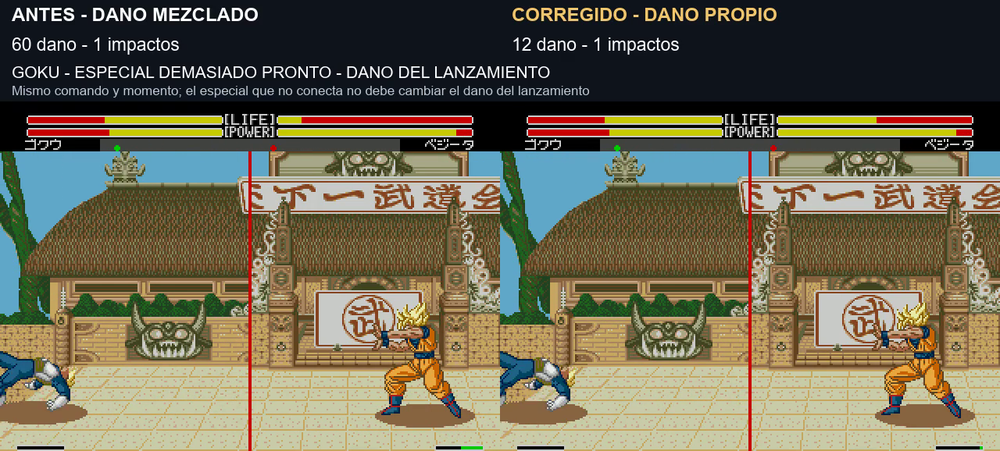

# Lanzamiento → especial: revisión de los once personajes

**8/11/2026 · v1.0 build 20261108-160337 · revisión y corrección pendientes de valoración.** Base: K4 y las seis ráfagas aprobadas. Se revisa un especial principal de ki por personaje, con varios momentos de ejecución y ambos mandos. No se modifican los comandos, las cajas de colisión ni la velocidad general.

[Vídeo: los once personajes, unos 70 s](../assets/media/throw-links/once-personajes.mp4) · [Vídeo: daño, momento y defensa, unos 37 s](../assets/media/throw-links/comparacion.mp4) · [Manifiesto](../patches/throw-links/manifest.json) · [Pruebas detalladas](../evidence/throw-links/validation.json)

## Corrección encontrada

El lanzamiento normal calcula su daño cuando el rival cae. Al permitir recuperar el control antes de que termine esa caída, un ataque nuevo podía sustituir el tipo de golpe que ese cálculo consultaba. **Preparar un especial no debe convertir el daño del lanzamiento en el de ese especial.**

En el caso temprano de Goku, el lanzamiento pasaba incorrectamente de 12 a 60 de daño; con Krilin, de 15 a 58. Solo había un descuento de vida y un impacto, no lanzamiento más rayo. La corrección conserva los 12/15 del lanzamiento. Si el rayo realmente conecta después, aplica su daño como otro impacto separado. No se añaden HITS en edición ni se fuerza el segundo golpe.

Se guarda el tipo y potencia del agarre normal al comenzar la reacción de su víctima. Al calcular el golpe de aterrizaje se usa temporalmente esa fuente y se restaura inmediatamente el ataque que el lanzador esté ejecutando. Solo se captura cuando el atacante tiene la acción nativa **3A de agarre normal**: no se alteran por esta vía los lanzamientos internos de los Meteor.

Dos entradas de ocho bytes en **F7A0..F7AF**, una por víctima, se actualizan al comenzar la reacción y se consumen al aplicar el impacto. Se evita F740..F74F del ensayo de saltos y F760..F77B de la antigua vibración descartada. Puntos intervenidos: llamada inicial 1AD3E y daño de aterrizaje 1AE2C; se mantienen el cálculo nativo, contador y estados. No se da por probada toda la memoria nativa solo por no hallar referencias directas a esa zona.

## Momentos comprobados

| Personaje | Especial probado | Espera de mando de la muestra P1 tras recuperar el control | Daño lanzamiento + especial en la toma |
|---|---|---:|---:|
| Goku contra Vegeta |Kamehameha|72 frames|12 + 60 = 72|
| Gohan contra Goku |Masenko|48 frames|9 + 43 = 52|
| Piccolo contra Goku |Special Beam Cannon|48 frames|10 + 48 = 58|
| Vegeta contra Goku |Final Flash|24 frames|9 + 63 = 72|
| Trunks contra Goku |Burning Attack|0 frames|11 + 33 = 44|
| Cell contra Goku |Special Beam Cannon|12 frames|11 + 48 = 59|
| A18 contra Goku |Energy Flame|0 frames|15 + 63 = 78|
| Krilin contra Goku |Kamehameha|76 frames|15 + 58 = 73|
| Freezer contra Goku |Mega Buster|0 frames|15 + 48 = 63|
| Recoome contra Goku |Eraser Gun|0 frames|13 + 48 = 61|
| Ginyu contra Goku |Terra Smash|12 frames|12 + 58 = 70|

Los frames de espera van **antes de introducir el comando**, que en estas tomas usa cuatro frames por dirección y cuatro para el botón final. No son una regla universal ni el mínimo necesario: un gesto humano más rápido/lento cambia el momento del disparo. El motor funciona aproximadamente a 59,92 frames/s; 72/48/24 equivalen a 1,20/0,80/0,40 s. La distancia, el rival, su dirección y la fase de actualización también influyen.

Todos esos ejemplos P1 muestran dos descuentos de vida y 2 HITS. Los contactos que aplican daño en estas trazas ocurren a **Y448, al nivel del suelo**, no como un nuevo juggle aéreo. Se puede introducir la técnica mientras el rival desciende, pero ejecutarla demasiado pronto puede fallar. Esta revisión no convierte cualquier lanzamiento en un remate automático.

## Defensa y contador

En las muestras bien ajustadas de Goku, Gohan, Piccolo, Vegeta, Cell y Ginyu, mantener atrás no evita el segundo contacto. Krilin también tiene una ventana estrecha: P1 conecta con la espera 76; en P2, 76 falla frente al rival neutral, pero 77–79 conectan en las pruebas con/sin atrás. Una entrada aceptada no garantiza conectar: se distingue reconocimiento del mando de alcance y momento de impacto.

Con Trunks, A18, Freezer y Recoome, el rival que mantiene atrás reduce el daño del especial; sus secuencias con rival neutral y 2 HITS no prueban un combo inevitable. Tampoco se ha probado toda forma de escape, salto, cambio de lado o técnica defensiva en las demás ventanas.

El vídeo de defensa compara dos Kamehameha de Goku con el rival manteniendo atrás. A tiempo: 12+60 y 2 HITS; tarde: 12+30 y solo un impacto contado del lanzamiento. El especial bloqueado no se añade como otro HIT. En las secuencias tardías separadas también puede caducar el contador, aunque ambos ataques hayan causado daño: no se fuerzan a formar un combo.

## Comprobaciones y alcance

La evidencia contiene **126 casos de referencia en P1, 138 con la corrección en P1, 69 en P2 y 8 refinamientos adicionales de Krilin en P2**. Incluyen lanzamiento solo, distintos retrasos, entradas reconocidas y rival cubriéndose. El lanzamiento sin especial conserva el daño de referencia en los once personajes. Entre pares comparables, solo cambian los cuatro casos tempranos defectuosos de Goku/Krilin con/sin atrás.

También se comparan once muestras de Meteor antes y después, correspondientes a los diez personajes con Meteor ofensivo y una segunda técnica de Freezer: conservan impactos y daño en las muestras. No se presenta Body Change de Ginyu como un Meteor ofensivo auditado. Los datos de K4, las seis ráfagas y sus rutinas permanecen iguales.

Ambos vídeos son grabaciones nativas a velocidad normal, con audio del juego. El largo muestra secuencias con rival sin botones, cada una preparada y ejecutada con mandos; el corto muestra el fallo corregido, pronto frente a momento útil, y defensa. Los textos superiores resumen la toma completa; el HUD inferior cuenta en el juego. Posiciones y orientación se fijan al preparar cada caso; no se escriben HP, daños, reacciones o impactos para fabricar el enlace. El ki se carga mediante A+B antes de guardar los estados de partida.

Esta ROM parte de lo aprobado; **no incorpora la prueba de dos saltos de Goku**, que sigue separada y sin valorar. No se añade un movimiento ni comando nuevo. La corrección es para conservar la fuente de daño del agarre normal, no una ampliación global del buffer o un nuevo sistema de combos aéreos.

Pendientes: valoración con mando, turbo, consola real, otras técnicas, escenarios/emparejamientos y agarres interrumpidos o con KO. Las pruebas no garantizan ausencia de infinitos ni que toda secuencia de dos daños sea indefendible.

Construcción: `pnpm build:review --rom ruta/a/original.bin --version throw-links`. El repositorio guarda IPS, código propio y evidencia; la ROM completa queda en el paquete local de pruebas.
